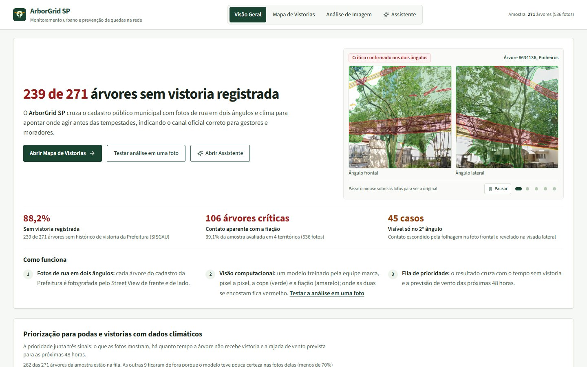
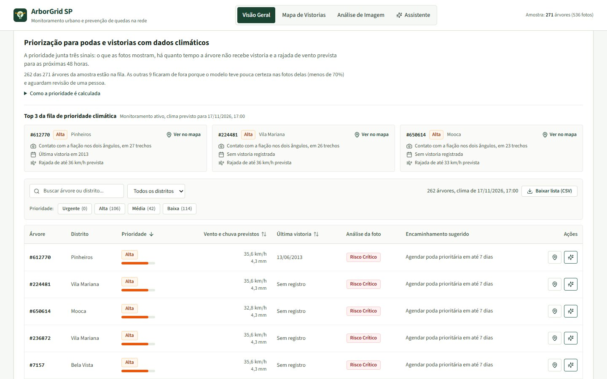
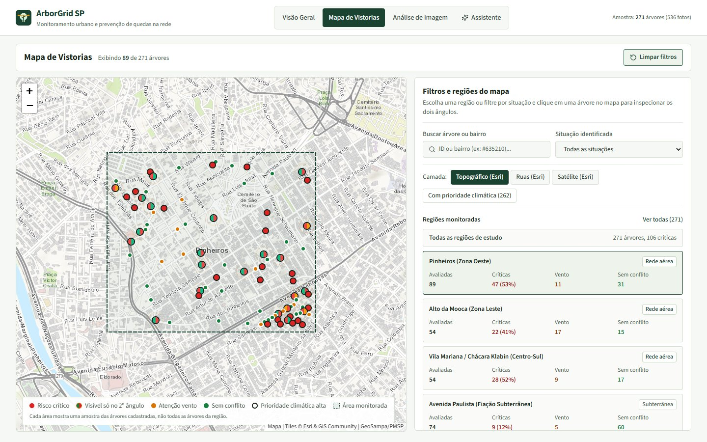
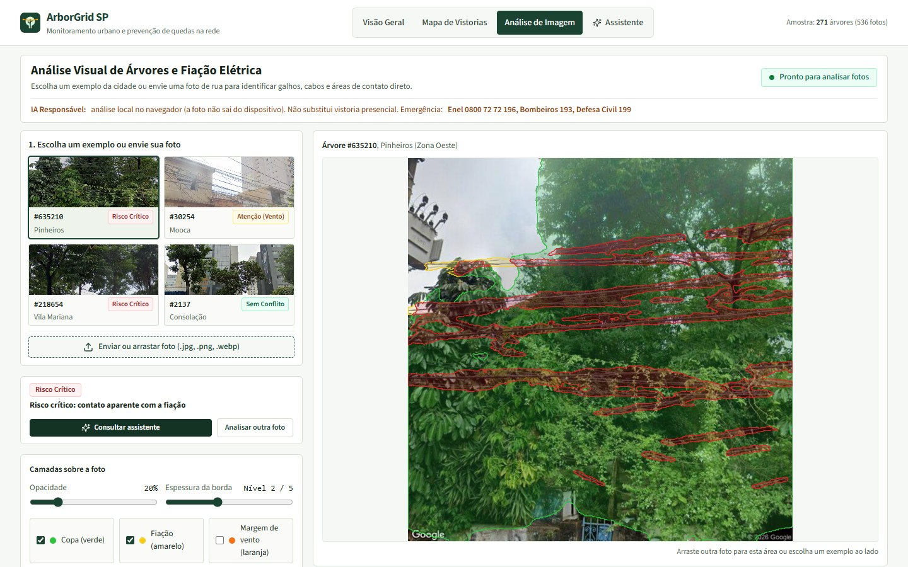
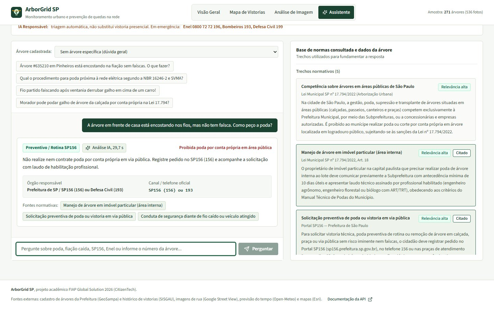

# ArborGrid SP

**Onde podar antes da tempestade.** O ArborGrid SP cruza o cadastro de árvores da Prefeitura de São Paulo com fotos de rua analisadas por visão computacional e com a previsão do tempo, e aponta quais árvores encostadas na fiação precisam de poda primeiro e qual canal oficial acionar.

- **MVP no ar:** https://arborgrid.duckdns.org
- **API (Swagger):** https://arborgrid.duckdns.org/docs



<table>
  <tr>
    <td width="50%"><br><sub>Fila de prioridade: risco da foto, tempo sem vistoria e vento previsto para 48 horas.</sub></td>
    <td width="50%"><br><sub>Mapa de vistorias: cada ponto é uma árvore, colorida pelo que as fotos mostraram.</sub></td>
  </tr>
  <tr>
    <td width="50%"><br><sub>Análise de imagem: o modelo roda no navegador e a foto não sai do aparelho.</sub></td>
    <td width="50%"><br><sub>Assistente: responde com o canal oficial e cita as normas usadas.</sub></td>
  </tr>
</table>

## Ficha Técnica do MVP

| Campo | Descrição |
| :--- | :--- |
| **Nome do produto** | ArborGrid SP |
| **Integrantes (RM)** | Kayky Oliveira Schunck (`99756`)<br>Lorenzo Gomes Andreata (`551117`)<br>Lucas Moreno Matheus (`97158`) |
| **Cidadão e território** | Moradores, pedestres e equipes de zeladoria e de energia de São Paulo (SP). Piloto em quatro áreas: Pinheiros, Alto da Mooca e Vila Mariana, com fiação aérea, e a Av. Paulista, com fiação subterrânea, usada para comparação. |
| **Problema, em uma frase** | Galhos encostados na fiação aérea causam apagões, risco de choque e quedas de árvores, e a maioria dessas árvores nunca teve vistoria registrada pela Prefeitura. |
| **Proposta de valor** | Priorizar a poda preventiva antes da tempestade, com transparência sobre o que as fotos mostraram e menos alarmes falsos, juntando dados abertos, fotos de rua em dois ângulos e a previsão de vento. |
| **Arquitetura: componentes** | [`webapp/`](webapp/): FastAPI + React/Leaflet e API REST<br>[`arborgrid-vision/`](arborgrid-vision/): SegFormer-B2 + OpenCV<br>[`llm-assistant/`](llm-assistant/): busca híbrida (RAG) + Qwen3 com LoRA + agente GeoSampa<br>[`normas-bot/`](normas-bot/): robô de RPA que confere a base de normas do assistente nas fontes oficiais<br>[`data-processing/`](data-processing/): Airflow 3 + Databricks (Bronze, Prata e Ouro)<br>[`infra/`](infra/): Terraform no Google Cloud, Docker Compose, Prometheus e Grafana |
| **Fontes de dados** | GeoSampa da Prefeitura de SP (cadastro de árvores e histórico de vistorias do SISGAU)<br>Google Street View (fotos de rua)<br>Open-Meteo (previsão de vento e chuva)<br>Normas municipais e técnicas, como a Lei 17.794/2022 e a NBR 16246, na base do assistente |
| **Modelos de IA utilizados** | **SegFormer-B2 (1024 px)** ajustado em três ciclos, quantizado em ONNX INT8 para rodar no navegador<br>**Qwen3-1.7B + LoRA (`r=16`)**, servido em GGUF Q4_K_M pelo llama.cpp |
| **URL do MVP e repositório** | https://arborgrid.duckdns.org<br>https://github.com/LM2124/Fiap-2026-GS2-CitizenTech-Projeto-Arborgrid |
| **Indicadores de impacto** | **Linha de base:** 88,2% das 271 árvores auditadas sem vistoria registrada no SISGAU.<br>**Técnicos:** 41,8% menos pixels falsos de fiação na Av. Paulista, em 65 árvores fora do treino; assistente com 93,3% de acerto estrito (90,9% nos 22 casos sem sobreposição com o treino), dos quais 13 pontos vêm de um piso de risco por regras; só o modelo acerta 80,0%.<br>**A medir no piloto:** interrupções atribuídas à vegetação a cada 1.000 árvores auditadas; tempo entre a triagem crítica e a poda; percentual de árvores críticas sem vistoria que passam a ser vistoriadas. |
| **ODS conectados** | ODS 11 (Cidades e comunidades sustentáveis), ODS 9 (Indústria, inovação e infraestrutura) e ODS 13 (Ação contra a mudança global do clima) |

### Contribuição para os ODS

- **ODS 11 (metas 11.5 e 11.7):** a poda preventiva direcionada entra antes da queda ou do choque, no lugar da supressão de emergência depois do acidente, e conserva a arborização. Medido pelo percentual de árvores críticas sem vistoria que passam a ser vistoriadas e pelo tempo entre a triagem crítica e a poda.
- **ODS 9 (meta 9.1):** cruzar a proximidade entre copa e fiação em mais de um ângulo e entregar os alertas por API às equipes de zeladoria e de energia apoia a manutenção programada da rede. Medido pelas interrupções atribuídas à vegetação a cada 1.000 árvores auditadas.
- **ODS 13 (meta 13.1):** a previsão de rajadas e chuva do Open-Meteo eleva a prioridade das árvores expostas a eventos extremos. Medido pela antecipação do atendimento das árvores críticas nas áreas de maior severidade climática.

## Onde está cada disciplina

| Disciplina | Onde | O que tem lá |
| :--- | :--- | :--- |
| Generative AI for Engineering | [`llm-assistant/`](llm-assistant/) | Base de normas com fontes, busca com `recall@k`, LoRA comparado ao RAG simples, placar das três configurações, cinco erros analisados e as respostas em JSON. No MVP, a aba Assistente. |
| Big Data Architecture & Data Integration | [`data-processing/`](data-processing/) | DAG do Airflow 3, camadas Bronze, Prata e Ouro no Databricks, modelo estrela, LGPD e o contrato que entrega a camada Ouro à fila de prioridade do MVP. |
| Applied Computer Vision | [`arborgrid-vision/`](arborgrid-vision/) | Coleta no GeoSampa e no Street View, segmentação de copa, fiação e poste em três ciclos de treino, auditoria em dois ângulos e quantização para o navegador. No MVP, a aba Análise de Imagem. |
| Secure DevOps Tools & Cloud Computing | [`infra/`](infra/) e [`.github/workflows/`](.github/workflows/) | Terraform no Google Cloud, pipeline com Gitleaks, Semgrep e Trivy, deploy sem segredos de longa duração e observabilidade. Arquitetura, custos e LGPD em [`infra/ARQUITETURA_CLOUD_DEVSECOPS.md`](infra/ARQUITETURA_CLOUD_DEVSECOPS.md). |
| Robotic Process Automation | [`normas-bot/`](normas-bot/) | Robô que confere, a cada execução, se os telefones, prazos e artigos citados pelo assistente continuam nas fontes oficiais: regras de decisão, novas tentativas, logs, testes offline e o mapeamento do processo. O assistente do MVP lê a base que ele verifica. |
| Business Intelligence & Startup Development | pitch em vídeo, entregue pelo Teams | O produto em uso está no MVP; problema, proposta de valor, indicadores e ODS estão na Ficha Técnica acima. |

## Como rodar

Com o Docker Desktop aberto, na raiz do repositório:

```bash
python scripts/start_stack.py        # Linux/macOS: python3
```

Na primeira vez, o script cria o `infra/.env` com tokens aleatórios, constrói as imagens e mostra no terminal os endereços e o token da API (`ARBORGRID_API_TOKEN`), usado pelo Airflow. No VS Code, **F5** faz o mesmo.

| Serviço | Endereço |
| :--- | :--- |
| Web app | http://localhost |
| API (Swagger) | http://localhost/docs |
| Prometheus | http://127.0.0.1:9090 |
| Grafana | http://127.0.0.1:3000 (senha no `infra/.env`) |

**Sem Docker:** `python scripts/start_stack.py --local-api` sobe só a API e o web app em http://127.0.0.1:8000, sem autenticação. Precisa de Python 3.12 e Node.js 22: na primeira vez, o script cria o ambiente virtual e compila o frontend.

**Arquivos que ficam fora do Git:**
- **Modelo do assistente** (`llm-assistant/models/arborgrid-qwen3-1.7b-q4_k_m.gguf`, ~1 GiB). Com ele na pasta, o script sobe o llama.cpp; sem ele, o assistente responde pelo modo de regras, com as mesmas normas.
- **Fotos completas do Street View**, pelos termos de uso do Google. O mapa, a fila, a API e a análise de imagem funcionam com as quatro fotos de exemplo do repositório.

## Testes

```bash
# cada linha a partir da raiz do repositório
cd webapp && pip install -r requirements-dev.txt && pytest -v           # API (num ambiente virtual)
cd webapp/frontend && npm ci && npm run build                          # frontend: tipos e build
cd llm-assistant && uv sync --group dev && uv run pytest -v            # assistente
cd normas-bot && uv run pytest -v                                       # robô de RPA
```

O mesmo pipeline roda a cada push no GitHub Actions ([`devsecops.yml`](.github/workflows/devsecops.yml)), junto com Gitleaks, Semgrep e Trivy.

## Estrutura do repositório

| Pasta | Conteúdo |
| :--- | :--- |
| [`webapp/`](webapp/) | API FastAPI, frontend React/Vite/Leaflet e testes |
| [`arborgrid-vision/`](arborgrid-vision/) | Visão computacional: notebooks, scripts, dataset e modelos |
| [`llm-assistant/`](llm-assistant/) | Assistente: base de normas, notebooks, avaliação e scripts de treino |
| [`normas-bot/`](normas-bot/) | Robô de RPA: fontes oficiais, regras, amostras offline, testes, logs e PDD |
| [`data-processing/`](data-processing/) | Pipeline de Big Data e contrato da API ([`CONTRATO_API.md`](data-processing/CONTRATO_API.md)) |
| [`infra/`](infra/) | Docker Compose, Caddy, Nginx, Prometheus, Grafana e Terraform |
| [`scripts/`](scripts/) | `start_stack.py` (sobe tudo localmente) e `deploy_vm.py` (bootstrap e acesso à VM) |
| [`docs/img/`](docs/img/) | Prints do MVP usadas neste README |
