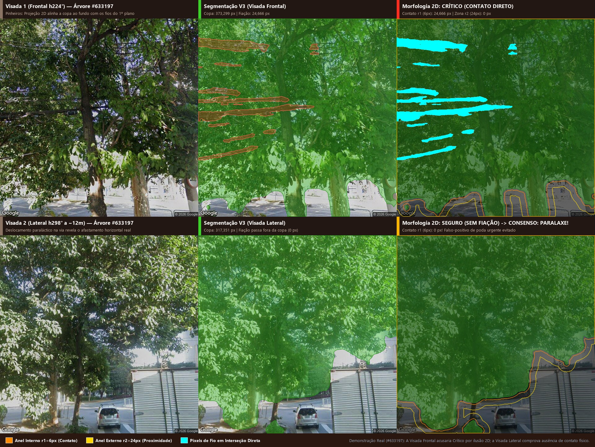
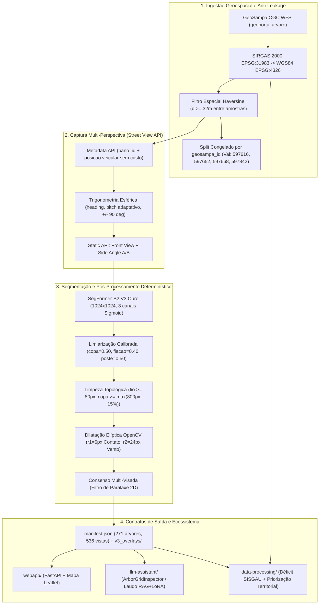
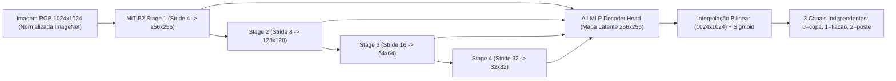
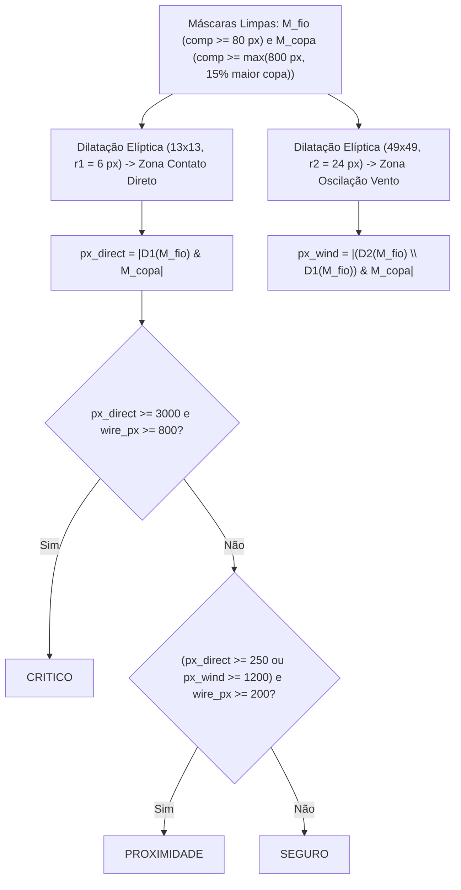

# Arquitetura do Pipeline de Visão Computacional (`arborgrid-vision/`)

> Documento complementar ao [`README.md`](README.md) e ao [`EXPLORACAO_MODELOS_E_QUANTIZACAO.md`](EXPLORACAO_MODELOS_E_QUANTIZACAO.md). Detalha a formulação geométrica, o modelo `SegFormer-B2 (1024×1024)`, a função de perda multi-label, o motor morfológico calibrado V3 ([`scripts/run_operational_pipeline.py`](scripts/run_operational_pipeline.py)) e os contratos de integração com o ecossistema ArborGrid SP.

---

## 1. Por que Segmentação Multi-Label por Pixel em vez de Bounding Boxes

Detetores baseados em caixas delimitadoras ortogonais (*Axis-Aligned Bounding Boxes — AABB*) falham estruturalmente no problema de conflito entre árvores e rede elétrica aérea:

1. **Cabos diagonais:** um feixe elétrico cruzando a cena entre `20°` e `60°` gera uma caixa retangular composta majoritariamente por céu e fachadas, causando falsas sobreposições com qualquer árvore no enquadramento.
2. **Copas podadas em "V" ou túnel:** árvores já manejadas contornam os condutores; sua caixa delimitadora continua englobando os cabos mesmo quando não existe contato físico.
3. **Oclusão mútua:** copa e fiação podem coexistir nas mesmas coordenadas de borda. Por isso adotamos segmentação semântica multi-label independente (`3` canais `sigmoid`) por pixel, em resolução nativa `1024×1024`.

---

## 2. Fluxo Ponta a Ponta do Sistema

---

## 3. Detalhamento Técnico dos Módulos

### 3.1. Ingestão GeoSampa WFS e Prevenção de Vazamento Espacial

- **Fonte oficial:** camada `geoportal:arvore` do geoportal GeoSampa (PMSP/SVMA), reprojetada na consulta OGC WFS de `SIRGAS 2000 / UTM Zone 23S` para `WGS84 (EPSG:4326)` ([`scripts/run_operational_pipeline.py`](scripts/run_operational_pipeline.py)).
- **Filtragem anti-leakage:** árvores vizinhas compartilham postes, iluminação e feixes de fiação. Aplicamos distância de Haversine ($d \ge 32\text{ m}$ na seleção de amostragem) e divisão treino/validação estritamente no nível de `geosampa_id` (`VAL_TREE_IDS = {"597616", "597652", "597668", "597842"}` — nenhuma vista dessas 4 árvores aparece no treinamento).
- **Auditoria SISGAU:** nas `271` árvores coletadas nos `4` recortes territoriais, `239` (`88,2%`) não possuem `sisgau_last_inspection` preenchido no cadastro público.

### 3.2. Geometria Esférica e Desambiguação por Paralaxe

A partir da posição da árvore $(\phi_t, \lambda_t)$ e da câmera veicular $(\phi_c, \lambda_c)$ obtida via *Street View Metadata API*, calculam-se:

- **Azimute horizontal (`heading`):**
  $$\theta = \operatorname{atan2}\!\big(\sin(\Delta\lambda)\cos\phi_t,\; \cos\phi_c\sin\phi_t - \sin\phi_c\cos\phi_t\cos(\Delta\lambda)\big)$$
- **Inclinação vertical adaptativa (`pitch`):**
  $$\alpha = \operatorname{atan2}\!\big(h_{\text{rede}} - h_{\text{cam}},\; \max(d,\; 4{,}5)\big)$$
  com $h_{\text{cam}} \approx 2{,}5\text{ m}$ (altura veicular) e $h_{\text{rede}} \approx 5{,}7\text{ m}$ (altura média dos condutores secundários/primários). O piso de $4{,}5\text{ m}$ evita inclinações extremas junto ao meio-fio.
- **Segundo ângulo ortogonal ($\theta \pm 90^\circ$):** árvores plantadas recuadas dentro de lotes podem aparentar cruzar os cabos na visada frontal (`Painel 2` acima); a visada lateral ao longo do eixo da via (`Painel 3`, `#633197`) expõe a separação física real e permite sinalizar `DIVERGENCIA_PARALAXE`.

---

### 3.3. Arquitetura `SegFormer-B2 (1024×1024)`, Perda Multi-Label e Estabilidade Numérica

- **Backbone:** `nvidia/segformer-b2-finetuned-cityscapes-1024-1024` ([`colab/Colab_02_Treino_Final_V3_ABC_1024px.ipynb`](colab/Colab_02_Treino_Final_V3_ABC_1024px.ipynb)).
- **Mitigação de *Sub-Pixel Aliasing* (`640 → 1024 px`):** como a cabeça `All-MLP` do SegFormer funde *features* em $1/4$ da resolução de entrada, entradas de `640×640` comprimem o mapa latente para `160×160`, reduzindo cabos de ~`2 px` a `0,5 px` sub-pixel e fragmentando a segmentação. Subindo para **`1024×1024`** após o Pacote 1, o mapa latente cresce para `256×256` (`+156%` de área de tokens), garantindo suporte $\ge 1\text{ px}$ contíguo nos condutores (prova visual detalhada em [`EXPLORACAO_MODELOS_E_QUANTIZACAO.md`](EXPLORACAO_MODELOS_E_QUANTIZACAO.md)).
- **Estabilidade com `BATCH_SIZE = 4`:** em vez de *Batch Normalization* (sensível a lotes pequenos), o *Mix Transformer* usa Layer Normalization, mantendo variância estável enquanto o ruído estocástico de batches compactos atua como regularizador implícito em direção a mínimos planos (*flat minima*, Keskar et al., 2017).
- **Função de Perda `MultiLabelSegLoss`:** combina `Binary Cross-Entropy` ponderada para compensar o desbalanceamento extremo dos cabos com `Soft Dice Loss` em nível de batch:
  $$\mathcal{L}_{\text{total}} = 0{,}45 \cdot \mathcal{L}_{\text{BCE}}(w=[1{,}2,\; 8{,}0,\; 5{,}0]) + 0{,}55 \cdot \big(0{,}25\,\text{Dice}_{\text{copa}} + 0{,}50\,\text{Dice}_{\text{fiacao}} + 0{,}25\,\text{Dice}_{\text{poste}}\big)$$
- **Otimização (`30` épocas):** `AdamW` (`weight_decay = 1e-2`), taxa diferencial no *backbone* (`1,2e-4`) vs. cabeça MLP (`6,0e-4`) e `CosineAnnealingLR` até `eta_min = 1e-5`, usando interpolação bilinear para `1024×1024` antes da perda e polígonos de fiação com espessura mínima garantida (`ensure_min_wire_thickness(..., min_thick_px=4.5)`).

---

### 3.4. Motor Morfológico Determinístico V3 e Consenso Multi-Visada

No script de produção [`scripts/run_operational_pipeline.py`](scripts/run_operational_pipeline.py), as probabilidades Sigmoid passam por binarização calibrada (`THRESHOLDS = {0: 0.50, 1: 0.40, 2: 0.50}`), limpeza geométrica em 8-conectividade (`cv2.connectedComponentsWithStats`) e duas dilatações elípticas sobre a máscara limpa de fiação (`Painel 1` da figura no topo):

#### Consolidação por Árvore (`v3_triage.consolidated`)
Quando há visada frontal e lateral disponível (`has_single_view = False`):
- **Ambos os ângulos `CRITICO`:** `CRITICO_CONFIRMADO` *(contato físico comprovado independente da perspectiva)*.
- **Um ângulo `CRITICO` e outro `SEGURO` / `PROXIMIDADE`:** `DIVERGENCIA_PARALAXE` *(ambiguidade 2D de profundidade ou oclusão unilateral — encaminhar vistoria prioritária de confirmação)*.
- **Pelo menos um ângulo `PROXIMIDADE` (sem `CRITICO`):** `PROXIMIDADE` *(margem dinâmica de balanço por vento violada)*.
- **Ambos `SEGURO`:** `SEGURO`.
- **Apenas visada frontal (`side_angle` indisponível):** classes `CRITICO_MONO_VISADA`, `PROXIMIDADE_MONO_VISADA` ou `SEGURO_MONO_VISADA`.

---

## 4. Contratos de Dados e Execução Web

| Consumidor | Artefato / Endpoint | Conteúdo e Papel no Ecossistema |
| :--- | :--- | :--- |
| `webapp/` (Mapa e API) | `manifest.json` + `geosampa_cadastral/*.geojson` | Plotagem Leaflet das `271` árvores auditadas + camada cadastral GeoSampa (`7.912` pontos) + metadados comparativos (`gold_triage`, `v2_triage`, `v3_triage`). |
| `llm-assistant/` (Copiloto) | `manifest.json` lido por `src/tools.py` | Fornece `distrito`, déficit SISGAU, `v3_triage` e `px_direct` / `px_wind` exatos quando o usuário pergunta por um `geosampa_id`. |
| `data-processing/` (Big Data) | `/api/v1/inspections` + GeoJSONs | Cruzamento entre risco físico da fiação e ausência de vistorias (`88,2%` nulos na amostra) junto a séries climáticas Open-Meteo. |
| Execução Web On-Demand | `segformer_v3_int8_dyn_matmul.onnx` (`43,9 MiB` Gzip) | Exportado por [`04_quantizacao_onnx_e_benchmark_cpu.ipynb`](04_quantizacao_onnx_e_benchmark_cpu.ipynb) para inferência via `onnxruntime-web` no navegador sem disputar RAM com o LLM no servidor. |
