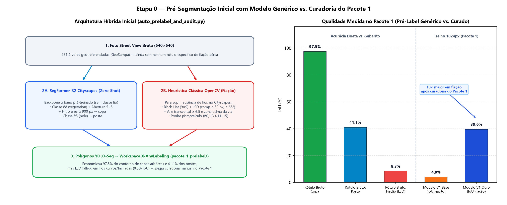
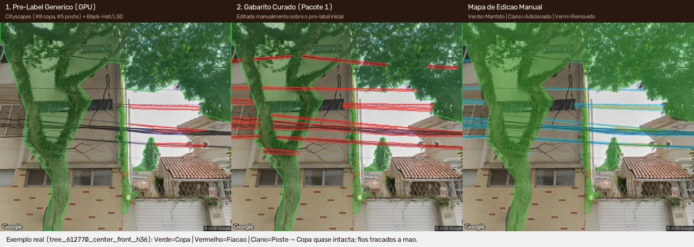
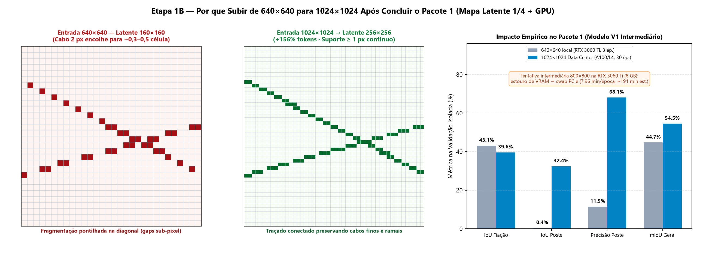
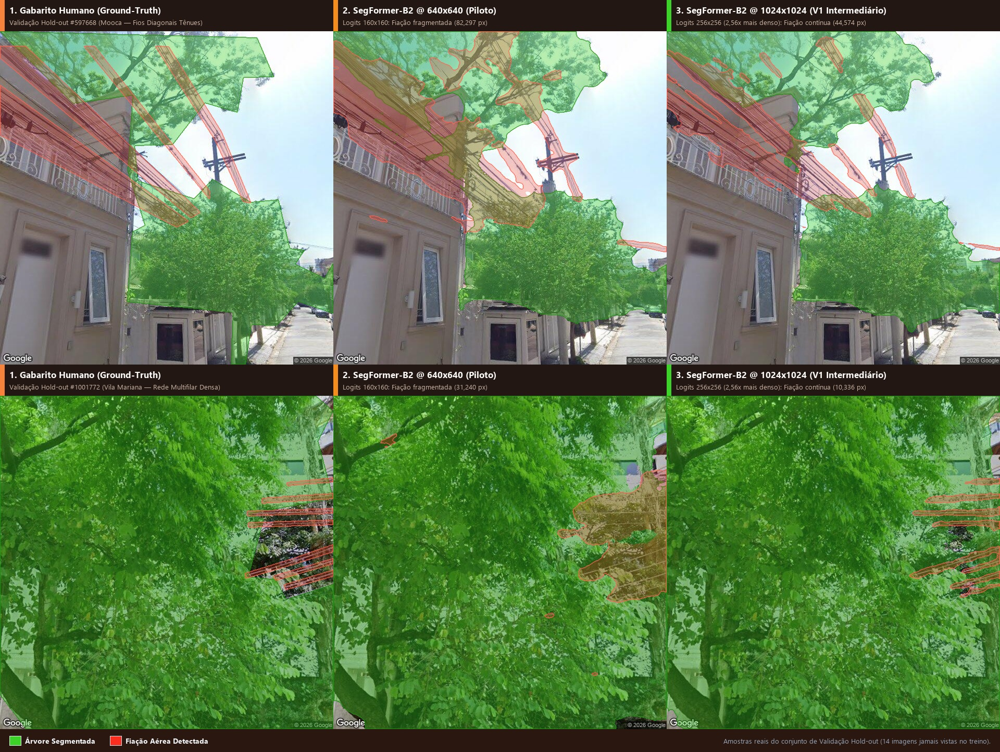
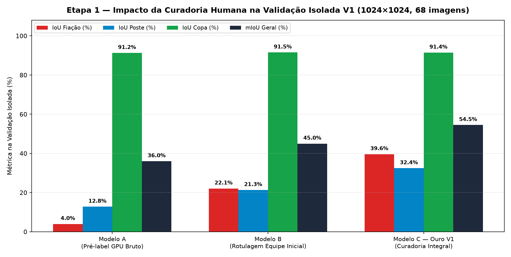
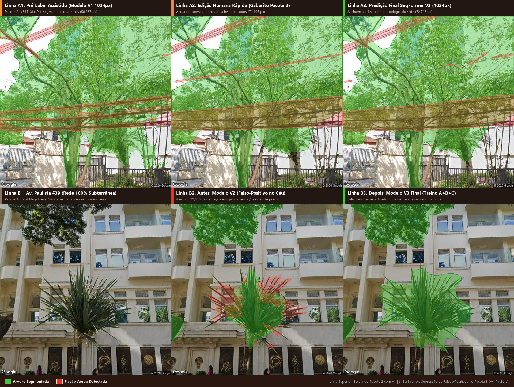
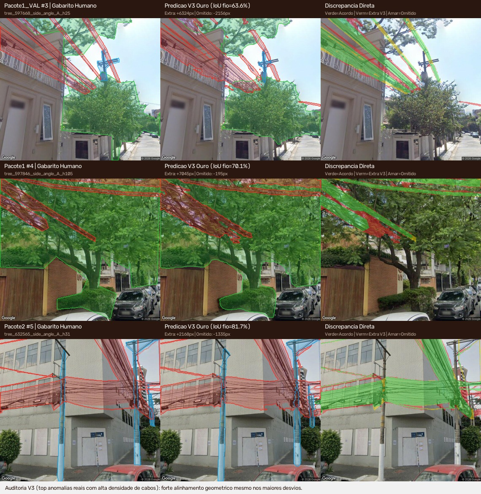

# Estudo Experimental, Curadoria, Quantização e Decisão de Deploy (`arborgrid-vision/`)

> Documento complementar ao [`README.md`](README.md) e à [`ARQUITETURA_PIPELINE.md`](ARQUITETURA_PIPELINE.md). Registra a trajetória experimental em fluxo decisório com provas visuais e exemplos concretos — da pré-segmentação inicial genérica e divisão em duas metades até a migração para `1024×1024` pós-Pacote 1, o pré-labeling da 2ª metade com o modelo intermediário, o estudo A/B/C final (`V3 Ouro`) e a quantização ONNX para a Web.
>
> **Ambiente de execução local (inferência e quantização):**
> - **GPU:** RTX 3060 Ti (8 GB)
> - **CPU:** Ryzen 9 7900X (12 cores / 24 threads)
> - **RAM:** 2×16 GB DDR5-5600
>
> **Treinamento em alta resolução (`1024×1024`):** Google Colab Pro (**NVIDIA A100 40 GB** / **L4 24 GB**).

---

## 1. Pré-Segmentação Genérica Inicial, Curadoria da 1ª Metade e Salto para `1024×1024`

### 1.1. Como Funcionava o Modelo Genérico Inicial na GPU ([`01_coleta_geosampa_e_prelabel_generico.ipynb`](01_coleta_geosampa_e_prelabel_generico.ipynb))

Para não anotar centenas de polígonos do zero no `X-AnyLabeling`, montamos um pipeline híbrido (*zero-shot* + visão computacional clássica) sobre as fotos Street View (`640×640`), antes de dividir o dataset residencial em duas metades (`pacote_1/` e `pacote_2/`):

- **Ramo Semântico Genérico (`nvidia/segformer-b2-finetuned-cityscapes-1024-1024`, sem fine-tuning):**
  - `copa`: extraímos a classe `vegetation` (`ID = 8`) do Cityscapes, aplicamos abertura morfológica (`5×5`) e filtramos componentes conexos (`área < 900 px` ou centróide rente ao chão `cy > 0,78·H`) para descartar arbustos baixos e canteiros.
  - `poste`: extraímos a classe `pole` (`ID = 5`) do Cityscapes.
- **Heurística Clássica OpenCV para `fiacao` (`detect_overhead_wires_contextual`):** como o Cityscapes não possui classe de fiação elétrica, combinamos `Black-Hat` morfológico (`9×9`) com o `Line Segment Detector (LSD)`, filtrando segmentos por comprimento (`>= 52 px`), ângulo (`<= 68°`), cota superior (`y <= 0,78·H`), vale escuro transversal (`valley_contrast >= 6,5` a `±5 px`) e exclusão de pista/veículos/pedestres do Cityscapes (`IDs [0,1,3,4,11..15]`).

O gabarito do Pacote 1 (`68` imagens: `60` treino + `8` validação isolada por `geosampa_id`) foi criado **manualmente com base nessa própria segmentação inicial** — editando e completando os polígonos gerados pela GPU no X-AnyLabeling. Comparando diretamente os rótulos brutos de `pacote_1_prelabel/` contra a versão final de `pacote_1/`:

- `copa` atingiu `97,5%` de IoU direto (`98,2%` de precisão), **poupando quase todo o contorno manual de árvores**;
- `poste` atingiu `41,1%` de IoU direto (exigindo apenas adição de postes omitidos e remoção de falsos positivos em pilares);
- `fiacao` via `LSD` obteve apenas `8,3%` de IoU direto, pois segmentos retos falham em cabos curvados contra prédios e folhagens — exigindo traçado manual completo em fitas contínuas e junções.

---

### 1.2. Por que Subir de `640×640` para `1024×1024` Após Concluir o Pacote 1

1. **Testes locais na `RTX 3060 Ti (8 GB)` após terminar o Pacote 1:**
   - Em piloto inicial em `640×640` (`3` épocas via [`02_ablation_v1_resolucao_e_expansao_v2.ipynb`](02_ablation_v1_resolucao_e_expansao_v2.ipynb)), os cabos curados já subiam para `43,09%` de IoU, mas `poste` colapsava em `0,39%` de IoU e os fios saíam picotados em diagonais.
   - Ao tentar elevar a resolução localmente para `800×800` (`25` épocas), os gradientes estouraram os `8 GB` de VRAM disponíveis, disparando swap contínuo via PCIe: a época `3/25` levou `7,96 min` (`~191 min` estimados para apenas um experimento).
2. **Prova visual do *Sub-Pixel Aliasing* no decodificador $1/4$ (`All-MLP`):**
   - O decodificador `All-MLP` do SegFormer funde *features* em $1/4$ da resolução de entrada. Em `640×640`, o mapa latente tem apenas `160×160 px`, fazendo cabos de ~`2 px` encolherem para `~0,3–0,5` célula e quebrarem em traços pontilhados. Subindo para `1024×1024`, o mapa latente cresce para `256×256 px` (`+156%` de área de tokens), mantendo suporte $\ge 1\text{ px}$ conectado em toda a diagonal.

3. **Decisão:** Migramos o treino para GPUs de Data Center (`NVIDIA A100 40 GB` / `L4 24 GB` no Google Colab Pro) na resolução nativa **`1024×1024`**. No Pacote 1, isso destravou a convergência de postes (`0,4% → 32,4%` IoU, `68,1%` precisão) e consolidou o modelo intermediário `V1 Ouro`.

### 1.3. Pré-label Genérico vs. Modelo Intermediário `V1 Ouro` (`1024×1024`, `30` épocas)

Mantendo arquitetura (`SegFormer-B2`), hiperparâmetros e validação rigorosamente congelados (`8` imagens de `4` árvores isoladas por `geosampa_id`: `597616`, `597652`, `597668`, `597842`), comparamos nas `60` imagens de treino do Pacote 1 o treino sobre os rótulos genéricos iniciais vs. a 1ª metade curada manualmente:

| Experimento (`V1 @ 1024px`) | Origem dos Rótulos (`Pacote 1` — `60` treino) | IoU Fiação | Recall Fiação | Precisão Poste | IoU Poste | IoU Copa | mIoU Geral |
| :--- | :--- | :---: | :---: | :---: | :---: | :---: | :---: |
| `V1 Base (Pré-label Genérico)` | Segmentação inicial automática (`Cityscapes` + `Black-Hat`/`LSD`) | `3,97%` | `3,99%` | `27,67%` | `12,79%` | `91,25%` | `36,00%` |
| **`V1 Intermediário (Ouro)`** | Curadoria em fitas contínuas e junções (`pacote_1`) | **`39,60%`** | **`45,11%`** | **`68,07%`** | **`32,42%`** | **`91,43%`** | **`54,48%`** |

### Conclusão da Etapa 1: Modelo Intermediário `V1 Ouro` Pronto para Acelerar a 2ª Metade
- A segmentação inicial genérica quase ignora fiação aérea contra fundos urbanos (`3,97%` IoU). A curadoria do Pacote 1 + salto para `1024×1024` multiplicaram o `IoU Fiação` por `10×` (`39,60%`), gerando o modelo intermediário `V1 Ouro` usado na etapa seguinte para pré-rotular a segunda metade do dataset.

---

## 2. Pré-Labeling da 2ª Metade (`V1 → V2 Full`) e Pacote 3 (`Hard Negatives`)

Com o modelo intermediário `V1 Ouro (1024×1024)` validado na 1ª metade, executamos [`02_ablation_v1_resolucao_e_expansao_v2.ipynb`](02_ablation_v1_resolucao_e_expansao_v2.ipynb) sobre a 2ª metade (`pacote_2/`) para substituir os pré-labels genéricos por polígonos de alta resolução. Após revisão humana desse pré-labeling e consolidação das duas metades, treinamos o `V2 Full` (`132` imagens: `124` treino + `8` validação fixa) em GPU `NVIDIA L4 24 GB`:

- `V1 Intermediário (68 imgs) → V2 Full (132 imgs)`:
  - `IoU Fiação`: `39,60% → 45,03%` (`+5,43 p.p.`; Recall `45,11% → 50,99%`, Precisão `76,43% → 79,40%`).
  - `Poste`: IoU `32,42% → 34,95%` e Precisão `68,07% → 94,71%` (`+26,64 p.p.`, eliminando quase todos os falsos postes em pilares prediais).
  - `Copa`: IoU `91,43% → 92,68%` (Precisão `95,84%`) e `mIoU Geral = 57,55%` (`+3,07 p.p.`).

### Quebra de Expectativa após Terminar o Pacote 2 (Av. Paulista → Pacote 3)
Ao concluir o Pacote 2 e executar o `V2 Full` em campo na Avenida Paulista — corredor com rede elétrica 100% subterrânea —, descobrimos um viés de positividade: como `100%` das fotos de Pinheiros/Mooca/Vila Mariana possuíam fios aéreos, a rede ativava falsos positivos sobre frisos metálicos, brises e esquadrias de edifícios envidraçados. Para neutralizar esse efeito sem perder sensibilidade em bairros reais, montamos depois do Pacote 2 o **Pacote 3 (`Hard Negative Mining`: `18` imagens curadas de `9` árvores da Av. Paulista com classe `fiacao` vazia)** e um Teste Cego independente (`20` fotos inéditas da Paulista).

---

## 3. Matriz Experimental Final A/B/C (`V3 Ouro`) e Impacto em Campo

No notebook autônomo [`colab/Colab_02_Treino_Final_V3_ABC_1024px.ipynb`](colab/Colab_02_Treino_Final_V3_ABC_1024px.ipynb) (gerado via [`colab/Colab_01_Ablation_V1_e_Treino_V2_1024px.ipynb`](colab/Colab_01_Ablation_V1_e_Treino_V2_1024px.ipynb)), isolamos o impacto de *data augmentation* segura e *Hard Negative Mining* sobre **`143` imagens anotadas** (após descarte `_delete_` de amostras com oclusão extrema) e avaliamos em paralelo na **validação residencial (`8` imgs)** e no **Teste Cego da Av. Paulista (`20` imgs)**:

| Experimento V3 (`1024×1024`, `30` épocas) | Treino / Augmentations | IoU Fiação | IoU Copa | IoU Poste (Prec.) | mIoU Val | Paulista Cego: Pixels Falsos Médios | Paulista Cego: Taxa Zero-FP |
| :--- | :--- | :---: | :---: | :---: | :---: | :---: | :---: |
| **`Modelo A` (Baseline Curado)** | `117` imgs (P1+P2) · Padrão (`Flip/Brilho/Crop`) | `43,11%` | `92,84%` | `33,00%` (`82,75%`) | `56,32%` | `7.318,0 px` | `75,0%` (`15/20`) |
| **`Modelo B` (+Aug Calibrada)** | `117` imgs · `+HSV ±5%`, `+Rot ±3°` (sem blur) | **`45,13%`** | `92,86%` | `32,46%` (**`96,90%`**) | **`56,82%`** | `8.157,0 px` | `70,0%` (`14/20`) |
| **`Modelo C (Ouro V3 Final)`** | **`135` imgs** (`+Pacote 3 Hard Negs`) · `+Aug` | **`42,44%`** | **`92,86%`** | `30,95%` (**`96,64%`**) | **`55,42%`** | **`6.495,2 px`** | **`75,0%` (`15/20`)** |

**Detalhamento completo por classe na validação (`8` imagens / `4` árvores):**

| Modelo | Copa IoU / Prec. / Recall | Fiação IoU / Prec. / Recall | Poste IoU / Prec. / Recall | mIoU |
| :--- | :---: | :---: | :---: | :---: |
| `V3 A` | `92,84% / 96,04% / 96,53%` | `43,11% / 79,33% / 48,57%` | `33,00% / 82,75% / 35,43%` | `56,32%` |
| `V3 B` | `92,86% / 95,99% / 96,61%` | `45,13% / 75,33% / 52,96%` | `32,46% / 96,90% / 32,80%` | `56,82%` |
| **`V3 C (adotado)`** | **`92,86% / 95,80% / 96,80%`** | **`42,44% / 76,58% / 48,77%`** | **`30,95% / 96,64% / 31,29%`** | **`55,42%`** |

> Embora a precisão de postes no `V3 C` seja de `96,64%`, seu IoU é `30,95%` e seu recall é `31,29%`; na fiação, o recall é `48,77%`. Fios e postes são estruturas finas sensíveis a deslocamentos de `1`–`3 px`, com perdas em nível de pixel mitigadas no nível da árvore pelo consenso multi-ângulo e pela margem de vento OpenCV.

### Decisão Arquitetural: Por que adotar o `Modelo C Ouro V3` em vez do `Modelo B`?
- Embora as novas augmentations do `Modelo B` tenham alcançado o pico de `IoU Fiação` na validação (`45,13%`), elas elevaram os falsos alarmes no Teste Cego da Paulista para `8.157 px` médios e baixaram o `Zero-FP` para `70,0%`.
- Ao incluir os `18` *hard negatives* da Paulista (`Modelo C Ouro V3`), aceitamos um recuo controlado de `-2,69 p.p.` no `IoU Fiação` da validação (`42,44%`) para derrubar em **`-20,4%` os pixels falsos médios no teste cego (`8.157 → 6.495 px`)**, mantendo `92,86%` de IoU em copas e `96,64%` de precisão em postes (`30,95%` IoU / `31,29%` recall em postes e `48,77%` recall em fiação no nível de pixel).
- *Nota amostral:* com validação de `8` imagens (`4` árvores) e teste cego de `20` imagens, o `Zero-FP` de `75%` (`15/20`) tem intervalo de Wilson (95%) de `[53%; 89%]`, e a diferença entre `B` (`70%`) e `C` (`75%`) representa apenas `1` imagem.
- Além disso, na auditoria completa sobre todas as `143` imagens curadas (reproduzível via [`03_avaliacao_v3_auditoria_e_inferencia_campo.ipynb`](03_avaliacao_v3_auditoria_e_inferencia_campo.ipynb)), o `Modelo C V3` obteve `100,00%` de concordância (`iou_wire`) nas `18` imagens de `pacote_3_hard_negatives`, `82,78%` no treino do `pacote_1` e `80,09%` no `pacote_2`. Mesmo quando isolamos os exemplos com maior discrepância absoluta de pixels do dataset, as predições permanecem geometricamente alinhadas aos feixes reais e ao gabarito humano:

### Comprovação Territorial em Produção (`271` árvores · `536` vistas)

Comparando a inferência completa do `V2 Full` vs. `V3 Ouro` no [`manifest.json`](dataset/sp_geosampa_api/manifest.json):

| Território (Rede Elétrica) | Árvores | Variação `wire_px` (`V2 → V3`) | `CRITICO_CONFIRMADO` | `DIVERGENCIA_PARALAXE` | `PROXIMIDADE` / Mono | `SEGURO` / Mono |
| :--- | :---: | :---: | :---: | :---: | :---: | :---: |
| **Pinheiros** *(Aérea)* | `89` | `-5,45%` | `23` (`25,8%`) | `22` (`24,7%`) | `11` (`12,4%`) | `33` (`37,1%`) |
| **Alto da Mooca** *(Aérea)* | `54` | `-15,75%` | `11` (`20,4%`) | `11` (`20,4%`) | `17` (`31,5%`) | `15` (`27,8%`) |
| **Vila Mariana / Klabin** *(Aérea)* | `54` | `-13,82%` | `22` (`40,7%`) | `6` (`11,1%`) | `9` (`16,7%`) | `17` (`31,5%`) |
| **Av. Paulista** *(100% Subterrânea)* | `74` (`65` inéditas) | **`-41,82%`** *(65 inéditas)* / `-56,11%` *(74 total)* | `3` (`4,1%`) *(cruzamentos)* | `6` (`8,1%`) | `5` (`6,8%`) | **`51/65` (`78,5%`)** inéditas / `60/74` (`81,1%`) total |

> **Sobreposição treino × campo:** na Av. Paulista, `9` das `74` árvores integram o `pacote_3_hard_negatives` de treino (IDs `36, 39, 43, 4565, 4728, 5692, 5695, 651875, 7204`), onde o `V3` zerou `144.149 → 0 px` (memorização); nas `65` árvores inéditas (`129` vistas), a queda foi de `442.616 → 257.508 px` (`-41,82%`) e `78,5%` (`51/65`) como `SEGURO` (vs. `46/65 = 70,8%` no `V2`). Em Pinheiros, `71` das `89` árvores têm `dataset_role = train_curated` (taxas refletem triagem sobre árvores vistas no treino); Alto da Mooca e Vila Mariana (`54` árvores cada) são `inference_only` sem gabarito humano.

---

## 4. Quantização ONNX (`CPU 2 threads`) e Decisão de Hospedagem Web

Como o servidor de nuvem do ecossistema precisa rodar `webapp/`, `nginx`, `prometheus`/`grafana` e o copiloto `llm-assistant/` (`Qwen 1.7B Q4_K_M`, `2.015 MiB` base) sem GPU dedicada, avaliamos se seria possível compactar o `SegFormer-B2 V3 (1024×1024)` para CPU ou se o melhor caminho seria executá-lo **no navegador via Web**.

Implementamos [`04_quantizacao_onnx_e_benchmark_cpu.ipynb`](04_quantizacao_onnx_e_benchmark_cpu.ipynb) executando cada variante em subprocesso isolado limitado a `2 threads` de CPU, medindo tamanho bruto e Gzip (custo de download Web), pico de RAM RSS (`psutil`), latência (`28` imagens = `8` validação + `20` teste cego Paulista), IoU, `Zero-FP` e concordância da triagem final do motor morfológico V3 **em relação ao modelo `FP32` original** (não acurácia contra gabarito humano):

| Variante (`SegFormer-B2 V3 1024×1024`) | Escopo de Quantização | Disco | Gzip Web | Pico RAM RSS | Latência Média (P95) | mIoU Val | IoU Fiação | Zero-FP Paulista | Concordância vs. FP32 |
| :--- | :--- | ---: | ---: | ---: | ---: | ---: | ---: | ---: | ---: |
| `pytorch_fp32` | Pesos `FP32` originais | `104,5 MiB` | `96,9 MiB` | `3.310 MiB` | `4,40s` (`4,47s`) | `55,41%` | `42,44%` | `75,0%` (`15/20`) | `100,0%` (`28/28`) |
| `onnx_fp32` | Grafo ONNX opset 17 `FP32` | `104,6 MiB` | `96,9 MiB` | `5.235 MiB` | `2,73s` (`2,77s`) | `55,41%` | `42,44%` | `75,0%` (`15/20`) | `100,0%` (`28/28`) |
| `onnx_fp16` | Pesos `FP16` (`keep_io_types=True`) | `52,5 MiB` | `48,3 MiB` | `6.273 MiB` | `3,38s` (`3,42s`) | `55,43%` | `42,44%` | `75,0%` (`15/20`) | `100,0%` (`28/28`) |
| **`onnx_int8_dyn_matmul`** | **Dinâmica `QInt8` só `MatMul`/`Gemm`** | **`51,8 MiB`** | **`43,9 MiB`** | `5.129 MiB` | **`2,48s` (`2,55s`)** | **`56,28%`** | **`42,55%`** | **`75,0%` (`15/20`)** | **`100,0%` (`28/28`)** |
| `onnx_int8_dynamic` | Dinâmica `QInt8` completa (`Conv+MatMul`) | `26,9 MiB` | `18,7 MiB` | `4.371 MiB` | `26,64s` (`26,94s`) | `56,66%` | `42,40%` | `75,0%` (`15/20`) | `96,4%` (`27/28`) |
| `onnx_int8_static_qdq` | Estática `QDQ` (`QUInt8`/`QInt8`, MinMax `24` imgs) | `27,4 MiB` | `18,6 MiB` | `2.654 MiB` | `5,94s` (`6,02s`) | `54,25%` | `40,41%` | `55,0%` (`11/20`) | `92,9%` (`26/28`) |

### Análise de Trade-offs e Decisão Final

1. **Por que `onnx_int8_dynamic` (completo) falhou em latência (`26,64s`):** ao quantizar também camadas convolucionais do `Mix-FFN` e `OverlapPatchEmbed`, o ONNX Runtime em CPU gera nós `ConvInteger` com perda severa de paralelismo/vetorização — ficando `9,8×` mais lento que `onnx_fp32` (`26,64s` vs. `2,73s`) e mudando `1` triagem (`PROXIMIDADE → CRITICO`).
2. **Por que `onnx_int8_static_qdq` falhou em fiação e falsos alarmes:** o *clipping* estático `MinMax` em `QUInt8` achata gradientes sutis de cabos sub-pixel: `IoU Fiação` cai `42,44% → 40,41%`, o `Zero-FP` da Paulista despenca `75,0% → 55,0%` (`11/20`) e `2` triagens divergem (incluindo falso positivo `SEGURO → PROXIMIDADE` na Paulista). Além disso, seu pico de `2.654 MiB` RSS em CPU ainda inviabiliza rodar o modelo na mesma instância ao lado do `Qwen 1.7B Q4_K_M` (`2.015 MiB` base).
3. **Por que vencemos com `onnx_int8_dyn_matmul` na Web:**
   - Restringir a quantização dinâmica `QInt8` às camadas lineares e de atenção (`op_types_to_quantize=["MatMul", "Gemm"]`), mantendo as convoluções em `FP32`, reduz o arquivo pela metade (`51,8 MiB` em disco / `43,9 MiB` via Gzip), entrega a **menor latência em CPU `2t` (`2,48s`, `-43,6%` vs. PyTorch)**, registra `56,28%` mIoU, `42,55%` IoU Fiação, `75,0%` Zero-FP e **`100,0%` (`28/28`) de concordância de triagem com o modelo `FP32`**.
   - **Decisão fechada:** hospedar `segformer_v3_int8_dyn_matmul.onnx` (`43,9 MiB` comprimido) como ativo estático para execução cliente no navegador (`onnxruntime-web`), liberando `100%` da RAM da VM na nuvem para a API e o assistente `Qwen`. Como alternativa caso haja GPU/WebGPU no cliente, `onnx_fp16` (`48,3 MiB` Gzip, `100,0%` de concordância) preserva pesos em meia precisão nativa.

---

## 5. Registro Consolidado de Incidentes e Soluções (`PRB-001` a `PRB-013`)

| ID | Sintoma / Gargalo Observado | Causa-Raiz Identificada | Solução Implementada |
| :--- | :--- | :--- | :--- |
| **`PRB-001`** | Interseção espúria em cabos diagonais e copas podadas em "V". | Caixas retangulares ortogonais (`AABB`) incluem >90% de fundo em diagonais. | Segmentação semântica multi-label por pixel (`SegFormer-B2`). |
| **`PRB-002`** | Árvores no fundo de lotes aparentavam tocar cabos da calçada. | Projeção monocular 2D suprime profundidade (efeito paralaxe). | Captura multi-perspectiva ($\theta$ e $\theta \pm 90^\circ$) e classificação `DIVERGENCIA_PARALAXE`. |
| **`PRB-003`** | Fios diagonais segmentados em linha pontilhada em `640×640`. | Mapa latente de $1/4$ (`160×160`) torna cabos de `2 px` em entidades sub-pixel (`0,5 px`). | Escalonamento para resolução nativa **`1024×1024`** (mapa latente `256×256`). |
| **`PRB-004`** | Treino `800×800` local projetando `191 min` (`7,96 min` por época `3/25`). | Saturação dos `8 GB` VRAM da RTX 3060 Ti causando swap contínuo via PCIe. | Treino em Data Center GPU (`A100 40 GB` / `L4 24 GB`) no Colab Pro. |
| **`PRB-005`** | Divergência de shapes na métrica vs. gabarito original (`640` vs. `1024`). | Logits comparados sem reamostragem uniforme. | Padronização de interpolação bilinear dos logits para `(IMGSZ, IMGSZ)`. |
| **`PRB-006`** | Falsos postes em pilares e quinas de edifícios no piloto `V1`. | Rótulos iniciais insuficientes apenas na 1ª metade (`Pacote 1`) e pilares parecidos com postes. | Pré-labeling + curadoria da 2ª metade (`Pacote 2` → `V2`), elevando precisão de postes para `94,71%` (`96,64%` no `V3`). |
| **`PRB-007`** | Falha de tipo OpenCV em pós-processamento (`CV_64FC1` vs `CV_8UC1`). | Inicialização `np.zeros` padrão `float64` passada a `cv2.findContours`. | Coerção explícita para `dtype=np.uint8`. |
| **`PRB-008`** | Bloqueio de tiles OSM (`file:///`) e restrição de API em CartoDB. | Política de uso de tiles barrando origens locais sem chave. | Uso consolidado de camadas Esri ArcGIS Online compatíveis sem chave em `generate_interactive_map.py`. |
| **`PRB-009`** | Desalinhamento no polígono amostral da Av. Paulista. | Bbox ortogonal com buffer estreito omitia faces adjacentes. | Polígono orientado ao eixo viário (`420 m` totais cobrindo Rua São Carlos do Pinhal e Al. Santos). |
| **`PRB-010`** | Sobreposição de *hover* dos polígonos nos cliques das árvores no mapa. | Eventos SVG capturados pela camada vetorial do setor. | Polígonos territoriais com `interactive: false` e `fill: false` + painel lateral retrátil. |
| **`PRB-011`** | Panoramas internos do Metrô Paulista/Consolação (`#2139`, `#2135`) no dataset. | Coordenada da árvore coincidia com trajeto pedestre subterráneo (*Trekker*). | Quarentena e descarte dos espécimes internos do manifesto oficial. |
| **`PRB-012`** | Falsos positivos em frisos metálicos e brises da Av. Paulista no `V2`. | Dataset `100%` composto por vias com rede aérea induzia viés positivo. | **Pacote 3 (`18` Hard Negatives)** reduzindo `wire_px` nas `65` árvores inéditas da Paulista em `-41,82%` (`-56,11%` incluindo as `9` árvores de treino). |
| **`PRB-013`** | Quantização dinâmica INT8 completa em ONNX `9,8×` mais lenta (`26,64s` CPU `2t`). | Nós `ConvInteger` de convoluções têm baixo desempenho no `CPUExecutionProvider` ORT. | Quantização seletiva em **`MatMul`/`Gemm` (`onnx_int8_dyn_matmul`)**: **`2,48s` CPU** e `100%` triagem. |
