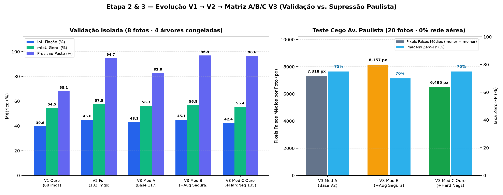
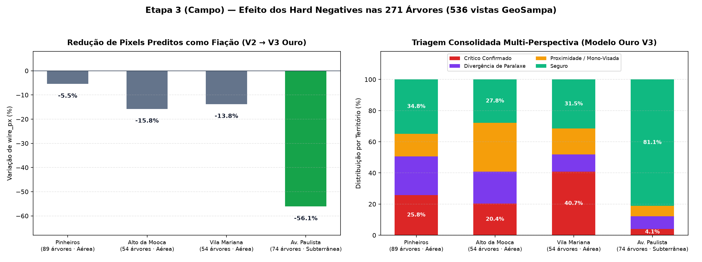
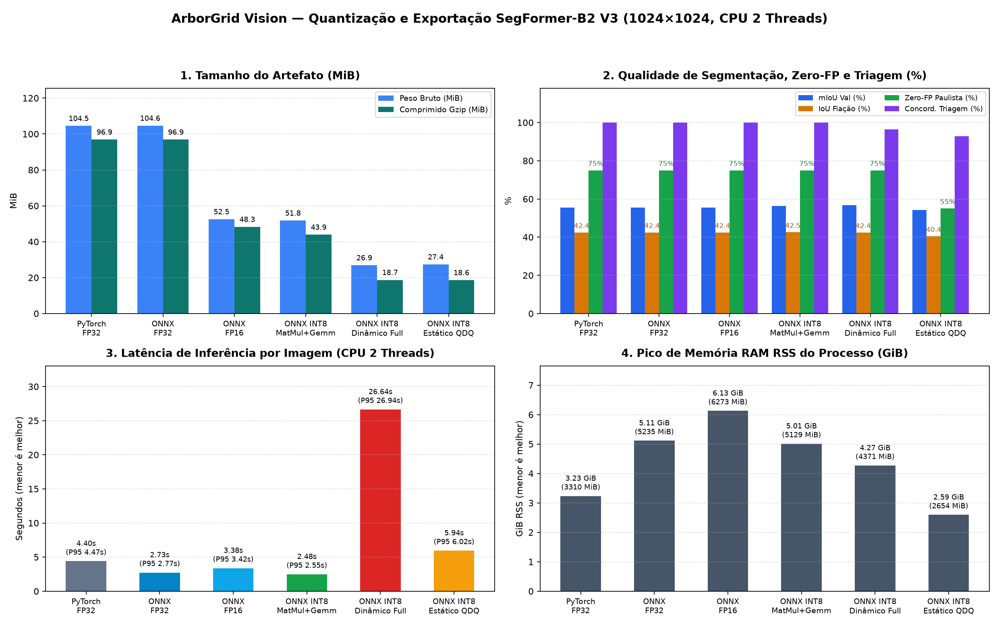

# Estudo Experimental, Curadoria, Quantização e Decisão de Deploy (`arborgrid-vision/`)

> Documento complementar ao [`README.md`](README.md) e à [`ARQUITETURA_PIPELINE.md`](ARQUITETURA_PIPELINE.md). Registra a trajetória experimental em **4 etapas de fluxo decisório** — da ablação inicial de qualidade de rótulos até o estudo A/B/C final (`V3 Ouro`) e à quantização ONNX para hospedagem na Web sem disputar memória com o copiloto LLM.
>
> **Ambiente de execução local (inferência e quantização):**
> - **GPU:** RTX 3060 Ti (8 GB)
> - **CPU:** Ryzen 9 7900X (12 cores / 24 threads)
> - **RAM:** 2×16 GB DDR5-5600
>
> **Treinamento em alta resolução (`1024×1024`):** Google Colab Pro (**NVIDIA A100 40 GB** / **L4 24 GB**).

---

## 1. Formulação Inicial, Curadoria Ouro e Gargalo de Resolução (`V1`)

Antes de escalar dados ou buscar otimizações de inferência, investigamos duas variáveis fundamentais sobre o **Pacote 1 (`68` fotos de `35` árvores)**: se rótulos automáticos ou pouco revisados bastariam para fiação aérea e qual resolução espacial preservava cabos finos.

### 1.1. Gargalo de VRAM Local (`800×800`) e *Sub-Pixel Aliasing* (`640 → 1024 px`)

1. **Limite físico na GPU local (`RTX 3060 Ti 8 GB`):**
   - Em teste piloto rápido (`3` épocas @ `640×640`, [`runs/pilot_ablation/ablation_metrics.json`](runs/pilot_ablation/ablation_metrics.json)), o `Modelo C` já superava largamente `A` e `B` em fiação (`43,09%` vs. `28,43%` e `11,03%`).
   - Porém, ao tentar subir a resolução para **`800×800`** localmente (`25` épocas), os tensores de gradiente excederam a VRAM disponível após desconto do desktop, disparando paginação contínua via barramento PCIe: pela telemetria de [`train_status.json`](runs/pilot_ablation/train_status.json), a época `3/25` levou **`7,96 min`** com previsão de **`191 min`** apenas para o `Modelo A` (`4%` do ciclo completo).
2. **Por que não permanecer em `640×640`?**
   - Como o decodificador `All-MLP` do SegFormer opera em **$1/4$ da resolução de entrada**, fotos de `640×640` geram mapa latente de apenas **`160×160 px`**: cabos de ~`2 px` encolhem para **`0,5 px`** (*sub-pixel aliasing*), quebrando linhas diagonais em fragmentos pontilhados.
3. **Decisão:** Migrar o treino para GPUs de Data Center (`A100 40 GB` / `L4 24 GB`) na resolução nativa do *backbone* Cityscapes (**`1024×1024`**, mapa latente `256×256 px`).

### 1.2. Ablação Controlada de Qualidade de Rótulos (`1024×1024`, `30` épocas)

Mantendo a arquitetura (`SegFormer-B2`), hiperparâmetros e partição de validação rigorosamente congelados (`8` imagens de `4` árvores isoladas por `geosampa_id`: `597616`, `597652`, `597668`, `597842`), variamos apenas a origem dos rótulos das **`60` imagens de treino** ([`runs/pilot_ablation_1024/ablation_metrics_1024px.json`](runs/pilot_ablation_1024/ablation_metrics_1024px.json)):

| Experimento (`V1 @ 1024px`) | Origem dos Rótulos de Treino (`60` imgs) | IoU Fiação | Recall Fiação | Precisão Poste | IoU Poste | IoU Copa | mIoU Geral |
| :--- | :--- | :---: | :---: | :---: | :---: | :---: | :---: |
| **`Modelo A`** | Pré-label GPU bruto (`SegFormer` + `Black-Hat`/`LSD`) | `3,97%` | `3,99%` | `27,67%` | `12,79%` | `91,25%` | `36,00%` |
| **`Modelo B`** | Rotulagem inicial da equipe sem padrão rígido | `22,08%` | `23,10%` | **`96,12%`** | `21,29%` | **`91,50%`** | `44,96%` |
| **`Modelo C (Ouro V1)`** | **Curadoria integral (fitas contínuas e junções em Y)** | **`39,60%`** | **`45,11%`** | `68,07%` | **`32,42%`** | `91,43%` | **`54,48%`** |

### Conclusão da Etapa 1: Curadoria Manual em Fita + `1024×1024` São Obrigatórias
- O pré-label automático (`Modelo A`) quase ignora fiação (`3,97% IoU`), e a rotulagem preliminar (`Modelo B`) estaciona em `22,08% IoU` por omitir condutores sobre fundos complexos. A curadoria padrão Ouro (`Modelo C V1`) multiplicou o **`IoU Fiação` por `10×` sobre o pré-label (`+79,3%` relativo sobre `B`)**, estabelecendo o protocolo usado na expansão do dataset.

---

## 2. Escala de Dados (`V1 → V2`) e Descoberta na Av. Paulista (`Hard Negatives`)

Com o protocolo validado, pré-rotulamos o **Pacote 2** usando o próprio `Modelo C V1`, aplicamos revisão humana e consolidamos o dataset **`V2 Full` (`132` imagens: `124` treino + `8` validação fixa)** em GPU `NVIDIA L4 24 GB` ([`runs/full_v2_132/metricas_v2_132imgs.json`](runs/full_v2_132/metricas_v2_132imgs.json)):

- **`V1 Ouro (68 imgs) → V2 Full (132 imgs)`:**
  - `IoU Fiação`: `39,60% → 45,03%` (**`+5,43 p.p.`**; Recall `45,11% → 50,99%`, Precisão `76,43% → 79,40%`).
  - `Poste`: IoU `32,42% → 34,95%` e **Precisão `68,07% → 94,71%`** (`+26,64 p.p.`, eliminando quase todos os falsos postes em pilares prediais).
  - `Copa`: IoU `91,43% → 92,68%` (Precisão `95,84%`) e **`mIoU Geral = 57,55%`** (`+3,07 p.p.`).

### Quebra de Expectativa no Controle Negativo (Av. Paulista)
Ao executar o `V2 Full` em campo na **Avenida Paulista** — corredor com rede elétrica **100% subterrânea** —, descobrimos um **viés de positividade**: como `100%` das fotos de Pinheiros/Mooca/Vila Mariana possuíam fios aéreos, a rede ativava falsos positivos sobre **frisos metálicos, brises e esquadrias de edifícios envidraçados**. Para neutralizar esse efeito sem perder sensibilidade em bairros reais, estruturamos o **Pacote 3 (`Hard Negative Mining`: `18` imagens curadas de `9` árvores da Av. Paulista com classe `fiacao` vazia)** e um **Teste Cego independente (`20` fotos inéditas da Paulista)**.

---

## 3. Matriz Experimental Final A/B/C (`V3 Ouro`) e Impacto em Campo

No notebook autônomo [`ArborGrid_Training_Colab_1024px_Final_A_B.ipynb`](ArborGrid_Training_Colab_1024px_Final_A_B.ipynb) (gerado via [`scripts/build_colab_final_ab_notebook.py`](scripts/build_colab_final_ab_notebook.py)), isolamos o impacto de *data augmentation* segura e *Hard Negative Mining* sobre **`143` imagens anotadas** (após descarte `_delete_` de amostras com oclusão extrema) e avaliamos em paralelo na **validação residencial (`8` imgs)** e no **Teste Cego da Av. Paulista (`20` imgs)**:

| Experimento V3 (`1024×1024`, `30` épocas) | Treino / Augmentations | IoU Fiação | IoU Copa | IoU Poste (Prec.) | mIoU Val | Paulista Cego: Pixels Falsos Médios | Paulista Cego: Taxa Zero-FP |
| :--- | :--- | :---: | :---: | :---: | :---: | :---: | :---: |
| **`Modelo A` (Baseline Curado)** | `117` imgs (P1+P2) · Padrão (`Flip/Brilho/Crop`) | `43,11%` | `92,84%` | `33,00%` (`82,75%`) | `56,32%` | `7.318,0 px` | `75,0%` (`15/20`) |
| **`Modelo B` (+Aug Calibrada)** | `117` imgs · `+HSV ±5%`, `+Rot ±3°` (sem blur) | **`45,13%`** | `92,86%` | `32,46%` (**`96,90%`**) | **`56,82%`** | `8.157,0 px` | `70,0%` (`14/20`) |
| **`Modelo C (Ouro V3 Final)`** | **`135` imgs** (`+Pacote 3 Hard Negs`) · `+Aug` | **`42,44%`** | **`92,86%`** | `30,95%` (**`96,64%`**) | **`55,42%`** | **`6.495,2 px`** | **`75,0%` (`15/20`)** |

### Decisão Arquitetural: Por que adotar o `Modelo C Ouro V3` em vez do `Modelo B`?
- Embora as novas augmentations do **`Modelo B`** tenham alcançado o pico de `IoU Fiação` na validação (`45,13%`), elas elevaram os falsos alarmes no Teste Cego da Paulista para **`8.157 px` médios** e baixaram o `Zero-FP` para **`70,0%`**.
- Ao incluir os **`18` *hard negatives* da Paulista (`Modelo C Ouro V3`)**, aceitamos um recuo controlado de `-2,69 p.p.` no `IoU Fiação` da validação (`42,44%`) para derrubar em **`-20,4%` os pixels falsos médios no teste cego (`8.157 → 6.495 px`)** preservando `96,64%` de precisão em postes e `92,86%` de IoU em copas.
- Além disso, na auditoria completa sobre todas as **`143` imagens curadas** ([`runs/audit_anomalies_v3/audit_anomalies_v3_report.json`](runs/audit_anomalies_v3/audit_anomalies_v3_report.json)), o `Modelo C V3` obteve **`100,00%` de concordância (`iou_wire`)** nas `18` imagens de `Pacote3_HardNeg`, **`82,78%`** no treino do `Pacote 1` e **`80,09%`** no `Pacote 2`.

### Comprovação Territorial em Produção (`271` árvores · `536` vistas)

Comparando a inferência completa do `V2 Full` vs. `V3 Ouro` no [`manifest.json`](dataset/sp_geosampa_api/manifest.json):

| Território (Rede Elétrica) | Árvores | Variação `wire_px` (`V2 → V3`) | `CRITICO_CONFIRMADO` | `DIVERGENCIA_PARALAXE` | `PROXIMIDADE` / Mono | `SEGURO` / Mono |
| :--- | :---: | :---: | :---: | :---: | :---: | :---: |
| **Pinheiros** *(Aérea)* | `89` | `-5,45%` | **`23` (`25,8%`)** | `22` (`24,7%`) | `11` (`12,4%`) | `33` (`37,1%`) |
| **Alto da Mooca** *(Aérea)* | `54` | `-15,75%` | **`11` (`20,4%`)** | `11` (`20,4%`) | `17` (`31,5%`) | `15` (`27,8%`) |
| **Vila Mariana / Klabin** *(Aérea)* | `54` | `-13,82%` | **`22` (`40,7%`)** | `6` (`11,1%`) | `9` (`16,7%`) | `17` (`31,5%`) |
| **Av. Paulista** *(100% Subterrânea)* | `74` | **`-56,11%`** | **`3` (`4,1%`)** *(cruzamentos)* | `6` (`8,1%`) | `5` (`6,8%`) | **`60` (`81,1%`)** |

---

## 4. Quantização ONNX (`CPU 2 threads`) e Decisão de Hospedagem Web

Como o servidor de nuvem do ecossistema precisa rodar **`webapp/`**, **`nginx`**, **`prometheus`/`grafana`** e o copiloto **`llm-assistant/` (`Qwen 1.7B Q4_K_M`, `2.015 MiB` base)** sem GPU dedicada, avaliamos se seria possível compactar o **SegFormer-B2 V3 (`1024×1024`)** para CPU ou se o melhor caminho seria executá-lo **no navegador via Web**.

Implementamos [`scripts/benchmark_quantization.py`](scripts/benchmark_quantization.py) executando cada variante em **subprocesso isolado limitado a `2 threads` de CPU**, medindo tamanho bruto e Gzip (custo de download Web), pico de RAM RSS (`psutil`), latência (`28` imagens = `8` validação + `20` teste cego Paulista), IoU, `Zero-FP` e **concordância do veredito final do motor morfológico V3**:

| Variante (`SegFormer-B2 V3 1024×1024`) | Escopo de Quantização | Disco | Gzip Web | Pico RAM RSS | Latência Média (P95) | mIoU Val | IoU Fiação | Zero-FP Paulista | Concordância Triagem |
| :--- | :--- | ---: | ---: | ---: | ---: | ---: | ---: | ---: | ---: |
| `pytorch_fp32` | Pesos `FP32` originais | `104,5 MiB` | `96,9 MiB` | `3.310 MiB` | `4,40s` (`4,47s`) | `55,41%` | `42,44%` | `75,0%` (`15/20`) | `100,0%` (`28/28`) |
| `onnx_fp32` | Grafo ONNX opset 17 `FP32` | `104,6 MiB` | `96,9 MiB` | `5.235 MiB` | `2,73s` (`2,77s`) | `55,41%` | `42,44%` | `75,0%` (`15/20`) | `100,0%` (`28/28`) |
| `onnx_fp16` | Pesos `FP16` (`keep_io_types=True`) | `52,5 MiB` | `48,3 MiB` | `6.273 MiB` | `3,38s` (`3,42s`) | `55,43%` | `42,44%` | `75,0%` (`15/20`) | `100,0%` (`28/28`) |
| **`onnx_int8_dyn_matmul`** | **Dinâmica `QInt8` só `MatMul`/`Gemm`** | **`51,8 MiB`** | **`43,9 MiB`** | `5.129 MiB` | **`2,48s` (`2,55s`)** | **`56,28%`** | **`42,55%`** | **`75,0%` (`15/20`)** | **`100,0%` (`28/28`)** |
| `onnx_int8_dynamic` | Dinâmica `QInt8` completa (`Conv+MatMul`) | `26,9 MiB` | `18,7 MiB` | `4.371 MiB` | `26,64s` (`26,94s`) | `56,66%` | `42,40%` | `75,0%` (`15/20`) | `96,4%` (`27/28`) |
| `onnx_int8_static_qdq` | Estática `QDQ` (`QUInt8`/`QInt8`, MinMax `24` imgs) | `27,4 MiB` | `18,6 MiB` | **`2.654 MiB`** | `5,94s` (`6,02s`) | `54,25%` | `40,41%` | `55,0%` (`11/20`) | `92,9%` (`26/28`) |

### Análise de Trade-offs e Decisão Final

1. **Por que `onnx_int8_dynamic` (completo) falhou em latência (`26,64s`):** Ao quantizar também camadas convolucionais do `Mix-FFN` e `OverlapPatchEmbed`, o ONNX Runtime em CPU gera nós `ConvInteger` com perda severa de paralelismo/vetorização — ficando **`9,8×` mais lento que `onnx_fp32`** (`26,64s` vs. `2,73s`) e mudando `1` triagem (`PROXIMIDADE → CRITICO`).
2. **Por que `onnx_int8_static_qdq` falhou em fiação e falsos alarmes:** O *clipping* estático `MinMax` em `QUInt8` achata gradientes sutis de cabos sub-pixel: `IoU Fiação` cai `42,44% → 40,41%`, o **`Zero-FP` da Paulista despenca `75,0% → 55,0%` (`11/20`)** e `2` triagens divergem (incluindo falso positivo `SEGURO → PROXIMIDADE` na Paulista). Além disso, seu pico de **`2.654 MiB` RSS** em CPU ainda inviabiliza rodar o modelo na mesma instância ao lado do **`Qwen 1.7B Q4_K_M` (`2.015 MiB` base)**.
3. **Por que vencemos com `onnx_int8_dyn_matmul` hospedado para execução na Web:**
   - Restringir a quantização dinâmica `QInt8` às camadas lineares e de atenção (`op_types_to_quantize=["MatMul", "Gemm"]`), mantendo as convoluções em `FP32`, reduz o arquivo pela metade (**`51,8 MiB`** em disco / **`43,9 MiB` via Gzip**), entrega a **menor latência de todas em CPU `2t` (`2,48s`, `-43,6%` vs. PyTorch)**, registra **`56,28%` mIoU**, **`42,55%` IoU Fiação**, **`75,0%` Zero-FP** e **`100,0%` (`28/28`) de concordância de triagem**.
   - **Decisão fechada:** Hospedar `segformer_v3_int8_dyn_matmul.onnx` (`43,9 MiB` comprimido) como ativo estático para execução cliente no navegador (`onnxruntime-web`), liberando `100%` da RAM da VM na nuvem para a API e o assistente `Qwen`. Como alternativa caso haja GPU/WebGPU no cliente, `onnx_fp16` (`48,3 MiB` Gzip, `100,0%` de concordância) preserva pesos em meia precisão nativa.

---

## 5. Registro Consolidado de Incidentes e Soluções (`PRB-001` a `PRB-013`)

| ID | Sintoma / Gargalo Observado | Causa-Raiz Identificada | Solução Implementada |
| :--- | :--- | :--- | :--- |
| **`PRB-001`** | Interseção espúria em cabos diagonais e copas podadas em "V". | Caixas retangulares ortogonais (`AABB`) incluem >90% de fundo em diagonais. | Segmentação semântica multi-label por pixel (`SegFormer-B2`). |
| **`PRB-002`** | Árvores no fundo de lotes aparentavam tocar cabos da calçada. | Projeção monocular 2D suprime profundidade (efeito paralaxe). | Captura multi-perspectiva ($\theta$ e $\theta \pm 90^\circ$) e classificação `DIVERGENCIA_PARALAXE`. |
| **`PRB-003`** | Fios diagonais segmentados em linha pontilhada em `640×640`. | Mapa latente de $1/4$ (`160×160`) torna cabos de `2 px` em entidades sub-pixel (`0,5 px`). | Escalonamento para resolução nativa **`1024×1024`** (mapa latente `256×256`). |
| **`PRB-004`** | Treino `800×800` local projetando `191 min` (`7,96 min` por época `3/25`). | Saturação dos `8 GB` VRAM da RTX 3060 Ti causando swap contínuo via PCIe. | Treino em Data Center GPU (`A100 40 GB` / `L4 24 GB`) no Colab Pro. |
| **`PRB-005`** | Divergência de shapes na métrica vs. gabarito original (`640` vs. `1024`). | Logits comparados sem reamostragem uniforme. | Padronização de interpolação bilinear dos logits para `(IMGSZ, IMGSZ)`. |
| **`PRB-006`** | Falsos postes em pilares e quinas de edifícios no piloto (`B` / `V1`). | Rótulos iniciais insuficientes e pilares parecidos com postes. | Curadoria integral do Pacote 2 (`V2`), elevando precisão de postes para `94,71%` (`96,64%` no `V3`). |
| **`PRB-007`** | Falha de tipo OpenCV em pós-processamento (`CV_64FC1` vs `CV_8UC1`). | Inicialização `np.zeros` padrão `float64` passada a `cv2.findContours`. | Coerção explícita para `dtype=np.uint8`. |
| **`PRB-008`** | Bloqueio de tiles OSM (`file:///`) e restrição de API em CartoDB. | Política de uso de tiles barrando origens locais sem chave. | Uso consolidado de camadas Esri ArcGIS Online compatíveis sem chave em `generate_interactive_map.py`. |
| **`PRB-009`** | Desalinhamento no polígono amostral da Av. Paulista. | Bbox ortogonal com buffer estreito omitia faces adjacentes. | Polígono orientado ao eixo viário (`420 m` totais cobrindo Rua São Carlos do Pinhal e Al. Santos). |
| **`PRB-010`** | Sobreposição de *hover* dos polígonos nos cliques das árvores no mapa. | Eventos SVG capturados pela camada vetorial do setor. | Polígonos territoriais com `interactive: false` e `fill: false` + painel lateral retrátil. |
| **`PRB-011`** | Panoramas internos do Metrô Paulista/Consolação (`#2139`, `#2135`) no dataset. | Coordenada da árvore coincidia com trajeto pedestre subterráneo (*Trekker*). | Quarentena e descarte dos espécimes internos do manifesto oficial. |
| **`PRB-012`** | Falsos positivos em frisos metálicos e brises da Av. Paulista no `V2`. | Dataset `100%` composto por vias com rede aérea induzia viés positivo. | **Pacote 3 (`18` Hard Negatives)** zerando alucinações e reduzindo `wire_px` da Paulista em `-56,11%`. |
| **`PRB-013`** | Quantização dinâmica INT8 completa em ONNX `9,8×` mais lenta (`26,64s` CPU `2t`). | Nós `ConvInteger` de convoluções têm baixo desempenho no `CPUExecutionProvider` ORT. | Quantização seletiva em **`MatMul`/`Gemm` (`onnx_int8_dyn_matmul`)**: **`2,48s` CPU** e `100%` triagem. |
