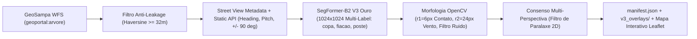
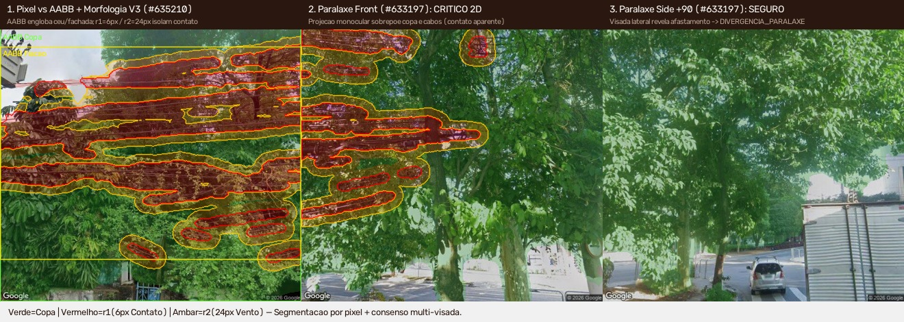
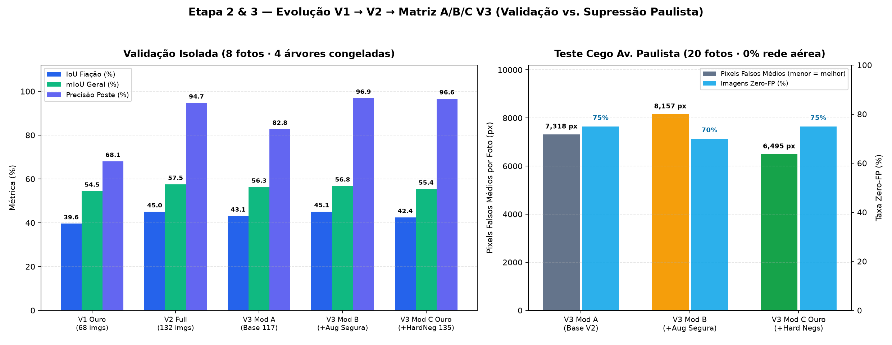
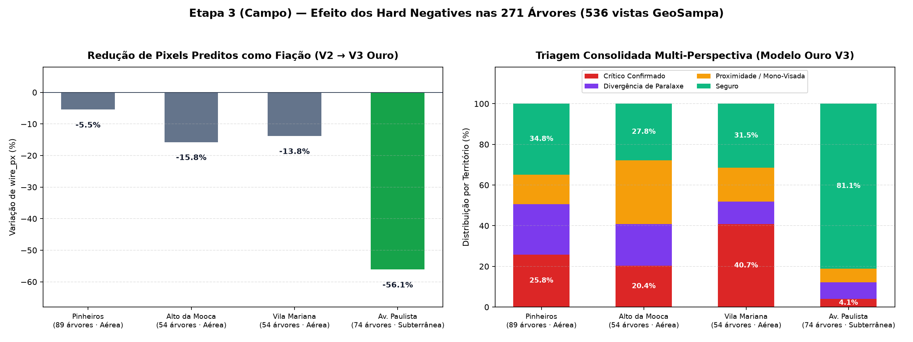
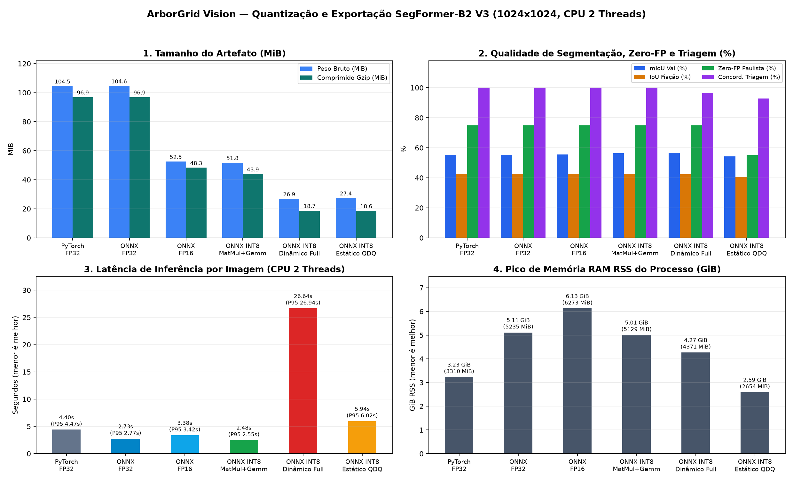

# ArborGrid Vision — Applied Computer Vision (`arborgrid-vision/`)

Módulo de auditoria preventiva de conflitos entre a arborização viária de São Paulo e a rede aérea de distribuição elétrica, combinando ingestão geoespacial oficial (PMSP GeoSampa WFS / SISGAU), triangulação multi-perspectiva (Street View API), segmentação semântica multi-label em alta resolução (`SegFormer-B2 1024×1024`) e morfologia matemática determinística em OpenCV.

---

## 1. Integrantes e Conexão com o Ecossistema ArborGrid SP

- **Grupo:** Equipe CitizenTech 4ES (FIAP Global Solution 2026.2 — *Applied Computer Vision*).
- **Conexão com o MVP ([`../README.md`](../README.md)):** gera o manifesto operacional georreferenciado ([`dataset/sp_geosampa_api/manifest.json`](dataset/sp_geosampa_api/manifest.json)) e a triagem multi-perspectiva (`CRITICO_CONFIRMADO`, `DIVERGENCIA_PARALAXE`, `PROXIMIDADE`, `SEGURO`) consumidos pelo backend/mapa em [`webapp/`](../webapp/), pelo copiloto técnico (`ArborGridInspector`) em [`llm-assistant/`](../llm-assistant/) e pelos pipelines territoriais em [`data-processing/`](../data-processing/).

---

## 2. Arquitetura do Pipeline Ponta a Ponta

> *Detalhamento matemático (trigonometria esférica, `MultiLabelSegLoss`, justificativa `1024×1024`, filtros morfológicos V3 e exemplos de paralaxe) em [`ARQUITETURA_PIPELINE.md`](ARQUITETURA_PIPELINE.md).*





---

## 3. Estratégia de Dados (Divisão em 2 Metades + Pacote 3 Hard Negatives)

O dataset consolidado cobre `143` fotografias curadas manualmente no `X-AnyLabeling` + `20` fotografias de teste cego na Av. Paulista + `271` árvores (`536` vistas) auditadas em campo, construído em 4 etapas incrementais:

1. **Pré-segmentação inicial com modelo genérico (`pacote_1_prelabel/`, [`01_coleta_geosampa_e_prelabel_generico.ipynb`](01_coleta_geosampa_e_prelabel_generico.ipynb)):**
   - O backbone *zero-shot* `SegFormer-B2 Cityscapes` (`vegetation #8` filtrada → `copa`; `pole #5` → `poste`) foi combinado com `Black-Hat (9×9) + Line Segment Detector (LSD)` em OpenCV para detectar `fiacao`.
   - Sobre o gabarito do Pacote 1 (curado manualmente com base nessa própria segmentação), entregou `97,5%` de IoU direto em copas — **poupando quase todo o contorno manual de árvores** — mas apenas `8,3%` em fios.
2. **Separação do dataset residencial em 2 metades (`pacote_1/` e `pacote_2/`):**
   - Divisão agrupada por `geosampa_id` para validar o protocolo na 1ª metade sem vazamento entre ângulos da mesma árvore.
3. **Salto para `1024×1024`, modelo intermediário (`V1 Ouro`) e pré-labeling da 2ª metade:**
   - Após concluir o Pacote 1 e diagnosticar o *sub-pixel aliasing* do mapa latente $1/4$ (`640 → 160×160`) e o limite de VRAM local (`800×800`), migramos o treino para `1024×1024` (`256×256` latente) no Colab `A100/L4`.
   - Esse modelo intermediário `V1 Ouro` foi usado em [`02_ablation_v1_resolucao_e_expansao_v2.ipynb`](02_ablation_v1_resolucao_e_expansao_v2.ipynb) para pré-rotular o Pacote 2 em alta resolução antes da revisão final (`V2 Full`).
4. **Pacote 3 (`Hard Negatives Paulista`) após concluir o Pacote 2:**
   - Ao auditar o `V2 Full` na Av. Paulista (rede 100% subterrânea), adicionamos o Pacote 3 com cenas negativas sem fiação para suprimir falsos positivos em fachadas metálicas e brises (`V3 Ouro`).

| Recorte / Partição | Finalidade | Quantidade | Observação Técnica |
| :--- | :--- | :---: | :--- |
| `pacote_1/` (1ª metade) | Treino intermediário `V1` (`60`) + Validação fixa (`8`) | `68` imagens | Separação estrita por `geosampa_id` (`597616`, `597652`, `597668`, `597842`) — zero vazamento. |
| `pacote_2/` (2ª metade) | Pré-label `V1 Ouro` + curadoria final (`V2 Full`) | `57` imagens | Curadoria sobre as predições `1024×1024` do modelo `V1` após descarte de oclusão extrema. |
| `pacote_3_hard_negatives/` | Treino contra falsos alarmes pós-`Pacote 2` | `18` imagens | `9` árvores na Av. Paulista sem fiação aérea (frisos, esquadrias e fachadas espelhadas). |
| Teste Cego Av. Paulista | Validação negativa inédita | `20` imagens | Medição isolada de falsos positivos de fiação (`Zero-FP Rate` e pixels falsos médios). |
| Operação Territorial V3 | Inferência completa no mapa | `271` árvores (`536` vistas) | Pinheiros (`89`), Alto da Mooca (`54`), Vila Mariana (`54`), Av. Paulista (`74`); `88,2%` sem inspeção recente no SISGAU. |

> *Governança legal e citações em [`FONTES_DE_DADOS.md`](FONTES_DE_DADOS.md) | Protocolo operacional de curadoria no X-AnyLabeling em [`GUIA_LABELING_EQUIPE.md`](GUIA_LABELING_EQUIPE.md).*

---

## 4. Evolução Experimental (`V1 → V2 → V3 Ouro`) e Validação na Av. Paulista

> *Narrativa experimental completa com provas visuais de cada etapa em [`EXPLORACAO_MODELOS_E_QUANTIZACAO.md`](EXPLORACAO_MODELOS_E_QUANTIZACAO.md).*



| Geração / Experimento | Dados de Treino (`1024×1024`) | IoU Fiação | IoU Copa | Precisão Poste | mIoU Geral | Paulista Zero-FP (Cego) |
| :--- | :--- | :---: | :---: | :---: | :---: | :---: |
| `V1 Base` (Pré-label Genérico) | `60` imgs (Segmentação inicial GPU) | `3,97%` | `91,25%` | `27,67%` | `36,00%` | — |
| `V1 Intermediário` (Ouro) | `60` imgs (Pacote 1 — 1ª metade curada) | `39,60%` | `91,43%` | `68,07%` | `54,48%` | — |
| `V2 Full` | `124` imgs (Pacote 1 + Pacote 2 @ L4) | `45,03%` | `92,68%` | `94,71%` | `57,55%` | Alucinações em fachadas |
| `V3 Modelo A` (Base) | `117` imgs (Pacotes 1 + 2 curados) | `43,11%` | `92,84%` | `82,75%` | `56,32%` | `75,0%` (`7.318 px` FP) |
| `V3 Modelo B` (+Aug Segura) | `117` imgs (+`HSV ±5%`, `rot ±3°`) | `45,13%` | `92,86%` | `96,90%` | `56,82%` | `70,0%` (`8.157 px` FP) |
| **`V3 Modelo C (Ouro Final)`** | **`135` imgs** (`+Pacote 3 Hard Neg.`) | **`42,44%`** | **`92,86%`** | **`96,64%`** | **`55,42%`** | **`75,0%` (`6.495 px` FP)** |

### Impacto Empírico em Campo (`271` árvores · `536` vistas)



- Ao treinar com o Pacote 3 (`Hard Negative Mining`), o **`Modelo C V3`** reduziu os pixels falsamente segmentados como fiação na Av. Paulista (`74` árvores) em **`-56,11%`** (`586.765 → 257.508 px`), classificando `81,1%` (`60/74`) como `SEGURO` e isolando apenas `3` críticos confirmados (`4,1%`) nos cruzamentos com vias transversais de rede aérea — contra `20,4%` (Mooca), `25,8%` (Pinheiros) e `40,7%` (Vila Mariana).

---

## 5. Quantização ONNX e Decisão de Hospedagem na Web

Avaliamos `6` variantes do `SegFormer-B2 V3 (1024×1024)` em subprocessos isolados na CPU limitada a `2 threads` ([`04_quantizacao_onnx_e_benchmark_cpu.ipynb`](04_quantizacao_onnx_e_benchmark_cpu.ipynb)) para decidir entre inferência no servidor compartilhado ou execução cliente na Web:



| Variante | Artefato | Disco | Gzip Web | Pico RAM RSS | Latência CPU `2t` | mIoU Val | IoU Fiação | Zero-FP Paulista | Triagem V3 |
| :--- | :--- | ---: | ---: | ---: | ---: | ---: | ---: | ---: | ---: |
| `pytorch_fp32` | `.pt` original | `104,5 MiB` | `96,9 MiB` | `3.310 MiB` | `4,40s` | `55,41%` | `42,44%` | `75,0%` | `100,0%` |
| `onnx_fp32` | `segformer_v3_fp32.onnx` | `104,6 MiB` | `96,9 MiB` | `5.235 MiB` | `2,73s` | `55,41%` | `42,44%` | `75,0%` | `100,0%` |
| `onnx_fp16` | `segformer_v3_fp16.onnx` | `52,5 MiB` | `48,3 MiB` | `6.273 MiB` | `3,38s` | `55,43%` | `42,44%` | `75,0%` | `100,0%` |
| **`onnx_int8_dyn_matmul`** | `segformer_v3_int8_dyn_matmul.onnx` | **`51,8 MiB`** | **`43,9 MiB`** | `5.129 MiB` | **`2,48s`** | **`56,28%`** | **`42,55%`** | **`75,0%`** | **`100,0%` (`28/28`)** |
| `onnx_int8_dynamic` | `segformer_v3_int8_dynamic.onnx` | `26,9 MiB` | `18,7 MiB` | `4.371 MiB` | `26,64s` | `56,66%` | `42,40%` | `75,0%` | `96,4%` (`27/28`) |
| `onnx_int8_static_qdq` | `segformer_v3_int8_static_qdq.onnx` | `27,4 MiB` | `18,6 MiB` | `2.654 MiB` | `5,94s` | `54,25%` | `40,41%` | `55,0%` | `92,9%` (`26/28`) |

- **Decisão arquitetural:** mesmo a opção mais enxuta em RAM (`onnx_int8_static_qdq`, `2.654 MiB` RSS) degrada o Zero-FP da Paulista (`75,0% → 55,0%`) e disputa memória na VM com o `Qwen 1.7B Q4_K_M` (`2.015 MiB` base). Por isso adotamos **`onnx_int8_dyn_matmul`** (`51,8 MiB` / `43,9 MiB` Gzip, `2,48s`, `100,0%` de concordância de triagem) para execução sob demanda no navegador (`onnxruntime-web`), preservando `100%` da RAM da VM para a API e o LLM.

---

## 6. Estrutura e Reprodução

O módulo adota uma arquitetura **Dual-Track MLOps**, separando a **Trilha de Pesquisa Científica (Notebooks Numerados)** da **Trilha de Operação Contínua (CLI Declarativa Idempotente)**:

```text
arborgrid-vision/
├── README.md                                              # Guia principal e ficha resumida
├── ARQUITETURA_PIPELINE.md                                # Geometria, SegFormer-B2, Loss, OpenCV V3 e contratos
├── EXPLORACAO_MODELOS_E_QUANTIZACAO.md                    # Fluxo decisório V1->V2->V3->ONNX e registro PRB-*
├── FONTES_DE_DADOS.md                                     # Licenciamento (GeoSampa, © Google, Esri)
├── GUIA_LABELING_EQUIPE.md                                # Manual operacional de curadoria no X-AnyLabeling
├── pyproject.toml                                         # Configuração reprodutível de ambiente (uv sync / PyTorch CU128 + ONNX)
├── 01_coleta_geosampa_e_prelabel_generico.ipynb           # [Pesquisa 01] Coleta WFS + Street View e Auditoria do Pré-Label Genérico
├── 02_ablation_v1_resolucao_e_expansao_v2.ipynb           # [Pesquisa 02] Ablation 640px vs 1024px (V1) e Expansão do Pacote 2 (V2)
├── 03_avaliacao_v3_auditoria_e_inferencia_campo.ipynb     # [Pesquisa 03] Avaliação V3 (Av. Paulista), Anomalias de Fiação e Paralaxe 2D
├── 04_quantizacao_onnx_e_benchmark_cpu.ipynb              # [Pesquisa 04] Quantização ONNX INT8 (MatMulInteger) e Benchmark CPU
├── 05_figuras_e_mosaicos_documentacao.ipynb               # [Pesquisa 05] Geração Reprodutível dos 6 Gráficos (.png) e 5 Mosaicos (.jpg)
├── colab/                                                 # Notebooks dedicados ao treinamento pesado em GPU Cloud (Google Colab)
│   ├── Colab_01_Ablation_V1_e_Treino_V2_1024px.ipynb      # Treino 1024x1024 do Modelo V1 (Pacote 1) e Modelo V2 (Pacotes 1+2)
│   └── Colab_02_Treino_Final_V3_ABC_1024px.ipynb          # Treino Final 1024x1024 do Modelo V3 (Pacotes 1+2+3) e Benchmark A/B/C
├── scripts/                                               # Módulos compartilhados e automação operacional enxuta
│   ├── config.py                                          # Fonte única de diretórios, checkpoints, URLs e limiares V3
│   ├── vision_utils.py                                    # Motor SegFormer (.pt / .onnx), Morfologia r1=6/r2=24 e Tipografia UTF-8
│   ├── run_operational_pipeline.py                        # CLI Operacional: regions.json -> GeoSampa WFS -> Street View -> V3 -> WebApp
│   ├── prepare_xanylabeling_workspace.py                  # Preparação de lotes para curadoria humana no X-AnyLabeling
│   └── export_xanylabeling_to_yolo.py                     # Conversor de polígonos JSON (X-AnyLabeling) para máscaras/YOLO
├── reports/                                               # Relatórios experimentais JSON versionados (93 KB) consumidos pelos notebooks
├── assets/                                                # Gráficos analíticos (.png) e mosaicos fotográficos acentuados em UTF-8 (.jpg)
├── dataset/
│   ├── arborgrid_v3_gold_dataset.zip                      # Dataset consolidado (Pacotes 1, 2 e 3) pronto para upload no Colab
│   ├── sp_geosampa_api/
│   │   ├── regions.json                                   # Definição declarativa de zonas amostrais (Pinheiros, Mooca, Paulista, etc.)
│   │   ├── manifest.json                                  # Inventário auditado de 271 árvores (536 imagens Street View)
│   │   ├── images/                                        # Imagens Street View brutas (640x640)
│   │   └── v3_overlays/                                   # Overlays segmentados pelo Modelo V3 Final
│   └── workspace_xanylabeling/                            # Pacotes de anotação manual (pacote_1_prelabel, pacote_1, pacote_2, pacote_3)
└── models/
    └── segformer_v3_int8_dyn_matmul.onnx                  # Modelo V3 Quantizado INT8 Dinâmico (51,8 MiB — versionado diretamente no Git)
```

### Como Reproduzir o Ambiente e Executar

1. **Instalação Reprodutível com `uv`**:
   ```bash
   cd arborgrid-vision
   uv sync
   ```
2. **Diagnóstico e Execução da Pipeline Operacional (`run_operational_pipeline.py`)**:
   ```bash
   # Exibe a tabela de status das 8 regiões, imagens em disco e triagem V3 consolidada
   uv run python scripts/run_operational_pipeline.py --status

   # Executa inferência V3 (.pt GPU ou fallback automático para ONNX INT8 CPU) e sincroniza com o WebApp
   uv run python scripts/run_operational_pipeline.py --infer-v3 --sync-webapp

   # Expande o inventário com novas árvores do GeoSampa WFS em uma região, baixa Street View e roda V3
   uv run python scripts/run_operational_pipeline.py --region campo_belo --add-trees 15 --download-missing --infer-v3 --sync-webapp
   ```
