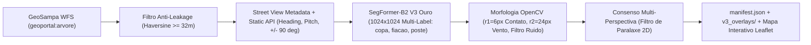

# ArborGrid Vision — Applied Computer Vision (`arborgrid-vision/`)

Módulo de auditoria preventiva de conflitos entre a **arborização viária de São Paulo** e a **rede aérea de distribuição elétrica**, combinando ingestão geoespacial oficial (**PMSP GeoSampa WFS / SISGAU**), triangulação multi-perspectiva (**Street View API**), segmentação semântica multi-label em alta resolução (**`SegFormer-B2 1024×1024`**) e morfologia matemática determinística em **OpenCV**.

---

## 1. Integrantes e Conexão com o Ecossistema ArborGrid SP

- **Grupo:** Equipe CitizenTech 4ES (FIAP Global Solution 2026.2 — *Applied Computer Vision*).
- **Conexão com o MVP ([`../README.md`](../README.md)):** Gera o manifesto operacional georreferenciado ([`dataset/sp_geosampa_api/manifest.json`](dataset/sp_geosampa_api/manifest.json)) e a triagem multi-perspectiva (`CRITICO_CONFIRMADO`, `DIVERGENCIA_PARALAXE`, `PROXIMIDADE`, `SEGURO`) consumidos diretamente pelo backend/mapa em [`webapp/`](../webapp/), pelo copiloto técnico (`ArborGridInspector`) em [`llm-assistant/`](../llm-assistant/) e pelos pipelines de priorização territorial em [`data-processing/`](../data-processing/).

---

## 2. Arquitetura do Pipeline Ponta a Ponta

> *Detalhamento matemático completo (trigonometria esférica, `MultiLabelSegLoss`, justificativa `1024×1024` contra Sub-pixel Aliasing, filtros morfológicos V3 e contratos JSON/GeoJSON) em **[`ARQUITETURA_PIPELINE.md`](ARQUITETURA_PIPELINE.md)**.*



---

## 3. Dados Curados, Territórios e Governança

O conjunto consolidado cobre **`143` fotografias curadas manualmente** no `X-AnyLabeling` + **`20` fotografias de teste cego** na Av. Paulista + **`271` árvores (`536` vistas)** auditadas em campo:

| Recorte / Partição | Finalidade | Quantidade | Observação Técnica |
| :--- | :--- | :---: | :--- |
| **Pacote 1 (Ouro Inicial)** | Treino (`60`) + Validação fixa (`8`) | `68` imagens | Separação estrita por `geosampa_id` (`597616`, `597652`, `597668`, `597842`) — zero vazamento. |
| **Pacote 2 (Expansão Curada)** | Treino multi-bairro | `57` imagens | Curadoria integral após descarte (`_delete_`) de amostras com oclusão extrema. |
| **Pacote 3 (Hard Negatives Paulista)** | Treino contra falsos alarmes | `18` imagens | `9` árvores na Av. Paulista sem fiação aérea (frisos, esquadrias e fachadas espelhadas). |
| **Teste Cego Av. Paulista** | Validação negativa inédita | `20` imagens | Medição isolada de falsos positivos de fiação (`Zero-FP Rate` e pixels falsos médios). |
| **Operação Territorial V3** | Inferência completa no mapa | `271` árvores (`536` vistas) | **Pinheiros** (`89`), **Alto da Mooca** (`54`), **Vila Mariana** (`54`), **Av. Paulista** (`74`); **`88,2%`** sem data de inspeção no SISGAU. |

> *Governança legal, citações e atribuições em **[`FONTES_DE_DADOS.md`](FONTES_DE_DADOS.md)** | Manual de anotação utilizado pela equipe em **[`GUIA_LABELING_EQUIPE.md`](GUIA_LABELING_EQUIPE.md)**.*

---

## 4. Evolução Experimental (`V1 → V2 → V3 Ouro`) e Validação na Av. Paulista

> *Narrativa experimental completa em fluxo decisório (incluindo gargalo de VRAM/PCIe na `RTX 3060 Ti`, ablação `640` vs. `1024 px` e matriz A/B/C completa) em **[`EXPLORACAO_MODELOS_E_QUANTIZACAO.md`](EXPLORACAO_MODELOS_E_QUANTIZACAO.md)**.*


| Geração / Experimento | Dados de Treino (`1024×1024`) | IoU Fiação | IoU Copa | Precisão Poste | mIoU Geral | Paulista Zero-FP (Cego) |
| :--- | :--- | :---: | :---: | :---: | :---: | :---: |
| **V1 Modelo A** | `60` imgs (Pré-label GPU bruto) | `3,97%` | `91,25%` | `27,67%` | `36,00%` | — |
| **V1 Modelo B** | `60` imgs (Rotulagem equipe inicial) | `22,08%` | `91,50%` | `96,12%` | `44,96%` | — |
| **V1 Modelo C (Ouro)** | `60` imgs (Curadoria Ouro integral) | `39,60%` | `91,43%` | `68,07%` | `54,48%` | — |
| **V2 Full** | `124` imgs (Pacotes 1 + 2 @ L4) | `45,03%` | `92,68%` | `94,71%` | **`57,55%`** | Alucinações em fachadas |
| **V3 Modelo A (Base)** | `117` imgs (Pacotes 1 + 2 curados) | `43,11%` | `92,84%` | `82,75%` | `56,32%` | `75,0%` (`7.318 px` FP) |
| **V3 Modelo B (+Aug Segura)** | `117` imgs (+`HSV ±5%`, `rot ±3°`) | **`45,13%`** | `92,86%` | **`96,90%`** | `56,82%` | `70,0%` (`8.157 px` FP) |
| **V3 Modelo C (Ouro Final)** | **`135` imgs** (`+Pacote 3 Hard Neg.`) | **`42,44%`** | **`92,86%`** | **`96,64%`** | **`55,42%`** | **`75,0%` (`6.495 px` FP)** |

### Impacto Empírico em Campo (`271` árvores · `536` vistas)


- Ao treinar com o **Pacote 3 (`Hard Negative Mining`)**, o **Modelo C V3** reduziu os pixels falsamente segmentados como fiação ao longo de todo o corredor subterrâneo da **Av. Paulista (`74` árvores)** em **`-56,11%`** (`586.765 → 257.508 px`), classificando **`81,1%` (`60/74`) como `SEGURO`** e isolando apenas **`3` críticos confirmados (`4,1%`)** exatamente em cruzamentos com vias transversais de rede aérea — contra **`20,4%` (Mooca), `25,8%` (Pinheiros) e `40,7%` (Vila Mariana)**.

---

## 5. Quantização ONNX e Decisão de Hospedagem na Web

Avaliamos **6 variantes do `SegFormer-B2 V3 (1024×1024)`** em processos isolados na **CPU limitada a `2 threads`** ([`scripts/benchmark_quantization.py`](scripts/benchmark_quantization.py)) para decidir entre inferência no servidor compartilhado ou execução cliente na Web:


| Variante | Artefato | Disco | Gzip Web | Pico RAM RSS | Latência CPU `2t` | mIoU Val | IoU Fiação | Zero-FP Paulista | Triagem V3 |
| :--- | :--- | ---: | ---: | ---: | ---: | ---: | ---: | ---: | ---: |
| `pytorch_fp32` | `.pt` original | `104,5 MiB` | `96,9 MiB` | `3.310 MiB` | `4,40s` | `55,41%` | `42,44%` | `75,0%` | `100,0%` |
| `onnx_fp32` | `segformer_v3_fp32.onnx` | `104,6 MiB` | `96,9 MiB` | `5.235 MiB` | `2,73s` | `55,41%` | `42,44%` | `75,0%` | `100,0%` |
| `onnx_fp16` | `segformer_v3_fp16.onnx` | `52,5 MiB` | `48,3 MiB` | `6.273 MiB` | `3,38s` | `55,43%` | `42,44%` | `75,0%` | `100,0%` |
| **`onnx_int8_dyn_matmul`** | `segformer_v3_int8_dyn_matmul.onnx` | **`51,8 MiB`** | **`43,9 MiB`** | `5.129 MiB` | **`2,48s`** | **`56,28%`** | **`42,55%`** | **`75,0%`** | **`100,0%` (`28/28`)** |
| `onnx_int8_dynamic` | `segformer_v3_int8_dynamic.onnx` | `26,9 MiB` | `18,7 MiB` | `4.371 MiB` | `26,64s` | `56,66%` | `42,40%` | `75,0%` | `96,4%` (`27/28`) |
| `onnx_int8_static_qdq` | `segformer_v3_int8_static_qdq.onnx` | `27,4 MiB` | `18,6 MiB` | **`2.654 MiB`** | `5,94s` | `54,25%` | `40,41%` | `55,0%` | `92,9%` (`26/28`) |

- **Decisão Arquitetural:** Mesmo a opção mais enxuta em RAM (`onnx_int8_static_qdq`, `2.654 MiB` RSS) degrada o **Zero-FP da Paulista (`75,0% → 55,0%`)** e consome memória demais para rodar na mesma VM ao lado do `Qwen 1.7B Q4_K_M` (`2.015 MiB` base) e da stack Web/Observabilidade. Portanto, adotamos **`onnx_int8_dyn_matmul`** (**`51,8 MiB` / `43,9 MiB` Gzip**, **`2,48s`**, **`100,0%` de concordância de triagem**) para **hospedagem e execução na Web** sob demanda no navegador (`onnxruntime-web`), preservando `100%` da RAM da VM para a API e o LLM.

---

## 6. Estrutura e Reprodução

```text
arborgrid-vision/
├── README.md                                        # Guia principal e ficha resumida
├── ARQUITETURA_PIPELINE.md                          # Geometria, SegFormer-B2, Loss, OpenCV V3 e contratos
├── EXPLORACAO_MODELOS_E_QUANTIZACAO.md              # Fluxo decisório V1->V2->V3->ONNX e registro PRB-*
├── FONTES_DE_DADOS.md                               # Licenciamento (GeoSampa, © Google, Esri)
├── GUIA_LABELING_EQUIPE.md                          # Manual operacional de curadoria no X-AnyLabeling
├── ArborGrid_Training_Colab_1024px_Final_A_B.ipynb  # Notebook autônomo do Estudo Final A/B/C (Colab L4/A100)
├── assets/                                          # Gráficos reproduzíveis em Matplotlib (sem fotos Street View)
└── scripts/                                         # Pipelines de coleta, auditoria, inferência V3, mapa e quantização
```

```powershell
cd arborgrid-vision

# 1. Executar inferência V3 Ouro e atualizar manifesto + mapa interativo
.venv\Scripts\python.exe scripts\run_v3_inference_and_update_map.py

# 2. Auditar anomalias nas 143 imagens curadas do dataset V3
.venv\Scripts\python.exe scripts\audit_anomalies_v3_dataset.py

# 3. Rodar benchmark isolado de quantização ONNX (CPU 2 threads) ou apenas re-sumarizar
.venv\Scripts\python.exe scripts\benchmark_quantization.py
.venv\Scripts\python.exe scripts\benchmark_quantization.py --summarize-only

# 4. Regenerar gráficos da documentação em assets/
.venv\Scripts\python.exe scripts\build_docs_charts.py
```
