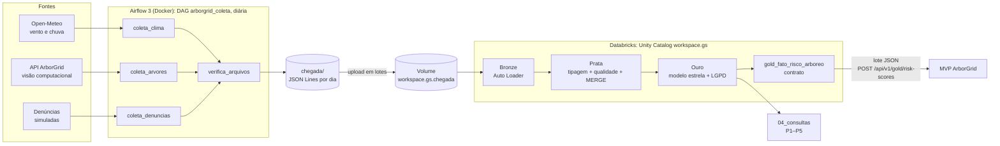
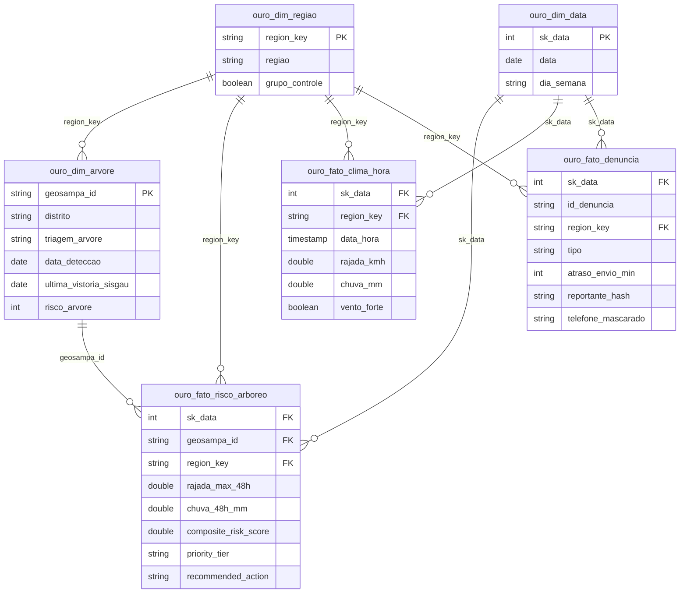

# ArborGrid: Big Data Architecture & Data Integration

Pasta **exclusiva da parte de Big Data** do projeto ArborGrid (FIAP Global Solution - CitizenTech, 4ES).
Aqui está o pipeline completo: coleta orquestrada no **Airflow**, arquitetura **Medallion** no **Databricks**
(Bronze → Prata → Ouro), modelo dimensional, proteção de dados (LGPD) e o contrato que entrega a camada Ouro ao MVP.

---

## 1. Integrantes

| Nome | RM | Parte |
|---|---|---|
| Kayky Oliveira Schunck | 99756 | **Big Data** (esta pasta) |
| Lorenzo Gomes Andreata | 551117 | |
| Lucas Moreno Matheus | 97158 | |

---

## 2. O produto em uma frase

> **O ArborGrid previne quedas de árvores sobre a rede elétrica de São Paulo:** cruza a visão computacional das
> árvores com a previsão de vento e **alerta a Defesa Civil e a Enel antes da tempestade**, sem depender da denúncia
> do morador, que muitas vezes nem consegue ligar quando falta sinal. **Prever é o que salva vidas.**

---

## 3. Perguntas de negócio (MVP)

Cada pergunta é respondida por uma consulta SQL em [`databricks/04_consultas.ipynb`](databricks/04_consultas.ipynb).

| # | Pergunta | Resposta (dados de 17/11/2026) |
|---|---|---|
| **P1** | A próxima tempestade vai atingir o meu bairro? Onde as árvores podem cair sobre a fiação nas próximas 48h? | 262 árvores monitoradas em 4 regiões, 106 críticas. A Paulista (rede subterrânea, grupo de controle) tem score médio de 30,2 contra cerca de 58 nas demais |
| **P2** | Quando o risco chega, e quanto tempo eu tenho para me preparar? | Pico de rajada às 17h, com **17 horas de antecedência** |
| **P3** | Quantas árvores perigosas o ArborGrid encontrou sozinho, antes de qualquer morador denunciar? | **74 de 106 críticas (70%)** sem nenhuma denúncia num raio de 150 m; denúncias chegam com até 143 min de atraso |
| **P4** | Onde a Defesa Civil e a Enel precisam agir primeiro? | Top 10 com score 80, todas com contato galho × fio, 8 delas nunca vistoriadas |
| **P5** | Sem prevenção, quantas árvores críticas ficariam expostas, e quantas podas precisam ser feitas antes? | 106 podas prioritárias; **88,2%** das árvores nunca foram vistoriadas pela Prefeitura |

---

## 4. Fontes de dados

| Fonte | Tipo | O que traz | Acesso |
|---|---|---|---|
| **Open-Meteo** (forecast) | API pública | Rajada, vento e chuva por hora, 3 dias à frente, nas 4 regiões | sem chave |
| **API ArborGrid** (`GET /api/v1/inspections`) | API do MVP (visão computacional) | Árvores detectadas no Street View: triagem, contato galho × fio, confiança, `model_version`, última vistoria SISGAU | token Bearer (Variable do Airflow) |
| **Denúncias de moradores** | gerada pela DAG (simulação) | Relatos pelo celular com horário do relato e do envio, GPS e tipo | — |

> ⚠️ **Todos os nomes, e-mails e telefones em `chegada/denuncias/` são FICTÍCIOS**, gerados de forma
> determinística pela própria DAG (`dags/arborgrid/fontes.py`). Nenhum dado pessoal real está neste repositório.
> As denúncias simuladas incluem de propósito registros com defeito (sem GPS, tipo inválido, envio antes do relato,
> duplicado) para exercitar as regras de qualidade da Prata.

---

## 5. Arquitetura



O Databricks Free Edition não alcança o Airflow local, então os arquivos da `chegada/` são enviados ao Volume
em lotes. O Auto Loader garante que cada arquivo seja lido **uma única vez**, mesmo que o upload se repita.

---

## 6. Orquestração (Airflow)

Arquivo: [`dags/arborgrid_coleta.py`](dags/arborgrid_coleta.py), com as funções em [`dags/arborgrid/`](dags/arborgrid/)

| Item | Configuração |
|---|---|
| Agendamento | `@daily`, `start_date` 10/11/2026, `catchup=True` (reprocessa dias passados) |
| Concorrência | `max_active_runs=1` |
| Falhas | `retries=2`, `retry_delay=2 min`, `on_failure_callback` registra tarefa, dia e tentativa |
| Paralelismo | as 3 coletas rodam em paralelo; `verifica_arquivos` só passa se os 3 arquivos do dia existirem e não estiverem vazios |
| Saída | `chegada/<fonte>/<fonte>_<AAAA-MM-DD>.json` (JSON Lines), gravado em arquivo temporário e renomeado (escrita atômica) |
| Segredos | URL e tokens lidos de **Airflow Variables** (criptografadas pela Fernet key); nada no código |

Variables usadas: `arborgrid_api_url`, `arborgrid_api_token`, `arborgrid_app_token`.

---

## 7. Camadas Medallion

| Camada | Notebook | O que faz | Resultado |
|---|---|---|---|
| Setup | `00_setup` | Cria o schema `workspace.gs` e o Volume `chegada` | — |
| **Bronze** | `01_bronze` | Auto Loader (`cloudFiles`, `availableNow`) com checkpoint: ingestão **incremental**, dado bruto + `arquivo_origem` + `carregado_em` | 2º lote somou só os arquivos novos; 3ª execução não duplicou nada |
| **Prata** | `02_prata` | `from_json` + `explode` das listas, tipagem, fuso `America/Sao_Paulo`, deduplicação (`ROW_NUMBER`), **11 regras de qualidade** e `MERGE` idempotente | 505 vistas de árvores, 960 horas de clima, 62 denúncias; 2º MERGE = 0 alterações |
| **Ouro** | `03_ouro` | Modelo estrela, score de risco, LGPD e 10 checagens de integridade | 10/10 checagens verdadeiras |
| Consultas | `04_consultas` | P1–P5 | ver seção 3 |
| Contrato | `05_contrato_mvp` | View para o MVP + exportação do lote | 262 árvores exportadas |

**Regras de qualidade da Prata** (registros barrados ficam com `motivo_rejeicao` e não entram):

| Fonte | Regras |
|---|---|
| Árvores | A1 chave ou data nula; A2 localização fora de SP; A3 triagem fora do catálogo; **A4 confiança < 0,7** (31 vistas barradas) |
| Clima | C1 chave nula; C2 rajada inválida (< 0 ou > 250 km/h); C3 chuva inválida |
| Denúncias | D1 chave ou data nula; D2 sem GPS ou fora de SP; D3 tipo fora do catálogo; D4 envio antes do relato (8 barradas em cada D2, D3 e D4) |

---

## 8. Modelo dimensional (Ouro)



| Tabela | Grão |
|---|---|
| `ouro_fato_risco_arboreo` | árvore × dia de referência (risco das 48h seguintes) |
| `ouro_fato_clima_hora` | região × hora |
| `ouro_fato_denuncia` | uma denúncia |
| `ouro_dim_arvore`, `ouro_dim_regiao`, `ouro_dim_data` | uma árvore, uma região, um dia |

**Score de risco (0–100)** = `risco_arvore × fator_vento`, limitado a 100.
- `risco_arvore`: CRITICO 70, PROXIMIDADE 40, SEGURO 10; **+15** se há contato direto galho × fio; **+15** se nunca houve vistoria ou a última tem mais de 10 anos
- `fator_vento` (maior rajada prevista em 48h): < 30 km/h ×0,6; 30–49 ×0,8; 50–69 ×1,0; ≥ 70 ×1,2
- Prioridade: **URGENTE** ≥ 85, **ALTA** 65–84, **MEDIA** 40–64, **BAIXA** < 40

---

## 9. LGPD e segurança

| Dado pessoal | Bronze | Prata | Ouro |
|---|---|---|---|
| Nome do morador | sim | **removido** (minimização) | não |
| E-mail | sim | sim | **hash SHA-256 com sal** (conta reincidência sem identificar a pessoa) |
| Telefone | sim | sim | **máscara** `(11) *****-1234` |
| GPS do celular | sim | sim | **generalizado** para 3 casas decimais (~100 m) |

**Nunca vão para o repositório:** o `.env` (Fernet key), os tokens das APIs (ficam nas Airflow Variables),
o **sal** da LGPD (fica em secret scope ou no arquivo `_controle/sal.txt` do Volume) e os logs do Airflow.

---

## 10. Contrato com o MVP

View **`workspace.gs.gold_fato_risco_arboreo`**: uma linha por árvore, com o risco do dia de referência mais recente.

| Coluna | Tipo | Significado |
|---|---|---|
| `geosampa_id` | STRING | árvore no cadastro da Prefeitura (chave do MERGE no MVP) |
| `distrito` | STRING | distrito oficial |
| `composite_risk_score` | DOUBLE (0–100) | score composto |
| `priority_tier` | STRING | URGENTE, ALTA, MEDIA ou BAIXA |
| `wind_gust_kmh` | DOUBLE | maior rajada prevista nas 48h |
| `precipitation_mm` | DOUBLE | chuva prevista nas 48h |
| `weather_observed_at` | STRING (ISO 8601) | hora do pico de rajada |
| `recommended_action` | STRING | ação recomendada para Defesa Civil / Enel |
| `audit_actor_hash` | STRING | identificador anonimizado do lote |

- **Frequência:** diária, depois da DAG e dos notebooks 01 → 05.
- **Entrega:** o notebook `05` exporta o lote no formato `GoldRiskBatchIn` (exemplo em
  [`amostras/gold_risk_scores_20261117.json`](amostras/gold_risk_scores_20261117.json), 262 árvores) e o script
  [`scripts/enviar_ouro_mvp.py`](scripts/enviar_ouro_mvp.py) publica em `POST /api/v1/gold/risk-scores`,
  com o token em variável de ambiente.

---

## 11. Estrutura da pasta

```
data-processing/
├── airflow/
│   └── docker-compose.yaml        Airflow 3.4 (LocalExecutor) + volume chegada/
├── amostras/                      uma amostra de cada fonte, o lote Ouro exportado e os payloads do contrato
│   └── gold_risk_scores_20261117.json
├── chegada/                       dados coletados pela DAG (o que foi enviado ao Volume)
│   ├── arvores/                   API ArborGrid, um arquivo por dia
│   ├── clima/                     Open-Meteo, um arquivo por dia
│   └── denuncias/                 denúncias FICTÍCIAS, um arquivo por dia
├── dags/
│   ├── arborgrid_coleta.py        DAG
│   └── arborgrid/                 config.py (regiões, URLs) e fontes.py (coletas)
├── databricks/                    notebooks 00 → 05 exportados COM as saídas
├── scripts/
│   └── enviar_ouro_mvp.py         envio do lote Ouro para a API do MVP
├── CONTRATO_API.md                contrato REST da API ArborGrid (inspeções e camada Gold)
└── README.md
```

---

## 12. Como reproduzir

**Airflow (local)**
1. Copie `airflow/docker-compose.yaml` para uma pasta de trabalho e crie ao lado as pastas `dags/`, `logs/`, `plugins/`, `config/` e `chegada/`. Copie o conteúdo de `dags/` desta pasta para lá.
2. Crie um `.env` (não versionado):
   ```
   AIRFLOW_UID=50000
   FERNET_KEY="<gerada com: python -c "from cryptography.fernet import Fernet; print(Fernet.generate_key().decode())">"
   ```
3. `docker compose up airflow-init` e depois `docker compose up -d`. Interface em `http://localhost:8080`.
4. Em **Admin → Variables**, crie `arborgrid_api_url` (ex.: `http://host.docker.internal`), `arborgrid_api_token` e `arborgrid_app_token`.
5. Suba a API ArborGrid (`python scripts/start_stack.py` na raiz do repositório) e ative a DAG `arborgrid_coleta`.

**Databricks**

6. Importe os notebooks de `databricks/` e rode o `00_setup`.
7. Envie os arquivos de `chegada/arvores`, `chegada/clima` e `chegada/denuncias` para as pastas de mesmo nome no Volume `/Volumes/workspace/gs/chegada/`.
8. Crie o arquivo `_controle/sal.txt` no Volume com um texto secreto qualquer (o sal da LGPD).
9. Rode os notebooks em ordem: `01_bronze` → `02_prata` → `03_ouro` → `04_consultas` → `05_contrato_mvp`.

**Envio ao MVP (opcional)**

10. Baixe o lote de `_export/` no Volume e rode:
    ```
    set ARBORGRID_API_URL=http://localhost
    set ARBORGRID_API_TOKEN=<token da API>
    python scripts/enviar_ouro_mvp.py gold_risk_scores_AAAAMMDD.json
    ```

---

## 13. Limitações conhecidas

- **Grade do Open-Meteo:** Pinheiros, Vila Mariana e Paulista caem na mesma célula do modelo e recebem a mesma previsão.
- **Imagens do Street View** são de 2022–2024; a triagem reflete a árvore naquela data, e o modelo precisa ser reavaliado periodicamente.
- **OpenStreetMap (hospitais) foi retirado:** a API Overpass ficou instável (406/502/timeout) em todos os servidores testados.
- **Dia 18/11:** a DAG já coletou esse dia, mas o Databricks foi carregado com os dias 10 a 17; os arquivos do dia 18 ficam como próximo lote.
- **271 × 262 árvores:** 9 árvores da API só tinham vistas com confiança < 0,7 (regra A4) e não entraram na Prata.
- **Grupo de controle:** a Paulista tem rede subterrânea, mas ainda aparecem 9 árvores críticas nas ruas laterais com fiação aérea.
- **API do MVP:** durante a coleta, a API ArborGrid rodou localmente e sem TLS. Hoje o MVP está publicado com HTTPS em https://arborgrid.duckdns.org, e o script de envio aponta para ele com `ARBORGRID_API_URL`.
