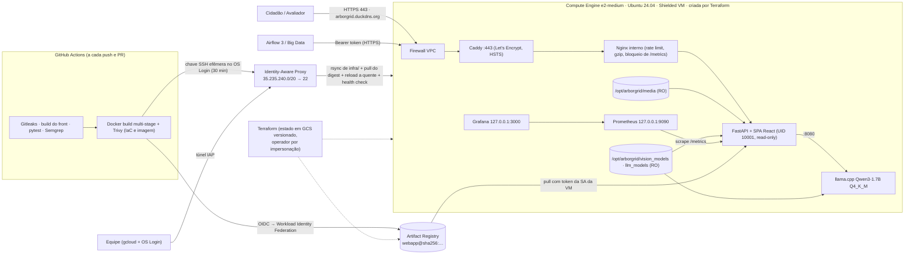

# Arquitetura Cloud, Segurança DevSecOps e Observabilidade — ArborGrid SP

Documento de referência para a disciplina **Secure DevOps Tools & Cloud Computing** (FIAP 4ES).

**Princípio da arquitetura:** nenhum segredo de longa duração e nenhuma porta administrativa na internet. O pipeline se autentica por OIDC (Workload Identity Federation), a imagem é construída e escaneada uma única vez e a VM executa exatamente aquele digest. Todo acesso SSH (CI e pessoas) passa pelo Identity-Aware Proxy com OS Login.

---

## 1. Diagrama da Arquitetura em Nuvem (Google Cloud Platform)



---

## 2. Matriz de Responsabilidade Compartilhada (Google Cloud vs. Equipe)

| Camada / Controle | Google Cloud | Equipe ArborGrid |
| :--- | :---: | :---: |
| Infraestrutura física, rede global, hipervisor e criptografia padrão em repouso (`pd-balanced`, Artifact Registry, Cloud Storage) | X | |
| Disponibilidade do IAP, do OS Login, do STS/IAM Credentials e rotação das chaves de assinatura OIDC↔GCP | X | |
| Provisionamento declarativo (`Terraform`), firewall (só 80/443 públicos; 22 apenas da faixa do IAP) e estado remoto versionado | | X |
| Hardening da VM: *Shielded VM* (Secure Boot, vTPM, Integrity Monitoring), OS Login, `block-project-ssh-keys`, service account própria com escopo de leitura do registry | | X |
| Container slim multi-stage, usuário não root (`UID 10001`), filesystem `read_only`, `cap_drop: ALL`, `no-new-privileges` | | X |
| Identidades e segredos: WIF no CI, impersonação no Terraform, chave SSH efêmera por execução; `ARBORGRID_API_TOKEN` e senha do Grafana só no `.env` da VM (fora do Git) | | X |
| Cadeia de suprimentos: Gitleaks, Semgrep e Trivy bloqueando o deploy; actions fixadas por SHA; Dependabot; imagem do LLM fixada por digest | | X |
| Conformidade LGPD, minimização e mídias Street View fora do repositório | | X |
| HTTPS: certificado Let's Encrypt renovado automaticamente pelo Caddy; domínio DuckDNS apontando para o IP estático | | X |

---

## 3. Localização dos Dados e Conformidade LGPD

O conjunto de dados hospedado (`manifest.json`) não contém dados pessoais; contudo, entradas digitadas pelo usuário no assistente e logs de acesso HTTP podem conter dados pessoais, tratados pelos controles abaixo:

- **Dados públicos na imagem (`manifest.json`):** coordenadas oficiais de árvores viárias públicas do GeoSampa (Decreto Municipal SP nº 57.576/2017), datas históricas de vistoria do SISGAU e contagens agregadas não identificáveis de pixels (`copa_px`, `wire_px`, `pole_px`).
- **Mídias visuais (`images/` e `v3_overlays/`):** fora do Git e da imagem (`.gitignore` e `.dockerignore`), enviadas uma vez à VM pelo bootstrap e montadas somente leitura (`/app/media:ro`), preservando o borramento nativo de rostos/placas e respeitando os Termos de Uso do Google Street View.
- **Identificadores anonimizados:** `pano_id` e atores operacionais enviados pela camada Gold recebem hash SHA-256 truncado (`pano_id_hash`, `audit_actor_hash`).
- **Perguntas ao assistente (`POST /api/v1/assistant/ask`):** a API mascara CPF, CNPJ, placa, telefone e e-mail antes de enviar o texto ao LLM e antes de devolvê-lo (`webapp/app/privacy.py`). As perguntas não são persistidas e o Uvicorn não registra corpos de requisição.
- **Upload de fotos na "Análise de Imagem":** processado exclusivamente no navegador (`ONNX Runtime Web`); a foto nunca sai do dispositivo.
- **Logs de acesso do Nginx:** registram IPs (dados pessoais sob a LGPD) e vivem só até a recriação do container; em produção, rotação e retenção limitada (`max-size` / `max-file`).
- **Região e transferência internacional:** `us-central1` (Iowa), com criptografia em repouso gerenciada pelo Google. Hospedar fora do Brasil configura transferência internacional (LGPD, art. 33); a alternativa nacional é `southamerica-east1` (São Paulo), com custo maior. Como a VM só persiste dados públicos e contagens não identificáveis, `us-central1` se justifica para o MVP.

---

## 4. Estimativa de Custo Mensal (Google Cloud `us-central1`)

Valores *on-demand* em USD (abatidos dos créditos da conta):

| Recurso | Especificação | Mensal 24/7 (USD) | Por hora |
| :--- | :--- | ---: | ---: |
| Computação | `1x e2-medium` (2 vCPU compartilhadas, 4 GB) | ~\$24,27 | \$0,0332 |
| Disco | `30 GB pd-balanced` | ~\$3,00 | \$0,0041 |
| IPv4 estático em uso | `1x` endereço externo | ~\$3,65 | \$0,0050 |
| Artifact Registry | até 10 versões da imagem (~300 MB cada; 0,5 GB grátis, depois \$0,10/GB·mês) | ~\$0,25 | — |
| Cloud Storage (estado do Terraform) | poucos KB, versionado | < \$0,01 | — |
| IAP, OS Login, WIF | sem custo | \$0,00 | — |
| Egress | 1ª visita à "Análise de Imagem" baixa ~`67 MB` (ONNX + WASM); 100 visitantes ≈ 6,7 GB a ~\$0,12/GB | ~\$0,80 *(100 visitantes)* | sob demanda |
| **Total** | | **~\$31,20 / mês** + egress | **~\$0,043 / h** |

Manter a stack 10 dias para a apresentação e a correção custa **~\$10,40**; com a VM parada fora da avaliação, sobra só o disco e o IP (**~\$0,22/dia**).

**Escala:** uma `e2-medium` por subprefeitura piloto (~\$31/mês). O primeiro componente a desacoplar é o LLM: Cloud Run com GPU L4 (escala a zero) ou Vertex AI, quando houver cota de GPU e tráfego que justifique.

---

## 5. Observabilidade: 4 Golden Signals + Alertas

- **Latência:** `arborgrid_http_request_duration_seconds_bucket` (P50 / P95 por rota).
- **Tráfego:** `arborgrid_http_requests_total` (RPS por rota e código HTTP).
- **Erros:** `arborgrid_http_errors_total` (taxa de `4xx` e `5xx`).
- **Saturação:** `arborgrid_inprogress_requests` e `process_resident_memory_bytes`.
- **Assistente IA:** respostas por modo (LLM × fallback) em `arborgrid_assistant_responses_total` e motivos do fallback em `arborgrid_llm_fallback_total`.
- **Exposição:** Prometheus e Grafana escutam só em `127.0.0.1` e são acessados pelo túnel do IAP (`python scripts/deploy_vm.py tunnel`). O Nginx devolve `404` para `/metrics` vindo de fora e aplica *rate limiting* em `/api/v1/assistant/ask` (`10 req/min` por IP, `burst 5`).
- **Regras de alerta ([`alerts.yml`](observability/prometheus/alerts.yml)):**
  - `ArborGridHigh5xxRatio`: `5xx` acima de `5%` das respostas (`for: 1m`).
  - `ArborGridAuthFailuresSpike`: sinal de segurança quando `401` superam `0,2 req/s` (`for: 15s`); demonstrável chamando `/api/v1/inspections` sem Bearer token em loop.
  - `ArborGridHighLatencyP95`: `P95` acima de `0,5 s` nas rotas interativas (fora o assistente e o download do modelo ONNX).
  - `ArborGridAssistantLatencyP95`: `P95` do assistente acima de `100 s` (o LLM em CPU leva de 40 s a 2 min).
  - `ArborGridLLMFallback`: o assistente caiu no modo de regras nos últimos 15 min.
  - `ArborGridServiceDown`: `up{job="arborgrid-webapp"} == 0` por `30 s`; demonstrável com `docker stop arborgrid-webapp`.

---

## 6. Pipeline e Deploy Automático (GitHub Actions → Artifact Registry → VM)

[`.github/workflows/devsecops.yml`](../.github/workflows/devsecops.yml), a cada push e pull request na `main`:

1. **Testes e segredos:** Gitleaks no histórico, build do frontend com checagem de tipos (`tsc -b && vite build`), `pytest` e Semgrep (`p/python`, `p/dockerfile`, `p/terraform`, `p/secrets`). Qualquer achado barra o pipeline.
2. **Imagem única:** build multi-stage (Node compila o SPA, Python instala dependências, a imagem final é slim e sem root), Trivy no IaC/Dockerfile e na imagem (`CRITICAL,HIGH` barram). Na `main`, a **mesma** imagem escaneada é publicada no Artifact Registry e o job repassa o **digest imutável** (`@sha256:…`) ao deploy.
3. **Autenticação sem segredo:** o runner troca o token OIDC do GitHub por credenciais de curta duração via **Workload Identity Federation**; o provedor só aceita este repositório na branch `main` ([`terraform/cicd.tf`](terraform/cicd.tf)).
4. **Acesso SSH efêmero:** o job gera um par de chaves, registra a pública no **OS Login** da service account por 30 minutos, busca a *host key* nos *guest attributes* da VM pela API autenticada (sem TOFU) e entra pelo túnel do **IAP**. No fim, a chave é revogada.
5. **Entrega mínima:** a VM só recebe `infra/` (compose e configurações, sem o Terraform e preservando o `.env`) e o modelo ONNX. O `.env` passa a apontar para o digest, a VM baixa a imagem com o token da própria service account (metadata server), sobe com `--no-build`, recarrega Nginx, Caddy e Prometheus **a quente** (configs montadas por pasta) e roda o health check em `/api/v1/health`. Health check falho = job falho.
6. **Menor privilégio:** a SA de CI só tem `compute.viewer` no projeto, `artifactregistry.writer` **no repositório**, e `iap.tunnelResourceAccessor` + `compute.osAdminLogin` **nesta VM**. A SA da VM só lê o repositório do Artifact Registry.
7. **Cadeia de suprimentos:** actions fixadas por SHA de commit, imagem do llama.cpp fixada por digest e Dependabot semanal para actions, pip, npm e imagens Docker.

---

## 7. Reprodução do Zero

```bash
# 0. Bootstrap do projeto (uma vez): APIs que o provider precisa antes do primeiro apply
gcloud services enable cloudresourcemanager.googleapis.com serviceusage.googleapis.com compute.googleapis.com
#    SA do Terraform com papéis mínimos: Compute Admin, Service Account Admin, Service Account User,
#    Project IAM Admin, Workload Identity Pool Admin, IAP Policy Admin, Service Usage Admin,
#    Artifact Registry Admin; e Storage Object Admin no bucket de estado.
#    O operador recebe Service Account Token Creator nessa SA e a impersona (sem chave JSON).
gcloud storage buckets create gs://<projeto>-tfstate --location us-central1 \
  --uniform-bucket-level-access --public-access-prevention
gcloud storage buckets update gs://<projeto>-tfstate --versioning

# 1. Infraestrutura
gcloud auth application-default login
export GOOGLE_IMPERSONATE_SERVICE_ACCOUNT=terraform-deployer@<projeto>.iam.gserviceaccount.com
cd infra/terraform
cp terraform.tfvars.example terraform.tfvars   # preencher projeto, admin_principals etc. (fora do Git)
terraform init -backend-config="bucket=<projeto>-tfstate"
terraform plan -out tfplan && terraform apply tfplan

# 2. Configuração do repositório (valores vêm dos outputs; nenhum é segredo de acesso)
gh secret set GCP_WIF_PROVIDER --body "$(terraform output -raw workload_identity_provider)"
gh secret set GCP_DEPLOY_SA    --body "$(terraform output -raw deploy_service_account)"
gh variable set GCP_PROJECT_ID --body "<projeto>"
gh variable set GCP_VM_NAME    --body "$(terraform output -raw instance_name)"

# 3. Dados que não vão no Git nem na imagem (uma vez): .env, mídias e modelo do LLM
python scripts/deploy_vm.py bootstrap --media arborgrid-vision/dataset/sp_geosampa_api \
  --llm-model llm-assistant/models/arborgrid-qwen3-1.7b-q4_k_m.gguf

# 4. Deploy: push na main (ou "Re-run" do workflow)
# Acesso administrativo e observabilidade, sempre pelo IAP:
python scripts/deploy_vm.py shell
python scripts/deploy_vm.py tunnel    # Grafana em http://127.0.0.1:13000, Prometheus em :19090
```
