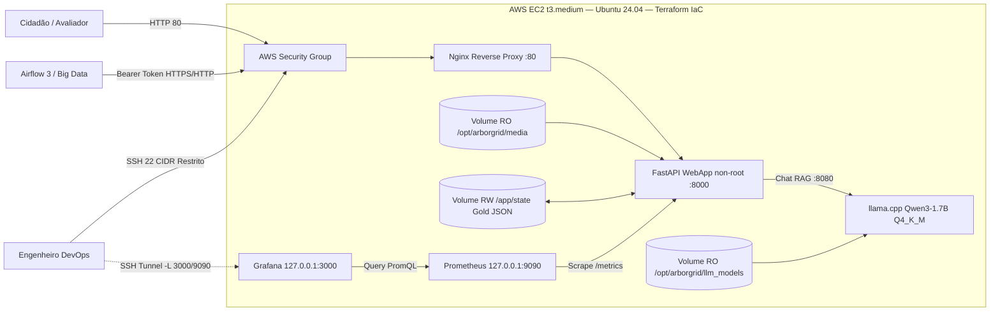

# Arquitetura Cloud, Segurança DevSecOps e Observabilidade — ArborGrid SP

Documento de referência para a disciplina **Secure DevOps Tools & Cloud Computing** (FIAP 4ES).

---

## 1. Diagrama da Arquitetura em Nuvem

---

## 2. Matriz de Responsabilidade Compartilhada (AWS vs. Equipe)

| Camada / Controle | Responsável AWS | Responsável Equipe ArborGrid |
| :--- | :---: | :---: |
| Infraestrutura física, rede subjacente e hypervisor EC2 | X | |
| Provisionamento declarativo, regras do Security Group e bloqueio de `0.0.0.0/0` em SSH | | X |
| Hardening do SO convidado, IMDSv2 obrigatório e criptografia EBS em repouso | | X |
| Container slim, usuário não-root (`UID 10001`), filesystem `read_only`, drop de capabilities | | X |
| Gestão de tokens (`ARBORGRID_API_TOKEN`) via GitHub Secrets / `.env` fora do Git | | X |
| Varredura contínua Gitleaks, Semgrep e Trivy antes do deploy automático | | X |
| Conformidade LGPD, anonimização e restrição de mídias Street View fora do repositório | | X |

---

## 3. Localização dos Dados e Conformidade LGPD

- **Dados públicos em código/container (`manifest.json`):** coordenadas geográficas oficiais de árvores viárias públicas provenientes do portal GeoSampa (Decreto Municipal SP nº 57.576/2017), datas históricas de vistoria municipal SISGAU e contagens agregadas de pixels (`copa_px`, `wire_px`, `pole_px`). Não contém nome, CPF, telefone, e-mail ou qualquer dado pessoal identificável (PII).
- **Mídias visuais (`images/` e `v3_overlays/`):** armazenadas fora do histórico Git (protegidas pelo `.gitignore` e `.dockerignore`), montadas como volume somente leitura (`/app/media:ro`) diretamente na EC2 apenas para visualização na auditoria acadêmica, preservando o borramento nativo de rostos/placas e respeitando os Termos de Uso do Google Street View.
- **Identificadores anonimizados:** `pano_id` e eventuais atores operacionais enviados pela camada Gold recebem hash SHA-256 truncado (`pano_id_hash`, `audit_actor_hash`).
- **Região de hospedagem:** AWS `us-east-1` (ou `sa-east-1` quando fora do Learner Lab), com disco EBS criptografado (`encrypted = true`).

---

## 4. Estimativa de Custo Mensal (AWS `us-east-1`)

Valores referenciais *on-demand* (cobertos por créditos do AWS Academy Learner Lab durante sessões ativas):

| Recurso | Especificação | Custo Mensal 24/7 (USD) | Custo por Hora |
| :--- | :--- | ---: | ---: |
| Computação EC2 | `1x t3.medium` (2 vCPU, 4 GiB RAM, necessária para `Qwen3-1.7B Q4_K_M`) | ~\$30,37 | \$0,0416/h |
| Armazenamento EBS | `30 GB gp3` criptografado | ~\$2,40 | \$0,0033/h |
| IPv4 Público & Tráfego | `1x IPv4` público (`$0,005/h`) + ~10 GB/mês transferência | ~\$4,55 | \$0,0062/h |
| **Total Estimado** | | **~\$37,32 / mês (730 h)** | **~\$0,051 / hora** |

*Observação:* quando a VM está desligada (`Stopped`) fora dos testes/demonstrações no Learner Lab, a cobrança recai apenas sobre o disco EBS (`30 GB` ≈ `~$2,40/mês`), consumindo fração mínima do orçamento de créditos do laboratório. Para execução enxuta sem inferência neural GGUF (usando *fallback* determinístico RAG), é possível reduzir para `t3.small` (~\$22,13/mês em 30 GB `gp3`).

---

## 5. Observabilidade: 4 Golden Signals + Alerta

- **Latência:** `arborgrid_http_request_duration_seconds_bucket` (P50 / P95 por rota).
- **Tráfego:** `arborgrid_http_requests_total` (RPS por rota e código HTTP).
- **Erros:** `arborgrid_http_errors_total` (taxa de `4xx` e `5xx`).
- **Saturação:** `arborgrid_inprogress_requests` e `process_resident_memory_bytes`.
- **Regras de Alerta ([`alerts.yml`](observability/prometheus/alerts.yml)):** `ArborGridHighClientErrorRate` dispara automaticamente quando erros `4xx/5xx` superam `0.2 req/s` por 15 segundos — facilmente demonstrável enviando requisições sem Bearer token para `/api/v1/inspections`.
