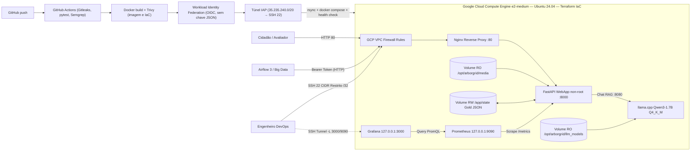

# Arquitetura Cloud, Segurança DevSecOps e Observabilidade — ArborGrid SP

Documento de referência para a disciplina **Secure DevOps Tools & Cloud Computing** (FIAP 4ES).

---

## 1. Diagrama da Arquitetura em Nuvem (Google Cloud Platform)



---

## 2. Matriz de Responsabilidade Compartilhada (Google Cloud vs. Equipe)

| Camada / Controle | Responsável Google Cloud (GCP) | Responsável Equipe ArborGrid |
| :--- | :---: | :---: |
| Infraestrutura física, rede global, hipervisor Borg/KVM e criptografia padrão em repouso (`pd-balanced`) | X | |
| Provisionamento declarativo (`Terraform`), regras de Firewall VPC e bloqueio estrito de `0.0.0.0/0` na porta 22 | | X |
| Hardening da VM (*Shielded VM*: Secure Boot, vTPM, Integrity Monitoring e `block-project-ssh-keys = true`) | | X |
| Container slim, usuário não-root (`UID 10001`), filesystem `read_only`, drop de capabilities | | X |
| Credenciais de deploy: Workload Identity Federation (sem chave de Service Account), chave SSH dedicada do CI e *host key* fixada em GitHub Secrets; `ARBORGRID_API_TOKEN` só no `.env` da VM (fora do Git) | | X |
| Disponibilidade do Identity-Aware Proxy, do STS/IAM Credentials e rotação das chaves de assinatura OIDC↔GCP | X | |
| Varredura contínua Gitleaks, Semgrep e Trivy antes do deploy automático | | X |
| Conformidade LGPD, anonimização e restrição de mídias Street View fora do repositório | | X |

---

## 3. Localização dos Dados e Conformidade LGPD

O conjunto de dados hospedado (`manifest.json`) não contém dados pessoais; contudo, entradas digitadas pelo usuário no assistente e logs de acesso HTTP podem conter dados pessoais, tratados pelos controles abaixo:

- **Dados públicos em código/container (`manifest.json`):** coordenadas geográficas oficiais de árvores viárias públicas provenientes do portal GeoSampa (Decreto Municipal SP nº 57.576/2017), datas históricas de vistoria municipal SISGAU e contagens agregadas não identificáveis de pixels (`copa_px`, `wire_px`, `pole_px`).
- **Mídias visuais (`images/` e `v3_overlays/`):** armazenadas fora do histórico Git (protegidas pelo `.gitignore` e `.dockerignore`), montadas como volume somente leitura (`/app/media:ro`) na VM apenas quando necessário, preservando o borramento nativo de rostos/placas e respeitando os Termos de Uso do Google Street View.
- **Identificadores anonimizados:** `pano_id` e eventuais atores operacionais enviados pela camada Gold recebem hash SHA-256 truncado (`pano_id_hash`, `audit_actor_hash`).
- **Perguntas enviadas ao assistente (`POST /api/v1/assistant/ask`):** perguntas digitadas podem conter dados pessoais; a API mascara CPF, CNPJ, placa, telefone e e-mail antes de enviar o texto ao LLM e antes de devolvê-lo na resposta (`webapp/app/privacy.py`). As perguntas não são persistidas em banco ou disco e o Uvicorn não registra corpos de requisição nos logs.
- **Upload de fotos na aba "Análise de Imagem":** as imagens enviadas pelo usuário são processadas exclusivamente no navegador (`ONNX Runtime Web`) e nunca saem do dispositivo.
- **Logs de acesso do Nginx:** registram endereços IP dos clientes (dados pessoais sob a LGPD). O driver de log padrão do Docker mantém os registros até a recriação do container; recomenda-se configurar rotação e retenção limitada (`max-size` / `max-file`) em produção.
- **Região de hospedagem e transferência internacional:** Google Cloud `us-central1` (Iowa), com discos persistentes `pd-balanced` criptografados automaticamente em repouso por padrão no GCP (`Google-managed encryption keys`). A hospedagem fora do Brasil configura transferência internacional de dados (LGPD, art. 33); a alternativa nacional é `southamerica-east1` (São Paulo), com custo superior. Como os dados persistidos na VM se restringem a dados públicos abertos e contagens não identificáveis de pixels, a escolha de `us-central1` justifica-se para o MVP.

---

## 4. Estimativa de Custo Mensal (Google Cloud `us-central1`)

Valores referenciais *on-demand* em USD (abatidos diretamente do saldo/créditos pré-pagos da conta Google Cloud):

| Recurso | Especificação | Custo Mensal 24/7 (USD) | Custo por Hora |
| :--- | :--- | ---: | ---: |
| Computação GCE | `1x e2-medium` (2 vCPU compartilhadas, 4 GB RAM para `Qwen3-1.7B Q4_K_M`) | ~\$24,27 | \$0,0332/h |
| Armazenamento | `30 GB pd-balanced` (SSD balanceado criptografado) | ~\$3,00 | \$0,0041/h |
| IPv4 Público & Tráfego | `1x IPv4` efêmero em uso (`$0,005/h`) | ~\$3,65 | \$0,0050/h |
| Tráfego de saída (egress) | Cada primeira visita à aba de análise visual baixa ~`67 MB` (modelo ONNX `51,8 MiB` + WASM `14,8 MB`); `100` visitantes ≈ `6,7 GB` (egress ~`US$ 0,12/GB`) | ~\$0,80 *(100 visitantes)* | sob demanda |
| **Total Estimado** | | **~\$30,92 / mês (730 h)** + egress | **~\$0,042 / hora (~R\$ 0,24/h)** |

*Observação:* manter a stack ativa durante 10 dias corridos para apresentação e correção da banca consome apenas **~\$10,15 USD (~R\$ 58)** do saldo pré-pago, e desligar (`Stop`) a VM fora do horário de avaliação reduz o custo para apenas os `30 GB` de disco (**~\$0,10/dia**).

**Cenário de escala:** projeta-se uma instância `e2-medium` por subprefeitura piloto (~`US$ 31/mês`), sendo o servidor LLM o primeiro componente a ser desacoplado (instância dedicada ou Cloud Run) quando o tráfego crescer.

---

## 5. Observabilidade: 4 Golden Signals + Alertas

- **Latência:** `arborgrid_http_request_duration_seconds_bucket` (P50 / P95 por rota).
- **Tráfego:** `arborgrid_http_requests_total` (RPS por rota e código HTTP).
- **Erros:** `arborgrid_http_errors_total` (taxa de `4xx` e `5xx`).
- **Saturação:** `arborgrid_inprogress_requests` e `process_resident_memory_bytes`.
- **Assistente IA (painéis Grafana):** acompanhamento do volume de respostas por modo (LLM × fallback determinístico) via `arborgrid_assistant_responses_total` e dos motivos de acionamento do fallback via `arborgrid_llm_fallback_total`.
- **Exposição e proteção no Nginx:** o endpoint `/metrics` não é exposto publicamente (o Nginx retorna `404` para requisições externas; o Prometheus coleta `webapp:8000` pela rede interna). O Nginx também aplica compressão `gzip` e *rate limiting* em `/api/v1/assistant/ask` (`10 req/min` por IP, `burst 5`).
- **Regras de Alerta ([`alerts.yml`](observability/prometheus/alerts.yml)):**
  - `ArborGridHigh5xxRatio`: dispara quando respostas `5xx` ultrapassam `5%` do total nos últimos `5 min`.
  - `ArborGridAuthFailuresSpike`: sinal de segurança quando respostas HTTP `401` superam `0,2 req/s` (`for: 15s`) — demonstrável chamando `/api/v1/inspections` sem Bearer token em loop.
  - `ArborGridHighLatencyP95`: dispara quando a latência `P95` supera `0,5 s` nas rotas interativas (excluindo `/api/v1/assistant/ask` e o download do modelo ONNX).
  - `ArborGridAssistantLatencyP95`: dispara quando o `P95` de `/api/v1/assistant/ask` ultrapassa `25 s`.
  - `ArborGridServiceDown`: dispara quando `up{job="arborgrid-webapp"} == 0` por `30 s` — demonstrável executando `docker stop arborgrid-webapp` por `30 s`.

---

## 6. Deploy Automático (GitHub Actions → IAP → VM)

O job `deploy-to-vm` de [`.github/workflows/devsecops.yml`](../.github/workflows/devsecops.yml) roda a cada push em `main`, depois dos gates de segurança (Gitleaks, pytest, Semgrep, Trivy):

1. **Autenticação sem segredo de longa duração:** o runner troca seu token OIDC do GitHub por credenciais temporárias via **Workload Identity Federation** ([`terraform/cicd.tf`](terraform/cicd.tf)). O provedor só aceita tokens deste repositório na branch `main`.
2. **Menor privilégio:** a Service Account `*-cicd` só tem `roles/compute.viewer` no projeto e `roles/iap.tunnelResourceAccessor` **nesta VM**.
3. **Porta 22 fechada para a internet:** o SSH chega pelo túnel TCP do **Identity-Aware Proxy**. O firewall aceita a porta 22 apenas da faixa do IAP (`35.235.240.0/20`) e do CIDR administrativo `/32`. Nunca de `0.0.0.0/0`.
4. **Sem TOFU:** a *host key* da VM é fixada no secret `VM_KNOWN_HOSTS` (`StrictHostKeyChecking yes`); o CI usa um par de chaves SSH dedicado, revogável sem afetar o acesso humano.
5. **Entrega:** `rsync --delete` do código (preservando `infra/.env` da VM), `docker compose up -d --build --remove-orphans` e um **health check** em `/api/v1/health`. Se o health check falhar, o job falha.
6. **Configuração ausente falha alto:** se faltar algum secret, o job termina com erro em vez de "passar pulando" o deploy.

**Configuração (uma vez):**

```bash
# 0. Bootstrap (uma vez por projeto): o provider lê o projeto pela Cloud Resource Manager,
#    e a identidade do Terraform precisa poder ativar APIs, criar SAs/pools e conceder papéis
gcloud services enable cloudresourcemanager.googleapis.com serviceusage.googleapis.com
#    Papéis da SA do Terraform: Service Usage Admin, Service Account Admin,
#    Workload Identity Pool Admin, Project IAM Admin e IAP Policy Admin
#    Se o Terraform usar chave JSON de SA: organizações novas aplicam a org policy
#    iam.disableServiceAccountKeyCreation, e é preciso sobrescrevê-la no projeto para criar a chave.
#    O deploy do CI não usa chave (WIF): depois do apply, a policy pode voltar a valer
#    (chaves já criadas continuam funcionando).

# 1. Par de chaves dedicado ao CI
ssh-keygen -t ed25519 -f ~/.ssh/arborgrid_ci -N "" -C arborgrid-ci

# 2. terraform.tfvars: static_ip_address = "<IP atual da VM>" e ci_ssh_public_key = "<conteúdo de ~/.ssh/arborgrid_ci.pub>"
cd infra/terraform && terraform plan   # conferir: a VM deve ser "updated in-place", nunca "must be replaced"
terraform apply

# 3. Secrets e variáveis do repositório
gh secret set GCP_WIF_PROVIDER --body "$(terraform output -raw workload_identity_provider)"
gh secret set GCP_DEPLOY_SA    --body "$(terraform output -raw deploy_service_account)"
gh secret set VM_SSH_KEY       < ~/.ssh/arborgrid_ci
# Chave de host: evite o ssh-keyscan no Windows (o do OpenSSH 9.5 falha em silêncio por causa do KEX sntrup761).
# Conecte uma vez (grava a chave no known_hosts; confira o fingerprint) e exporte com o alias usado pelo CI:
ssh -i ~/.ssh/arborgrid_ci ubuntu@"$(terraform output -raw public_ip)" 'ssh-keygen -lf /etc/ssh/ssh_host_ed25519_key.pub'
gh secret set VM_KNOWN_HOSTS --body "$(ssh-keygen -F "$(terraform output -raw public_ip)" | grep ' ssh-ed25519 ' | awk '{print "arborgrid-vm", $2, $3}')"
gh variable set GCP_VM_NAME --body "$(terraform output -raw instance_name)"
```

Para conferir a *host key* sem confiar na rede, compare com `gcloud compute instances get-guest-attributes <vm> --query-path=hostkeys/ --zone <zona>`.
