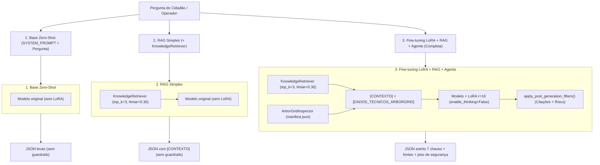
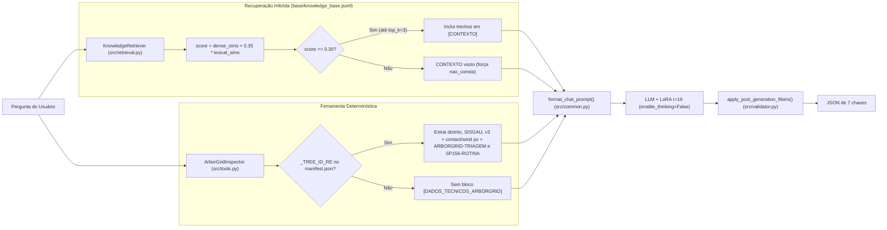
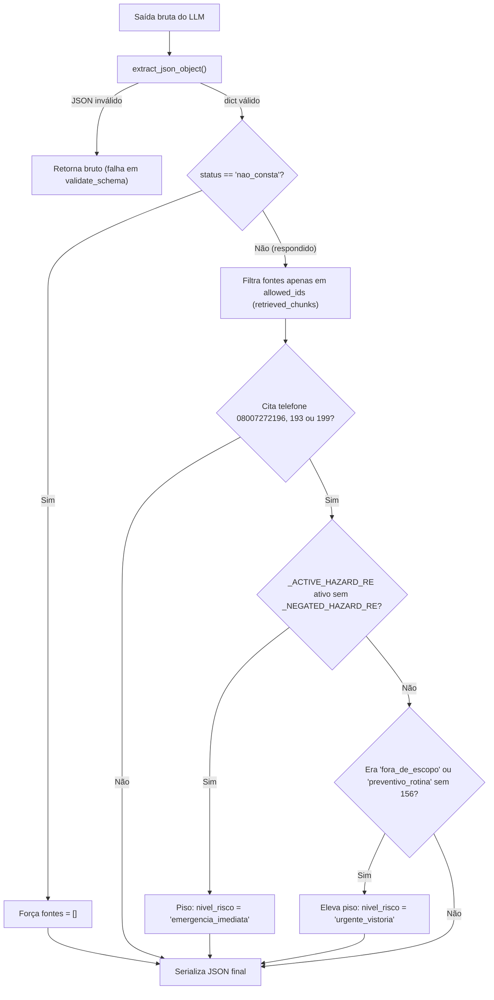

# Arquitetura do Sistema (`llm-assistant/`)

> Documento complementar ao [`README.md`](README.md) e ao [`EXPLORACAO_MODELOS_E_QUANTIZACAO.md`](EXPLORACAO_MODELOS_E_QUANTIZACAO.md). Detalha os módulos em [`src/`](src/) e [`scripts/run_benchmarks.py`](scripts/run_benchmarks.py) que diferenciam as 3 configurações comparadas na ablação arquitetural.

---

## 1. Evolução Progressiva das 3 Configurações Testadas

| Configuração (`scripts/run_benchmarks.py`) | `KnowledgeRetriever` (RAG) | `ArborGridInspector` (Agente) | Adaptador LoRA (`r=16`) | `apply_post_generation_filters()` |
| :--- | :---: | :---: | :---: | :---: |
| **`1_base_sem_contexto`** (`Base Zero-Shot`) | — | — | — | — |
| **`2_rag_simples`** (`RAG Simples`) | Sim (`[CONTEXTO]`) | — | — | — |
| **`3_rag_lora_agente`** (`Fine-tuning LoRA + RAG + Agente`) | Sim (`[CONTEXTO]`) | Sim (`manifest.json` + normas) | Sim | Sim |

---

## 2. Fluxo Ponta a Ponta da Arquitetura Final (`src/`)

---

## 3. Detalhamento dos Módulos de Controle

### 3.1 Busca Híbrida e Gate de Domínio ([`src/retrieval.py`](src/retrieval.py))
- **`KnowledgeRetriever`:** combina *embeddings* densos normalizados (`sentence-transformers/paraphrase-multilingual-MiniLM-L12-v2`) com TF-IDF (`TfidfVectorizer(ngram_range=(1, 2), sublinear_tf=True)`) sobre os 25 trechos curados de [`base/knowledge_base.jsonl`](base/knowledge_base.jsonl).
- **Ranqueamento e filtragem:** `score = dense_sims + (0.35 * lexical_sims)`. Apenas trechos com `score >= 0.30` (`DEFAULT_RETRIEVAL_THRESHOLD`, `top_k = 3`) entram no prompt via `format_context_block()`. Quando nenhum trecho atinge o limiar, o prompt informa explicitamente ausência de contexto confiável.

### 3.2 Agente Determinístico GeoSampa ([`src/tools.py`](src/tools.py))
- **`ArborGridInspector.maybe_build_tool_context()`:** identifica menções numéricas por `_TREE_ID_RE` e consulta `by_id` carregado de [`manifest.json`](../arborgrid-vision/dataset/sp_geosampa_api/manifest.json).
- **Agregação conservadora e injeção normativa:** consolida a gravidade entre vistas pela ordem **`CRITICO > PROXIMIDADE > SEGURO`**, calcula picos de pixel de contato direto (`max_contact_direct_px`) e margem de vento (`max_wind_buffer_px`), e injeta o bloco `[DADOS_TECNICOS_ARBORGRID]`.
- Quando encontra uma árvore válida, [`scripts/run_benchmarks.py`](scripts/run_benchmarks.py#L266-L273) também garante que os trechos normativos `ARBORGRID-TRIAGEM` e `SP156-ROTINA` componham os *chunks* disponíveis para citação exata.

### 3.3 Validador Programático e Filtros Pós-Geração ([`src/validator.py`](src/validator.py))

- **Avaliação determinística (`evaluate_prediction()`):** verifica conformidade de esquema com `validate_schema()` sobre as 7 chaves de `RESPONSE_FIELDS` ([`src/common.py`](src/common.py)), valida telefones contra `allowed_phones` extraídos do contexto recuperado e garante ausência de dados pessoais na resposta (`_CPF_RE` e `_PLATE_RE` para LGPD).
