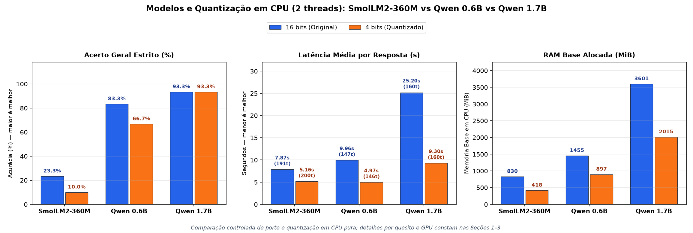
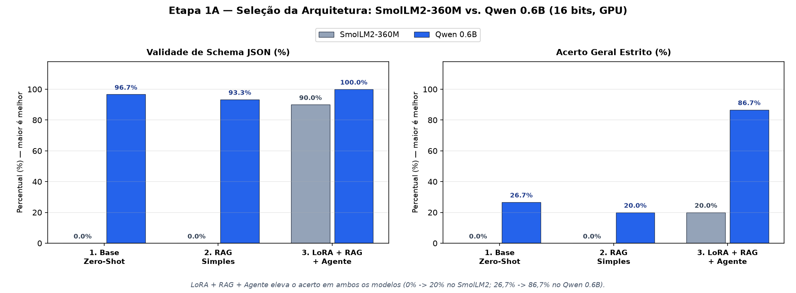
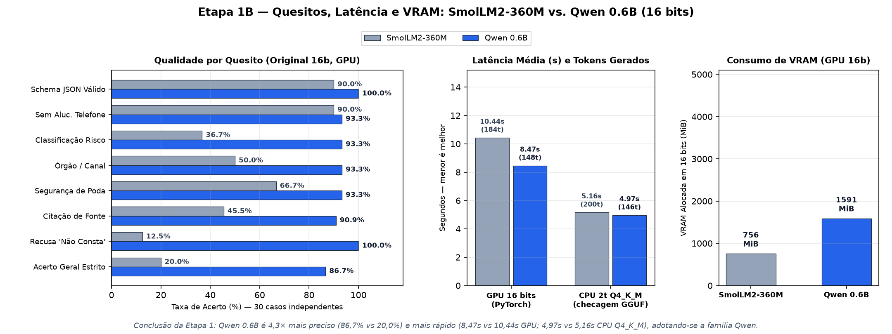
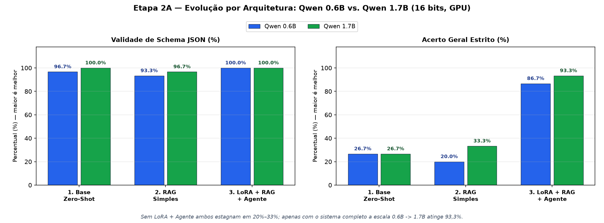
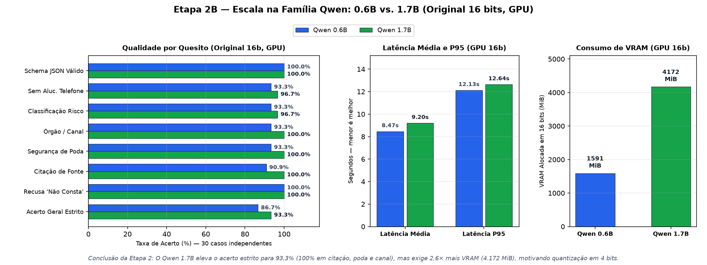
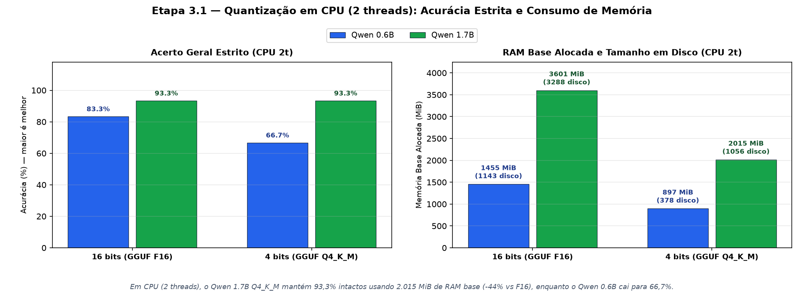
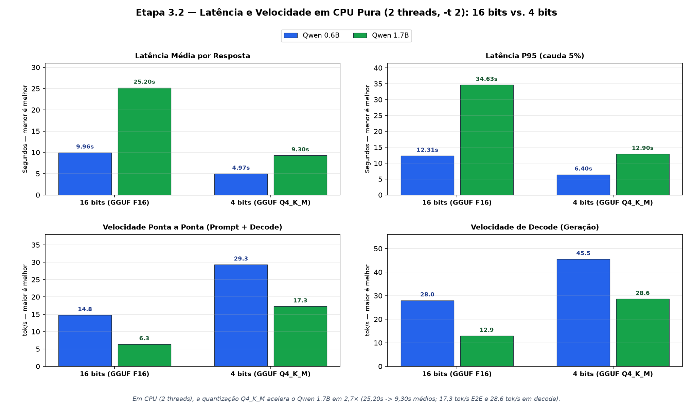

# Estudo de Modelos, Arquitetura, Quantização e Infraestrutura (`llm-assistant/`)

> Documento complementar ao [`README.md`](README.md). Este registro documenta as **3 etapas experimentais** que validaram a escolha da arquitetura **`LoRA + RAG + Agente`**, descartaram o **`SmolLM2-360M`**, escalaram até o **`Qwen 1.7B`** e mediram a quantização `4 bits` em CPU visando operação sem GPU na nuvem.
>
> **Ambiente de execução local:**
> - **GPU:** RTX 3060 Ti (8 GB)
> - **CPU:** Ryzen 9 7900X (12 cores / 24 threads)
> - **RAM:** 2×16 GB DDR5-5600

### Panorama Geral: Modelos e Quantização em CPU (`2 threads`)

> Síntese comparando precisão **original (`16 bits`)** vs. **quantizada (`4 bits`)** nos três modelos em **CPU pura (`2 threads`)**.

---

## 1. Exploração Inicial (16 bits): `SmolLM2-360M` vs. `Qwen 0.6B`

Para avaliar modelos compactos adequados à operação econômica, iniciamos comparando o **`SmolLM2-360M`** (`HuggingFaceTB/SmolLM2-360M-Instruct`) e o **`Qwen 0.6B`** (`Qwen/Qwen3-0.6B`) em precisão original de **16 bits (`bfloat16`)** na GPU.

### 1.1 Seleção da Arquitetura (`Base` → `RAG Simples` → `Fine-tuning LoRA + RAG + Agente`)

Antes da análise por quesito, testamos ambos os modelos em três evoluções arquiteturais progressivas:
1. **`Base Zero-Shot`:** modelo original pré-treinado, sem contexto nem ajuste de pesos;
2. **`RAG Simples`:** modelo original com recuperação semântica de trechos no prompt (sem ajuste de pesos);
3. **`Fine-tuning LoRA + RAG + Agente`:** primeira configuração com ajuste fino supervisionado LoRA (`r=16`, `3` épocas, máscara `-100`), acoplada ao agente GeoSampa e ao validador programático.

*Evidências auxiliares: [arquitetura detalhada e fluxogramas (`src/`)](ARQUITETURA_DO_SISTEMA.md) · curva LoRA ([`SmolLM2-360M`, `eval_loss = 0,2134`](assets/smol360m_curva_loss_lora.png) | [`Qwen 0.6B`, `eval_loss = 0,0011`](assets/06b_curva_loss_lora.png)) · placar completo ([`SmolLM2-360M`](assets/smol360m_placar_comparativo.png) | [`Qwen 0.6B`](assets/06b_placar_comparativo.png)) · [CSV `SmolLM2-360M`](avaliacao/smol360m_placar_comparativo.csv).*

- **Salto com `Fine-tuning LoRA + RAG + Agente`:** sem ajuste fino direcionado, o `SmolLM2-360M` não gera JSON válido (`0,0%` de *schema* e acerto), e o `Qwen 0.6B` fica estagnado em `26,7%` (`Base`) e `20,0%` (`RAG Simples`). Somente ao introduzir o **`Fine-tuning LoRA`** com RAG e Agente ambos atingem seus máximos (**`20,0%`** e **`86,7%`**), consolidando essa arquitetura como padrão para os testes seguintes.

### 1.2 Qualidade por Quesito, Latência e VRAM (`Fine-tuning LoRA + RAG + Agente`)

| Modelo (`LoRA + RAG + Agente`, GPU 16b) | Schema Válido | Risco | Órgão / Canal | Recusa "Não Consta" | Acerto Geral Estrito | VRAM Alocada | Latência Média | Tokens Médios |
| :--- | :---: | :---: | :---: | :---: | :---: | :---: | :---: | :---: |
| **`SmolLM2-360M`** | 90,0% | 36,7% | 50,0% | 12,5% | **20,0%** (`6/30`) | `756,4 MiB` | **`10.435 ms`** | `184,4` |
| **`Qwen 0.6B`** | **100,0%** | **93,3%** | **93,3%** | **100,0%** | **86,7%** (`26/30`) | `1.590,6 MiB` | **`8.466 ms`** | `148,1` |

#### Quebra de expectativa: menor não foi mais rápido
1. **Qualidade insuficiente:** mesmo com LoRA, o `SmolLM2-360M` atingiu apenas **`20,0%`** de acerto estrito, falhou em `7/8` recusas `"não consta"` (`12,5%`) e alucinou fontes (`16,7%`) e telefones (`10,0%`).
2. **Latência igual ou pior que o `Qwen 0.6B`:** em GPU 16 bits, o `SmolLM2-360M` foi mais lento (**`10,44 s`** vs. **`8,47 s`**). Em checagem extra com GGUF `Q4_K_M` em CPU (**limitada a `2 threads`**), apesar de gerar tokens mais rápido (`69,6` vs. `45,5 tok/s` no *decode*), seu tokenizador produz saídas maiores (**`200,4` tokens** médios vs. **`145,6`** no `Qwen 0.6B`) ao longo de `32` camadas (contra `28`), empatando a latência em **`5.164 ms`** (`10,0%` de acerto) contra **`4.969 ms`** (`66,7%`) do `Qwen 0.6B`.

### Conclusão da Etapa 1: Adoção da Família Qwen e Descarte do `SmolLM2-360M`
Como o `Qwen 0.6B` entregou **4,3× mais acerto (`86,7%` vs. `20,0%`)** **e** **menor latência** em 16 bits, descartamos o `SmolLM2-360M` e passamos a investigar o limite de confiabilidade dentro da família **Qwen**.

---

## 2. Escalando para o `Qwen 1.7B` (Teto de Acurácia vs. Custo em GPU)

Definida a família, treinamos o **`Qwen 1.7B`** (`Qwen/Qwen3-1.7B`) sob exatamente o mesmo protocolo LoRA (`r=16`, `3` épocas) para comparar os ganhos de escala frente ao **`Qwen 0.6B`** em **16 bits (`bfloat16`)** na GPU.

### 2.1 Evolução por Arquitetura (`Qwen 0.6B` vs. `Qwen 1.7B`)

- **Escala isolada não resolve:** em `Base Zero-Shot`, o `1.7B` empata com o `0.6B` (`26,7%`); em `RAG Simples`, sobe apenas para `33,3%`. Somente com **`LoRA + RAG + Agente`** a capacidade adicional do `Qwen 1.7B` se converte em confiabilidade operacional (**`93,3%`** vs. **`86,7%`**).

### 2.2 Qualidade por Quesito, Latência e VRAM (`LoRA + RAG + Agente`)

- **Ganho de qualidade (`86,7%` → `93,3%`):** os acertos sobem de `26/30` para **`28/30` casos**, fechando **`100,0%`** em validade de schema, órgão/canal competente, segurança de poda, citação da fonte esperada, recusa de `"não consta"` e conformidade LGPD *(placar completo dos 3 estágios no [`README.md`](README.md#5-placar-comparativo-entre-arquiteturas) e [`assets/placar_comparativo.png`](assets/placar_comparativo.png))*.
- **Penalidade em 16 bits:** a VRAM salta **`2,6×`** (`1.590,6 → 4.172,0 MiB`), enquanto a latência média em PyTorch GPU varia pouco (`8,47 s → 9,20 s`; `P95` de `12,13 s → 12,64 s`).

### Conclusão da Etapa 2: Quantizar para Operar em Nuvem sem GPU
O **`Qwen 1.7B`** atingiu o teto operacional (`93,3%`), mas exigir **`4.172 MiB` de VRAM** torna obrigatório quantizar para executá-lo em **CPU pura** em instâncias econômicas de nuvem.

---

## 3. Quantização `4 bits` em CPU (`2 threads`) e Viabilidade na Nuvem

Convertemos os dois modelos Qwen fundidos (`LoRA + Base`) para **GGUF** em **`16 bits (F16)`** e **quantizado `4 bits (Q4_K_M)`**, medindo exclusivamente em **CPU pura limitada a `2 threads` (`-t 2 -c 2048 -np 1 -dev none -ngl 0`)** no `llama.cpp`, reproduzindo o alvo sem GPU da nuvem.

### 3.1 Acurácia e Memória (`16 bits F16` vs. `4 bits Q4_K_M` em CPU `2 threads`)

- **`Qwen 1.7B` resiste intacto aos 4 bits:** preserva **`93,3%` (`28/30`)** tanto em `F16` quanto em **`Q4_K_M`**, reduzindo a RAM base alocada em **`44%`** (`3.600,9 → 2.015,0 MiB`; **`1.056,1 MiB`** em disco).
- **`Qwen 0.6B` degrada na quantização:** cai de **`83,3%` (`25/30`)** em `F16` CPU para **`66,7%` (`20/30`)** em `Q4_K_M` CPU (`896,8 MiB` RAM base; `378,3 MiB` em disco), evidenciando baixa tolerância sub-bilhão a 4 bits nesta tarefa.

### 3.2 Latência e Velocidade em CPU (`16 bits F16` vs. `4 bits Q4_K_M`, `2 threads`)

> *Planilha consolidada dos modelos Qwen: [`avaliacao/placar_comparativo_modelos.csv`](avaliacao/placar_comparativo_modelos.csv).*

- **Aceleração em CPU (`2 threads`):** quantizar de `16 bits -> 4 bits` acelera o **`Qwen 1.7B` em `2,7×`** (`25,20 s → 9,30 s` médios; `P95` de `34,63 s → 12,90 s`) e eleva a taxa ponta a ponta de `6,35` para **`17,26 tok/s`** (`28,60 tok/s` em *decode*). No **`Qwen 0.6B`**, a latência média cai para **`4,97 s`** (`P95 = 6,40 s`; `29,31 tok/s` ponta a ponta).
- **Projeção realista em vCPU de nuvem:** como o `Ryzen 9 7900X` local possui maior desempenho *single-thread* que vCPUs compartilhadas típicas da nuvem (~2× mais lentas em estimativa conservadora), espera-se **`~10 s`** por resposta no `Qwen 0.6B Q4_K_M` e **`~18,6 s`** no `Qwen 1.7B Q4_K_M` — latência aceitável para triagem técnica assíncrona em troca de **`+26,6 p.p.`** de confiabilidade.

### Conclusão da Etapa 3: Adoção do `Qwen 1.7B Q4_K_M` na Instância `t3.medium`
Como o modelo de Visão Computacional (`segformer_v3_int8_dyn_matmul.onnx`, `51,8 MiB`) foi descarregado para execução sob demanda no navegador via `onnxruntime-web`, a instância em nuvem (`AWS EC2 t3.medium` com `4 GiB` de RAM) fica dedicada a `webapp/`, `nginx`, `prometheus`/`grafana` e ao servidor de inferência `llama.cpp` (`COMPOSE_PROFILES=llm`, `LLAMA_THREADS=2`). Assim, adotamos o **`Qwen 1.7B Q4_K_M`** (`2.015,0 MiB` de RAM base, **`93,3%` de acerto estrito** sem degradação em 4 bits) como modelo oficial de produção, mantendo o `Qwen 0.6B Q4_K_M` (`896,8 MiB`) como alternativa ultraleve e *fallback* determinístico pelo motor RAG caso o serviço LLM esteja desabilitado.
