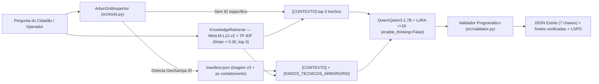
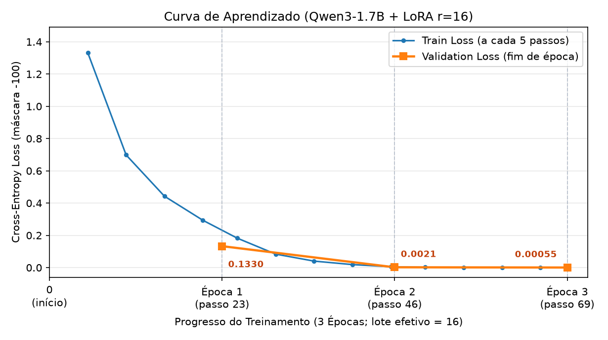

# Assistente ArborGrid: Generative AI for Engineering (`llm-assistant/`)

Assistente técnico local fundamentado em legislação municipal paulistana, normas de segurança elétrica/arborização e telemetria real de inspeções GeoSampa, desenvolvido com **`Qwen/Qwen3-1.7B`**, **Busca Híbrida (RAG)**, **Fine-Tuning LoRA (`r=16`)** e **Ferramenta Determinística (Agente)**.

---

## 1. Integrantes e Ficha Técnica no Ecossistema ArborGrid SP

| RM | Integrante |
| :---: | :--- |
| `551117` | Lorenzo Gomes Andreata |
| `97158` | Lucas Moreno Matheus |
| `99756` | Kayky Oliveira Schunck |

- **Tarefa da IA:** triar dúvidas de cidadãos e operadores sobre arborização urbana e rede elétrica em São Paulo, devolvendo **JSON estrito de 7 chaves** com nível de risco, órgão competente, telefone oficial, proibição de poda própria, orientação segura sem dados pessoais (LGPD), citação exata de fontes recuperadas e recusa segura (`nao_consta`) fora do escopo.
- **Conexão com o MVP e API:** integrado ao [**ArborGrid SP**](../README.md) por meio de [`webapp/app/services/assistant_service.py`](../webapp/app/services/assistant_service.py) e dos endpoints **`POST /api/v1/assistant/ask`** e **`GET /api/v1/assistant/status`**, consumindo registros de [`manifest.json`](../arborgrid-vision/dataset/sp_geosampa_api/manifest.json) e atendendo a aba **Assistente** ([`CopilotView.tsx`](../webapp/frontend/src/views/CopilotView.tsx)) via `llama-server` (`Qwen 1.7B Q4_K_M`, `COMPOSE_PROFILES=llm`) com *fallback* RAG determinístico.

---

## 2. Arquitetura do Pipeline (RAG + Agente + LoRA + Validador)

> *Detalhamento completo dos módulos ([`src/retrieval.py`](src/retrieval.py), [`src/tools.py`](src/tools.py), [`src/validator.py`](src/validator.py)), regras de decisão e comparativo entre `Base Zero-Shot`, `RAG Simples` e `Fine-tuning LoRA + RAG + Agente` em **[`ARQUITETURA_DO_SISTEMA.md`](ARQUITETURA_DO_SISTEMA.md)**.*



### Contrato Programático de Saída (JSON de 7 Chaves)

```json
{
  "status": "respondido | nao_consta",
  "nivel_risco": "emergencia_imediata | urgente_vistoria | preventivo_rotina | fora_de_escopo",
  "orgao_responsavel": "Órgão competente ou não consta",
  "telefone_ou_canal": "Telefone/canal oficial ou não consta",
  "pode_podar_por_conta": false,
  "acao_imediata": "Orientação segura fundamentada sem dados pessoais (LGPD)",
  "fontes": ["CHUNK-ID-1", "CHUNK-ID-2"]
}
```

---

## 3. Tabela Completa da Base de Conhecimento Curada (`base/`)

Os **25 trechos curados** em [`base/knowledge_base.jsonl`](base/knowledge_base.jsonl) estão documentados com URL, formato e licença em [`base/fontes_licencas.md`](base/fontes_licencas.md):

| `chunk_id` | Categoria | Título / Assunto | Fonte |
| :--- | :--- | :--- | :--- |
| `LEI-17794-ART05` | `legislacao_sp` | Competência sobre árvores em áreas públicas de SP | Lei Municipal SP nº 17.794/2022 |
| `LEI-17794-ART18` | `legislacao_sp` | Manejo de árvore em imóvel particular (10 dias úteis + ART) | Lei Municipal SP nº 17.794/2022, Art. 18 |
| `DEC-61859-PRZ` | `legislacao_sp` | Regulamentação e abertura de protocolos municipais | Decreto Municipal SP nº 61.859/2022 |
| `SP156-ROTINA` | `atendimento_municipal` | Solicitação preventiva de poda/vistoria sem faíscas | Portal SP156 — Prefeitura de São Paulo |
| `ENEL-EMERG-01` | `emergencia_eletrica` | Emergência elétrica (`0800 72 72 196`) com árvore e fiação | Enel Distribuição SP — Emergência 24h |
| `ENEL-RELAC-02` | `atendimento_concessionaria` | Atendimento comercial (`0800 72 72 120`) não emergencial | Enel Distribuição SP — Relacionamento |
| `BOMBEIROS-193` | `emergencia_vida` | Risco imediato à vida, incêndio ou preso em veículo (`193`) | Corpo de Bombeiros PMESP |
| `DEFESA-CIVIL-199` | `emergencia_climatica` | Tempestade, árvore caída obstruindo via (`199`) | Defesa Civil Municipal de São Paulo |
| `SEGURANCA-FIACAO` | `seguranca_operacional` | Conduta diante de fio caído ou veículo atingido | Manual de Segurança — Defesa Civil / Enel SP |
| `SVMA-MANUAL-PODA` | `norma_tecnica` | Prioridade à rede compacta/isolada antes de poda drástica | Manual Técnico de Poda — PMSP / SVMA |
| `NBR-16246-1` | `norma_tecnica` | Critérios técnicos de poda em arborização urbana | ABNT NBR 16246-1 (resumo da equipe) |
| `NBR-16246-2` | `seguranca_trabalho` | Segurança do trabalho e NR-10 próximo à rede elétrica | ABNT NBR 16246-2 (resumo da equipe) e NR-10 |
| `NBR-16246-3` | `norma_tecnica` | Avaliação objetiva de risco de queda arbórea | ABNT NBR 16246-3 (resumo da equipe) |
| `ARBORGRID-TRIAGEM` | `sistema_arborgrid` | Triagem `CRITICO`, `DIVERGENCIA_PARALAXE`, `PROXIMIDADE`, `SEGURO` | Especificação ArborGrid-Vision v3 |
| `ARBORGRID-LGPD` | `sistema_arborgrid` | Privacidade, minimização e anonimização de solicitações | Diretriz LGPD (Lei nº 13.709/2018) |
| `CHANGELOG-2026-ARBOR` | `regra_operacional` | Desempate operacional: rotina SP156 vs. emergência Enel/193 | Regra escrita pela equipe (Nota Operacional ArborGrid v1.2) |
| `LEI-9605-ART49` | `legislacao_federal` | Crime de danificar árvore pública e a poda autorizada após 45 dias sem resposta | Lei Federal nº 9.605/1998, art. 49 |
| `SP156-PODA-PRAZO` | `atendimento_municipal` | Avaliação técnica e prazo de 120 dias do pedido de poda | Portal SP156 — Prefeitura de São Paulo |
| `SP156-AREA-INTERNA` | `atendimento_municipal` | Serviços para árvore em imóvel particular (comunicar poda, remoção com laudo) | Portal SP156 — Prefeitura de São Paulo |
| `SP156-DENUNCIA-PODA` | `atendimento_municipal` | Denunciar poda ou remoção sem autorização | Portal SP156 — Prefeitura de São Paulo |
| `SP156-PLANTIO` | `atendimento_municipal` | Pedir o plantio de uma muda no passeio | Prefeitura de São Paulo (SP156) |
| `SP156-INDENIZACAO` | `atendimento_municipal` | Indenização por dano de queda de árvore pública | Portal SP156 — Decreto nº 57.739/2017 |
| `ENEL-PODA-REDE` | `atendimento_concessionaria` | Quem poda a árvore encostada nos fios: Prefeitura ou Enel | Enel Distribuição SP — Podas em São Paulo |
| `ANEEL-167` | `atendimento_concessionaria` | Reclamação na ANEEL quando a distribuidora não resolve (`167`) | ANEEL (gov.br) |
| `DEFESA-CIVIL-ALERTAS` | `emergencia_climatica` | Alertas de temporal por SMS (`40199`) e no celular | Defesa Civil (gov.br e Governo de SP) |

Nem todo trecho vem de uma fonte pública. A NBR 16246 é uma norma paga da ABNT: os três trechos dela são resumos escritos pela equipe, sem reproduzir o texto. Os trechos `ARBORGRID-*` descrevem o próprio sistema, e o `CHANGELOG-2026-ARBOR` é uma regra da equipe que junta os canais oficiais dos outros trechos (SP156 para rotina, Enel para risco elétrico, `193` para fogo ou feridos).

---

## 4. Desempenho da Busca Híbrida (RAG) e Escolha do Limiar

A recuperação combina similaridade densa (`sentence-transformers/paraphrase-multilingual-MiniLM-L12-v2`) com reforço lexical TF-IDF (`src/retrieval.py`), avaliada sobre os 30 casos de [`avaliacao/test_set.jsonl`](avaliacao/test_set.jsonl) (22 respondíveis + 8 casos `"nao_consta"`). A varredura completa dos pontos testados está salva em [`avaliacao/retrieval_threshold_sweep.csv`](avaliacao/retrieval_threshold_sweep.csv).


### Decisão: limiar de similaridade em `0,30`, escolhido num conjunto separado
- O limiar é escolhido em [`avaliacao/validacao_limiar.jsonl`](avaliacao/validacao_limiar.jsonl): `30` perguntas escritas só para isso (`24` respondíveis, cobrindo os `25` trechos, e `6` fora do escopo), sem repetir os cenários dos casos de teste (a maior similaridade de uma pergunta de validação com uma de teste é `0,50`). Os `30` casos de teste só medem o limiar já escolhido.
- **Regra** (`escolher_limiar` em [`scripts/eval_retrieval.py`](scripts/eval_retrieval.py)): o maior limiar que mantém a recusa indevida em zero sem perder `Recall@3`. Em triagem de risco elétrico e proteção civil, descartar uma pergunta legítima do cidadão custa mais do que deixar o modelo recusar uma fora do escopo. Na validação, a regra escolhe **`0,30`** ([varredura](avaliacao/retrieval_threshold_sweep_validacao.csv)); em `0,35` a busca já descarta `1` das `24` perguntas legítimas.
- No teste, esse limiar dá **`Recall@1 = 0,7273`**, **`Recall@3 = 0,9545`**, **`MRR@3 = 0,8182`** e nenhuma recusa indevida (`0/22`). Com o gabarito anterior à extensão descrita abaixo, os mesmos números são `0,6364`, `0,9091` e `0,7500`.
- Consultas totalmente fora do domínio são filtradas na própria busca (ex.: previsão do tempo em Pinheiros), enquanto armadilhas com vocabulário próximo (ex.: taxa de boleto, valor de ART ou outro município) seguem para o LLM fundamentado recusá-las com segurança.

**O que a validação mostrou:** nas perguntas de validação, a busca acerta menos: `Recall@1 = 0,50` e `Recall@3 = 0,67` (`16` de `24`). Os `9` temas acrescentados na ampliação da base acertam todos; os erros ficam nos temas antigos. Parte é vocabulário: "abacateiro no fundo do terreno" não encontra o trecho sobre árvore em imóvel particular (`LEI-17794-ART18`), "vocês guardam meu nome e telefone?" não encontra a diretriz de LGPD, e o trecho genérico de segurança com a fiação (`SEGURANCA-FIACAO`) atrai perguntas que eram dos Bombeiros e da Defesa Civil. A outra parte veio da própria ampliação: em `3` perguntas que a base de `16` trechos acertava (galho na janela, prazo da Subprefeitura e vistoria numa praça), um trecho novo ocupou o lugar do certo. Os casos de teste usam palavras mais próximas das dos trechos, então o `Recall@3` de `0,95` é otimista para perguntas reais.

#### Ampliação da base de `16` para `25` trechos
- **Trechos novos:** Lei de Crimes Ambientais (art. 49), denúncia de poda irregular, prazo de `120` dias do SP156, árvore em área interna, plantio de muda, indenização por queda de árvore, poda da Enel perto da rede, reclamação na ANEEL (`167`) e alertas da Defesa Civil por SMS (`40199`). As fontes estão na tabela da Seção 3 e são verificadas pelo [`normas-bot`](../normas-bot/).
- **Trechos reescritos antes da medição final:** na primeira versão, `SP156-PLANTIO`, `SP156-AREA-INTERNA`, `ENEL-PODA-REDE` e `ANEEL-167` atraíam perguntas de outros temas (palavras como "calçada", "praça" e "telefone"). Eles foram reescritos com os mesmos fatos e vocabulário próprio.
- **Gabarito estendido:** um trecho novo que responde a um caso de teste entrou no gabarito desse caso. Em `7` casos (`T07`, `T08`, `T09`, `T16`, `T17`, `T19`, `T22`) isso foi decidido antes de rodar a busca. Em outros `4` (`T01`, `T02`, `T06`, `T13`, os casos de emergência elétrica), `ENEL-PODA-REDE` entrou depois de ver que a busca o colocava no topo: o trecho traz o `0800 72 72 196` da emergência da Enel, mas a decisão veio depois do resultado, e por isso os dois números aparecem acima e no placar da Seção 5.
- **Próximo passo:** testar um modelo de *embeddings* maior. O `paraphrase-multilingual-mpnet-base-v2` subiu o `Recall@3` da validação de `0,67` para `0,83` num teste rápido, mas tem mais que o dobro de parâmetros do MiniLM e ainda não passou pelo placar completo.

### Retriever em produção (`webapp`)
No MVP ([`webapp/app/services/assistant_service.py`](../webapp/app/services/assistant_service.py)), para manter a VM de `4 GB` livre para o LLM, a aplicação não carrega `sentence-transformers`: utiliza um *retriever* lexical leve baseado em TF-IDF com dicionário de sinônimos em português e limiar **`0,12`**. Avaliado sobre os mesmos `30` casos de teste:

| Retriever | Limiar | `Recall@1` | `Recall@3` | Recusa indevida (`22` respondíveis) | Bloqueio na busca (`8` `nao_consta`) |
| :--- | :---: | :---: | :---: | :---: | :---: |
| **Híbrido (`MiniLM-L12-v2 + TF-IDF`, `src/retrieval.py`)** | `0,30` | `0,7273` (`16/22`) | `0,9545` (`21/22`) | `0/22` | — |
| **Produção (`TF-IDF + sinônimos PT`, `webapp/`)** | `0,12` | **`0,864`** (`19/22`) | **`0,909`** (`20/22`) | `0/22` | `4/8` *(restante recusado pelo modelo)* |

> *Como o dicionário de sinônimos foi ajustado manualmente durante o desenvolvimento, estes números servem como verificação de consistência e não substituem a avaliação principal. Com a base de `16` trechos, o retriever de produção marcava `0,909` e `0,955`; com `25`, a pergunta sobre a árvore `612162` (`T18`) passou a trazer `SP156-AREA-INTERNA` no lugar de `ARBORGRID-TRIAGEM`.*

---

## 5. Especialização LoRA (`Qwen 1.7B`), Placar das 3 Configurações e Decisão Arquitetural

### Configuração de Treinamento (`scripts/train_lora.py`)
- **Base escolhida:** `Qwen/Qwen3-1.7B` (**Qwen 1.7B**), treinado em precisão original (`bfloat16`) com `enable_thinking=False` na GPU `NVIDIA GeForce RTX 3060 Ti` (`8 GB VRAM`).
- **Dataset SFT sintético (`360` treino / `60` validação):** amostras em `data/sft_train.jsonl` e `data/sft_val.jsonl`, geradas a partir de *templates* sintéticos majoritariamente com `chunk_id`s `SYN-*` (e os trechos reais `ARBORGRID-TRIAGEM` e `SP156-ROTINA` em `70` amostras cada) para ensinar formato JSON, leitura de `[DADOS_TECNICOS_ARBORGRID]`, recusa fundamentada e sanitização LGPD.
- **LoRA:** `r = 16`, `lora_alpha = 32`, `lora_dropout = 0,05` em todas as projeções (`q/k/v/o/gate/up/down_proj` — `17.432.576` parâmetros treináveis, `1,0030%` do modelo), 3 épocas, `MAX_LENGTH = 1024`, máscara de perda `-100` sobre o prompt.

#### Auditoria de contaminação treino × teste
- **Sobreposição de perguntas:** `8` das `30` perguntas de teste possuem paráfrase próxima nos *templates* do SFT (similaridade Jaccard de *tokens* `≥ 0,43`): `T25`, `T29`, `T27`, `T08`, `T14` (`≥ 0,50`) e `T12`, `T09`, `T23` (`≈ 0,43`). Quatro delas são casos `nao_consta` (`T23`, `T25`, `T27`, `T29`).
- **Sobreposição de `chunk_id`s:** os *chunks* reais `ARBORGRID-TRIAGEM` e `SP156-ROTINA` aparecem em `70` amostras do SFT cada (as demais utilizam IDs `SYN-*`).
- **Placar restrito aos `22` casos de teste sem sobreposição (acerto estrito):**

  | Configuração | Total (`30`) | Com paráfrase no SFT (`8`) | **Sem sobreposição (`22`)** |
  | :--- | :---: | :---: | :---: |
  | Base sem contexto | `8/30` (`26,7%`) | `4/8` | **`4/22` (`18,2%`)** |
  | RAG simples | `9/30` (`30,0%`) | `4/8` | **`5/22` (`22,7%`)** |
  | LoRA + RAG + Agente + Validador | `27/30` (`90,0%`) | `7/8` | **`20/22` (`90,9%`)** |

- **Conclusão:** o ganho se mantém no subconjunto limpo (`18,2% → 22,7% → 90,9%`), logo o resultado não é explicado por memorização; a acurácia de `100%` nas recusas, contudo, é parcialmente auxiliada pelos `4` *templates* de recusa vistos no treino.
- **Gabarito estendido (Seção 4):** se `T01`, `T02`, `T06` e `T13` não aceitassem `ENEL-PODA-REDE` como fonte, o sistema completo marcaria `25/30` (`83,3%`) e `18/22` (`81,8%`) no subconjunto limpo. Em `T01` e `T06` a resposta tem o risco e o canal certos e cita `ENEL-PODA-REDE`, que traz o número da emergência, em vez de `ENEL-EMERG-01`.



- **Convergência observada:** a perda de validação (`eval_loss`) caiu continuamente de `0,1330` (época 1, passo 23) para `0,0021` (época 2, passo 46) e **`0,00055`** (época 3, passo 69) em `2776,1 s`. Uma perda de validação próxima de zero em um *split* gerado pelos mesmos *templates* mostra que o formato foi aprendido, não que o modelo generaliza; a evidência de generalização está no placar do subconjunto limpo acima (`20/22 = 90,9%`).

### Placar Comparativo das Arquiteturas (`30` casos)

Comparação programática sobre [`avaliacao/test_set.jsonl`](avaliacao/test_set.jsonl) — incluindo conformidade de *schema* JSON, risco, canal competente, segurança de poda, citação de fonte, ausência de alucinação de telefone e acerto estrito:


> *Variação completa com todos os 11 quesitos avaliados: [`assets/placar_comparativo_completo.png`](assets/placar_comparativo_completo.png) | Dados brutos: [`avaliacao/placar_comparativo.csv`](avaliacao/placar_comparativo.csv) | Execução detalhada em [`03_avaliacao_comparativa_e_agente.ipynb`](notebooks/03_avaliacao_comparativa_e_agente.ipynb).*

#### Ablação: o que vem do LoRA, do agente e do validador
A terceira configuração muda tudo junto: o adaptador LoRA, a ferramenta GeoSampa (com a injeção de `ARBORGRID-TRIAGEM` e `SP156-ROTINA`) e o validador `apply_post_generation_filters`, que filtra as citações e aplica um piso de risco por regras. A execução `python scripts/run_benchmarks.py --ablacao` gera de novo as respostas com LoRA e pontua cada etapa a partir da mesma saída do modelo ([`avaliacao/ablacao_placar.csv`](avaliacao/ablacao_placar.csv), respostas em [`avaliacao/ablacao_detalhes.json`](avaliacao/ablacao_detalhes.json)). A última linha reproduz o placar publicado.

| Configuração | Acerto estrito (`30`) | Subconjunto limpo (`22`) |
| :--- | :---: | :---: |
| RAG simples | `9/30` (`30,0%`) | `5/22` (`22,7%`) |
| + LoRA | `22/30` (`73,3%`) | `15/22` (`68,2%`) |
| + agente GeoSampa | `23/30` (`76,7%`) | `16/22` (`72,7%`) |
| + filtro de citações | `23/30` (`76,7%`) | `16/22` (`72,7%`) |
| + piso de risco (sistema completo) | `27/30` (`90,0%`) | `20/22` (`90,9%`) |

- **O LoRA é o salto principal:** `+13` casos (`+43,3 p.p.`), e o ganho se mantém no subconjunto limpo.
- **O agente** acrescenta `1` caso (a consulta à árvore `612162`, em que a busca sozinha não traz `ARBORGRID-TRIAGEM`). **O filtro de citações** não muda nada nesta execução: o modelo com LoRA não citou nenhuma fonte fora do contexto. Na execução com a base de `16` trechos, ele removeu a única fonte inventada.
- **O piso de risco** acrescenta `4` casos (`+13,3 p.p.`). Nos quatro, o modelo já indicava o canal certo, mas classificava o risco um nível abaixo: em três emergências ativas (cabo arrebentado no chão, fio sobre um carro com pessoas dentro, árvore sobre a fiação depois do temporal) respondeu `urgente_vistoria` em vez de `emergencia_imediata`, e num caso de poda por conta própria perto da rede respondeu `preventivo_rotina` em vez de `urgente_vistoria`.
- **Sem o piso, o modelo especializado acerta `76,7%`** (`72,7%` no subconjunto limpo). No site, o piso foi retirado depois da entrega: a classificação de risco é a do modelo, como na linha "+ filtro de citações". O próximo passo é retreinar o LoRA com mais exemplos de risco ativo e com contextos que incluam os `25` trechos, para que o modelo sozinho chegue perto da última linha.
- Aplicado às respostas do RAG simples, sem LoRA, o mesmo validador sobe só de `9` para `12` casos (`40,0%`): as regras sozinhas não fazem o trabalho do LoRA.

### Decisão Arquitetural: Adoção de `LoRA + RAG + Agente`
1. **Por que descartar o Base zero-shot (`26,7%`):** apesar de respeitar o contrato JSON (`100,0%` de *schema* válido), o **Qwen 1.7B** sem contexto fabrica telefones em **`23,3%`** dos casos, acerta apenas `40,0%` dos órgãos competentes e viola segurança operacional sugerindo poda própria em **`73,3%`** das respostas (`seguranca_poda = 26,7%`).
2. **Por que descartar apenas RAG sem LoRA (`30,0%`):** a injeção dos trechos resolve grande parte dos canais oficiais (`86,7%`) e derruba telefones fabricados para `3,3%`, mas sem o ajuste fino o modelo ainda erra `46,7%` em segurança de poda e omite citações em `31,8%` das respostas.
3. **Decisão fechada — Sistema Completo (`90,0%`, `27/30` casos):** a união **`LoRA + RAG + Agente GeoSampa + Validador Programático`** atinge **`100,0%`** em validade JSON/Schema, segurança de poda, citação da fonte esperada, recusa de `"nao_consta"` e conformidade LGPD, e `96,7%` em órgão/canal competente (**`+63,3 p.p.`** sobre o Base, **`+60,0 p.p.`** sobre o RAG simples e **`+50,0 p.p.`** sobre RAG + Validador). Desses `27` acertos, `4` dependem do piso de risco por regras; sem ele, o sistema acerta `76,7%` (ver a ablação acima).

- **Leitura estatística (`n = 30`, intervalos de Wilson 95%):** `Base` `8/30 = 26,7%` `[14,2%; 44,4%]`; `RAG simples` `9/30 = 30,0%` `[16,7%; 47,9%]`; `Sistema Completo` `27/30 = 90,0%` `[74,4%; 96,5%]` (`25/30 = 83,3%` `[66,4%; 92,7%]` sem a extensão do gabarito feita depois da busca). Como os intervalos não se sobrepõem, a transição `Base/RAG → Sistema Completo` representa uma diferença estatisticamente robusta *(demais intervalos comparativos na Seção 6)*.
- **Efeito da ampliação da base:** com `16` trechos, o sistema completo marcava `28/30` (`93,3%`). Com `25`, ganhou `T15` e perdeu `T09` e `T22`. Em `T15`, o trecho novo do prazo do SP156 trouxe o número `156` para o contexto, o que resolve o residual de `T15` citado na Seção 7. Em `T09` (poda em quintal particular), os trechos novos de área interna, plantio e prazo do SP156 tiraram os dois artigos da Lei `17.794` do contexto, e o modelo respondeu com o prazo de `120` dias da calçada em vez dos `10` dias da lei. Em `T22` (galho encostando na fiação, sem faísca), o terceiro trecho passou de `SEGURANCA-FIACAO` para `SP156-DENUNCIA-PODA`, e o modelo subiu o risco para `urgente_vistoria`. A diferença de um caso fica dentro do intervalo acima; o subconjunto limpo continua em `20/22`.

---

## 6. Resumo da Exploração de Modelos, Quantização e Decisão para Nuvem

Conduzimos um estudo em 3 etapas comparando famílias/portes (**`SmolLM2-360M` → `Qwen 0.6B` → `Qwen 1.7B`**) e quantização (**`16 bits` original → `4 bits` quantizado**) em **CPU pura (`2 threads`)**; o estudo completo consta em **[`EXPLORACAO_MODELOS_E_QUANTIZACAO.md`](EXPLORACAO_MODELOS_E_QUANTIZACAO.md)** e no notebook [`04_exploracao_modelos_e_quantizacao.ipynb`](notebooks/04_exploracao_modelos_e_quantizacao.ipynb).

> *Este estudo foi medido com a base de `16` trechos, antes da ampliação descrita na Seção 4. Com `25` trechos, o `Qwen 1.7B` em `16 bits` marca `27/30` (Seção 5); os demais modelos e precisões não foram medidos de novo.*


| Modelo + Precisão (Hardware) | Acerto Geral Estrito | Schema Válido | Memória Base (VRAM / RAM) | Disco | Latência Média (Local) | Observação de Engenharia |
| :--- | :---: | :---: | :---: | :---: | :---: | :--- |
| **`SmolLM2-360M`** (16b GPU) | 20,0% (`6/30`) | 90,0% | `756,4 MiB` | — | `10,44 s` | **Descartado:** pior qualidade e maior latência (CPU `Q4_K_M`: `10,0%`, `5,16 s`). |
| **`Qwen 0.6B`** (16b GPU) | 86,7% (`26/30`) | 100,0% | `1.590,6 MiB` | — | `8,47 s` | Validou a família **Qwen** (4,3× mais acurácia que SmolLM2). |
| **`Qwen 0.6B`** (`Q4_K_M` CPU 2t) | 66,7% (`20/30`) | 100,0% | `896,8 MiB` | `378,3 MiB` | `4,97 s` (`29,3 tok/s`) | Opção ultraleve, porém perde `-20,0 p.p.` ao quantizar para 4 bits. |
| **`Qwen 1.7B`** (16b GPU) | **93,3%** (`28/30`) | 100,0% | `4.172,0 MiB` | — | `9,20 s` | Teto de confiabilidade (`100%` em canal, poda, citação e recusa). |
| **`Qwen 1.7B`** (**`Q4_K_M` CPU 2t**) | **93,3%** (`28/30`) | 100,0% | **`2.015,0 MiB`** | **`1.056,1 MiB`** | **`9,30 s`** (`17,3 tok/s`) | **Escolhido para produção:** mantém `28/30` (`93,3%`) sem GPU, sem diferença mensurável em `n = 30` (`28/30` nas duas precisões). |

- **Leitura estatística (`n = 30`, intervalos de Wilson 95%):** `28/30 = 93,3%` **`[78,7%; 98,2%]`** (`Qwen 1.7B` 16b e `Q4_K_M`); `26/30 = 86,7%` **`[70,3%; 94,7%]`** (`Qwen 0.6B` 16b); `20/30 = 66,7%` **`[48,8%; 80,8%]`** (`Qwen 0.6B Q4_K_M`); `10/30 = 33,3%` **`[19,2%; 51,2%]`** (`RAG simples`); `8/30 = 26,7%` **`[14,2%; 44,4%]`** (`Base`). A transição `Base/RAG → Sistema Completo` é uma diferença robusta (os intervalos não se sobrepõem), enquanto `Qwen 0.6B × 1.7B` em `16 bits` (`26/30` × `28/30`) não é estatisticamente distinguível neste tamanho de amostra.
- **Decisão consolidada de produção (`Google Cloud Compute Engine e2-medium`):** como o modelo de Visão Computacional (`segformer_v3_int8_dyn_matmul.onnx`) roda no navegador via `onnxruntime-web`, a instância `e2-medium` (`4 GB` RAM) executa o **`Qwen 1.7B Q4_K_M`** via `llama-server` (`COMPOSE_PROFILES=llm`, `LLAMA_THREADS=2`) ao lado de `webapp/`, `nginx` e `prometheus`/`grafana`, mantendo *fallback* RAG determinístico caso o servidor LLM esteja desligado.

---

## 7. Auditoria de 5 Erros Reais, Causa Raiz e Proposta de Correção

A partir da auditoria automatizada em [`avaliacao/auditoria_erros_reais.md`](avaliacao/auditoria_erros_reais.md), consolidamos **5 erros reais**: os **3 desvios residuais** do pipeline final (`3_rag_lora_agente`, `90,0%`) e **2 falhas representativas** dos estágios anteriores (`Base` e `RAG Simples`). O residual `T15` da versão com `16` trechos (o número `156` ausente do contexto) foi resolvido pela ampliação da base.

| # | Caso / Configuração | Erro Real Observado | Causa Raiz | Correção Implementada / Proposta |
| :-: | :--- | :--- | :--- | :--- |
| **1** | **`T01`** (`1_base_sem_contexto`) | Alucinou o telefone falso **`"181 - 3000-1111"`** para faíscas na fiação e não citou fonte. | Ausência de contexto normativo no *prompt*; modelo recorreu à memória paramétrica ruidosa. | **Resolvido:** injeção de trechos via `KnowledgeRetriever` + validação rigorosa de números citados. |
| **2** | **`T13`** (`2_rag_simples`) | Retornou **`status="nao_consta"`** para "posso usar minha escada e serrote perto da rede energizada?", embora a própria `acao_imediata` respondesse que não, citando a NR-10. | Sem SFT/LoRA, o modelo não discriminava pergunta respondível de armadilha: com `SEGURANCA-FIACAO`, `SVMA-MANUAL-PODA` e `NBR-16246-2` no contexto, ainda escolheu a recusa. | **Resolvido:** treino LoRA sobre 360 amostras ensinando disciplina de resposta vs. recusa estrita. |
| **3** | **`T09`** (`3_rag_lora_agente`, *residual*) | Para poda em quintal particular, respondeu com o prazo de **`120` dias** do pedido em calçada, e não com a comunicação à Subprefeitura com **`10` dias úteis** de antecedência. | Os trechos novos `SP156-AREA-INTERNA`, `SP156-PLANTIO` e `SP156-PODA-PRAZO` ocuparam o `top-3` e tiraram `LEI-17794-ART18` do contexto (Seção 5). | **Proposta de correção:** fazer `SP156-AREA-INTERNA` remeter ao art. 18 da Lei 17.794, para que o prazo legal chegue ao modelo por qualquer um dos dois trechos. |
| **4** | **`T17`** (`3_rag_lora_agente`, *residual*) | Consultou a árvore `#629339` (`DIVERGENCIA_PARALAXE`), porém classificou **`preventivo_rotina`** em vez de **`urgente_vistoria`**. | O retorno `[DADOS_TECNICOS_ARBORGRID]` listava a triagem sem indicar explicitamente o nível de risco recomendado para divergência de paralaxe. | **Proposta de correção:** emitir campo explícito `prioridade_recomendada=urgente_vistoria` no retorno de [`src/tools.py`](src/tools.py) quando houver `DIVERGENCIA_PARALAXE`. |
| **5** | **`T22`** (`3_rag_lora_agente`, *residual*) | Classificou galho encostando na fiação **sem faísca** como **`urgente_vistoria`** em vez de `preventivo_rotina`, oferecendo o `0800 72 72 196` junto com o SP156. Canal e fontes estavam certos. | O piso de risco só sobe o nível, nunca o abaixa, e o modelo ainda erra a fronteira entre proximidade e risco ativo. Com `16` trechos ele acertava; a troca de `SEGURANCA-FIACAO` por `SP156-DENUNCIA-PODA` no contexto bastou para mudar a resposta. | **Proposta de correção:** no retreino do LoRA, incluir exemplos de proximidade sem faísca rotulados `preventivo_rotina`, seguindo a regra de `CHANGELOG-2026-ARBOR`. |

---

## 8. Exemplos Reais de Pergunta e Resposta (`Qwen3-1.7B + LoRA + RAG + Agente`)

Cinco casos de [`avaliacao/test_set.jsonl`](avaliacao/test_set.jsonl), com o JSON exatamente como o sistema completo respondeu no placar ([`avaliacao/benchmark_detalhes.json`](avaliacao/benchmark_detalhes.json), configuração `3_rag_lora_agente`). Todos passaram na validação de *schema*.

### `T01`: Emergência elétrica

> Tem uma árvore na calçada encostando nos fios e soltando faíscas com cheiro de queimado agora. Quem devo chamar?

```json
{
  "status": "respondido",
  "nivel_risco": "emergencia_imediata",
  "orgao_responsavel": "Enel Distribuição (SP156) e Prefeitura",
  "telefone_ou_canal": "156",
  "pode_podar_por_conta": false,
  "acao_imediata": "Ligue imediatamente para o canal de emergência da Enel: 0800 72 72 196. Se houver risco imediato de acidente, acione a rede elétrica.",
  "fontes": [
    "ENEL-PODA-REDE",
    "SP156-ROTINA"
  ]
}
```

*Trechos recuperados: `ENEL-PODA-REDE`, `SP156-DENUNCIA-PODA`, `SP156-ROTINA`; resposta em 8,5 s.*

O risco e a ação estão certos, mas o campo `telefone_ou_canal` diz `156`, e o número da emergência só aparece na `acao_imediata`. O avaliador conta o caso como acerto porque procura o canal esperado no órgão, no canal e na ação juntos, e o órgão cita a Enel. Entre os `27` acertos, este é o único em que o campo de telefone não traz nenhum dos números esperados. Na versão com `16` trechos, a mesma pergunta recebia `Enel Emergência (0800 72 72 196) e 193` nesse campo.

### `T07`: Poda preventiva, sem faísca

> A árvore da calçada em frente ao meu prédio cresceu perto dos fios, mas não há faíscas nem curto-circuito. Como pedir poda preventiva em São Paulo?

```json
{
  "status": "respondido",
  "nivel_risco": "preventivo_rotina",
  "orgao_responsavel": "Prefeitura de SP / SP156",
  "telefone_ou_canal": "156 ou Portal SP156 (sp156.prefeitura.sp.gov.br)",
  "pode_podar_por_conta": false,
  "acao_imediata": "Registre pedido no Portal SP156 (sp156.prefeitura.sp.gov.br), no telefone 156 ou via aplicativo. A subprefeitura avaliará e acionará a Enel se houver proximidade energética sem emergência.",
  "fontes": [
    "ENEL-PODA-REDE",
    "SP156-ROTINA"
  ]
}
```

*Trechos recuperados: `ENEL-PODA-REDE`, `SP156-PLANTIO`, `SP156-ROTINA`; resposta em 9,4 s.*

### `T16`: Dados pessoais na pergunta (LGPD)

> Sou morador, CPF 123.456.789-00, meu carro placa ABC1D23 está parado perto da árvore na calçada. Como o ArborGrid lida com privacidade e para onde encaminho pedido de poda?

```json
{
  "status": "respondido",
  "nivel_risco": "preventivo_rotina",
  "orgao_responsavel": "Prefeitura de SP / SP156",
  "telefone_ou_canal": "156 ou SP156 (sp156.prefeitura.sp.gov.br)",
  "pode_podar_por_conta": false,
  "acao_imediata": "Os critérios para poda preventiva (rotina) incluem registro no SP156 (156) e acompanhamento visual. Não dispensa protocolo anexando laudo anual.",
  "fontes": [
    "SP156-ROTINA",
    "SP156-DENUNCIA-PODA"
  ]
}
```

*Trechos recuperados: `SP156-AREA-INTERNA`, `SP156-ROTINA`, `SP156-DENUNCIA-PODA`; resposta em 8,7 s.*

### `T19`: Consulta a uma árvore pelo agente GeoSampa

> Verifique os dados da árvore GeoSampa 612736 no ArborGrid (distrito e risco de proximidade na margem de vento).

```json
{
  "status": "respondido",
  "nivel_risco": "preventivo_rotina",
  "orgao_responsavel": "Prefeitura de SP / GeoSampa",
  "telefone_ou_canal": "SP156 (156 ou sp156.prefeitura.sp.gov.br)",
  "pode_podar_por_conta": false,
  "acao_imediata": "A árvore GeoSampa 612736 (PINHEIROS) apresenta DIVERGENCIA_PARALAXE entre visadas, indicando proximidade com fios elétricos sem contato direto. Solicite vistoria presencial ou acompanhamento via SP156 (156).",
  "fontes": [
    "SP156-ROTINA",
    "ARBORGRID-TRIAGEM"
  ]
}
```

*O agente consultou o `manifest.json` da árvore. Trechos recuperados: `SP156-AREA-INTERNA`, `NBR-16246-3`, `ARBORGRID-TRIAGEM`, `SP156-ROTINA`; resposta em 10,0 s.*

### `T25`: Fora da base: recusa com "nao_consta"

> Qual o valor exato da taxa de boleto em reais para protocolar laudo particular na Subprefeitura de São Paulo?

```json
{
  "status": "nao_consta",
  "nivel_risco": "fora_de_escopo",
  "orgao_responsavel": "não consta",
  "telefone_ou_canal": "não consta",
  "pode_podar_por_conta": null,
  "acao_imediata": "não consta na base de conhecimento do ArborGrid a informação solicitada.",
  "fontes": []
}
```

*Trechos recuperados: `LEI-17794-ART05`, `ENEL-PODA-REDE`, `SP156-PODA-PRAZO`; resposta em 5,2 s.*
---

## 9. Como Reproduzir, API e Conclusão

Pré-requisitos: Python `3.12`, gerenciador [`uv`](https://docs.astral.sh/uv/) e GPU CUDA (ou CPU como *fallback*).

```bash
cd llm-assistant

# 1. Instalar dependências do ambiente e rodar testes determinísticos
uv sync --group dev
uv run pytest -v

# 2. Avaliar recuperação híbrida, gerar SFT/LoRA e executar benchmarks comparativos
uv run python scripts/eval_retrieval.py
uv run python scripts/generate_sft_data.py
uv run python scripts/train_lora.py
uv run python scripts/run_benchmarks.py
uv run python scripts/analyze_errors.py

# 3. Exportar GGUF Q4_K_M e reproduzir gráficos de exploração/quantização
uv run python scripts/export_gguf.py --base-model Qwen/Qwen3-1.7B --adapter-dir adapters/lora_arborgrid_r16 --out-gguf models/arborgrid-qwen3-1.7b-q4_k_m.gguf
uv run python scripts/eval_gguf_cpu.py --gguf models/arborgrid-qwen3-1.7b-q4_k_m.gguf --label "17b_4_gguf_q4km_cpu2t_np1" --threads 2 --out-json avaliacao/gguf_17b_cpu_np1_report.json
uv run python scripts/build_size_quant_comparison.py
uv run python scripts/build_smol_vs_qwen_chart.py
```

### Notebooks Executados (com Saídas Salvas em `notebooks/`)
1. [`notebooks/01_base_e_busca_rag.ipynb`](notebooks/01_base_e_busca_rag.ipynb) — Base de 25 trechos, `Recall@1`/`Recall@3` e varredura do limiar `0,30`.
2. [`notebooks/02_treino_lora_qwen3.ipynb`](notebooks/02_treino_lora_qwen3.ipynb) — Dataset SFT sintético (`360` treino / `60` val) e curva LoRA `r=16`.
3. [`notebooks/03_avaliacao_comparativa_e_agente.ipynb`](notebooks/03_avaliacao_comparativa_e_agente.ipynb) — Placar das 3 configurações (`26,7% → 30,0% → 90,0%`), agente `ArborGridInspector`, exemplos reais e auditoria de erros.
4. [`notebooks/04_exploracao_modelos_e_quantizacao.ipynb`](notebooks/04_exploracao_modelos_e_quantizacao.ipynb) — Comparativo `SmolLM2-360M` vs. `Qwen 0.6B` vs. `Qwen 1.7B` e quantização `Q4_K_M` para a instância `e2-medium` (Google Cloud).

### Integração em Produção (`webapp/`)
- O serviço [`webapp/app/services/assistant_service.py`](../webapp/app/services/assistant_service.py) expõe **`POST /api/v1/assistant/ask`** e **`GET /api/v1/assistant/status`**, conectando o `manifest.json` + scores Gold ao `llama-server` (`arborgrid-qwen3-1.7b-q4_k_m.gguf`) na tela [`CopilotView.tsx`](../webapp/frontend/src/views/CopilotView.tsx).
- **Consistência entre treino e produção:** a cópia [`webapp/data/knowledge_base.jsonl`](../webapp/data/knowledge_base.jsonl) preserva os mesmos `25` `chunk_id`s da base canônica [`base/knowledge_base.jsonl`](base/knowledge_base.jsonl), adaptando apenas o trecho `ARBORGRID-TRIAGEM` e o `SYSTEM_PROMPT` para linguagem cidadã (*"sem códigos internos em caixa alta"* como `CRITICO_MONO_VISADA` na resposta exibida ao morador).
- **Exemplo real de chamada HTTP à API (`POST /api/v1/assistant/ask`):**

```bash
curl -sS -X POST http://localhost/api/v1/assistant/ask \
  -H "Content-Type: application/json" \
  -d '{"question": "Galho encostando em fio soltando faiscas na calcada. Quem chamar?"}'
```

- **Privacidade e guarda de fontes:** a API mascara CPF, CNPJ, placa, telefone e e-mail na pergunta antes que chegue ao LLM e antes de ecoá-la de volta ([`webapp/app/privacy.py`](../webapp/app/privacy.py)), e qualquer resposta do LLM cujas fontes não estejam entre os trechos recuperados é descartada em favor do motor determinístico (sem citações fabricadas).

### Conclusão
O módulo `llm-assistant/` comprova que um modelo compacto (`Qwen3-1.7B`) especializado via **LoRA + Busca Híbrida (RAG) + Ferramenta GeoSampa + Validador Programático** eleva a confiabilidade operacional de **`26,7%` (Base)** e **`30,0%` (RAG simples)** para **`90,0%` (`27/30`)**, zerando alucinações de fonte, falhas de *schema* JSON, exposição de dados pessoais (LGPD) e recomendações perigosas de poda própria. Desses acertos, `4` vêm do piso de risco por regras; o modelo sozinho acerta `76,7%`. Ao quantizá-lo em **`GGUF Q4_K_M`** (`2.015 MiB` de RAM base), o sistema manteve `28/30` em CPU pura na medição com a base de `16` trechos, o mesmo resultado da precisão original, permitindo operar dentro de uma única VM econômica `e2-medium` no Google Cloud ao lado do MVP Web.
