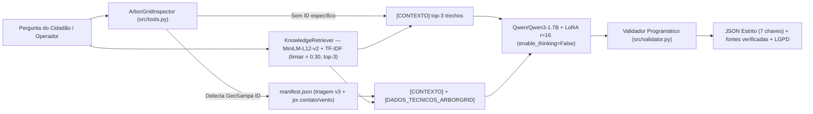

# ArborGrid Copiloto Técnico — Generative AI for Engineering (`llm-assistant/`)

Assistente técnico local fundamentado em legislação municipal paulistana, normas de segurança elétrica/arborização e telemetria real de inspeções GeoSampa, desenvolvido com **`Qwen/Qwen3-1.7B`**, **Busca Híbrida (RAG)**, **Fine-Tuning LoRA (`r=16`)** e **Ferramenta Determinística (Agente)**.

---

## 1. Integrantes e Ficha Técnica no Ecossistema ArborGrid SP

- **Grupo:** Equipe CitizenTech 4ES (FIAP Global Solution 2026.2 — completar lista nominal e RMs finais na entrega consolidada; desenvolvimento do módulo `llm-assistant/`: Lucas Moreno Matheus / Lorenzo Gomes Andreata).
- **Conexão com o MVP:** Atua como copiloto técnico e triador operacional integrado à infraestrutura do [**ArborGrid SP**](../README.md), consumindo registros de inspeção de [`manifest.json`](../arborgrid-vision/dataset/sp_geosampa_api/manifest.json) (compatível com `GET /api/v1/trees/{geosampa_id}` do módulo [`webapp/`](../webapp/)) para orientar cidadãos e equipes sobre gravidade, canal oficial competente e proibições de segurança/LGPD.

---

## 2. Arquitetura do Pipeline (RAG + Agente + LoRA + Validador)

> *Detalhamento completo dos módulos ([`src/retrieval.py`](src/retrieval.py), [`src/tools.py`](src/tools.py), [`src/validator.py`](src/validator.py)), regras de decisão e comparativo visual entre `Base Zero-Shot`, `RAG Simples` e `Fine-tuning LoRA + RAG + Agente` em **[`ARQUITETURA_DO_SISTEMA.md`](ARQUITETURA_DO_SISTEMA.md)**.*



### Contrato Programático de Saída (JSON de 7 Chaves)

Em vez de avaliar texto livre subjetivamente, todas as configurações são avaliadas de forma reproduzível e determinística sobre um contrato JSON estrito:

```json
{
  "status": "respondido | nao_consta",
  "nivel_risco": "emergencia_imediata | urgente_vistoria | preventivo_rotina | fora_de_escopo",
  "orgao_responsavel": "Órgão competente ou não consta",
  "telefone_ou_canal": "Telefone/canal oficial ou não consta",
  "pode_podar_por_conta": false,
  "acao_imediata": "Orientação segura fundamentada sem dados pessoais (LGPD)",
  "fontes": ["CHUNK-ID-1", "CHUNK-ID-2"]
}
```

---

## 3. Base de Conhecimento Curada (`base/`)

A base contém **16 trechos curados** em [`base/knowledge_base.jsonl`](base/knowledge_base.jsonl), detalhados com documento emissor, formato e licença em [`base/fontes_licencas.md`](base/fontes_licencas.md):

| Domínio | Exemplos de `chunk_id` | Órgão / Norma | Qtd. |
| :--- | :--- | :--- | :---: |
| Legislação Municipal SP | `LEI-17794-ART05`, `LEI-17794-ART18`, `DEC-61859-PRZ` | Lei SP nº 17.794/2022 e Decreto nº 61.859/2022 | 3 |
| Atendimento Municipal | `SP156-ROTINA`, `CHANGELOG-2026-ARBOR` | Portal SP156 / SVMA (regra rotina vs. emergência) | 2 |
| Concessionária e Segurança | `ENEL-EMERG-01`, `ENEL-RELAC-02`, `BOMBEIROS-193`, `DEFESA-CIVIL-199`, `SEGURANCA-FIACAO` | Enel SP (`0800 72 72 196` vs. `0800 72 72 120`), Bombeiros (`193`), Defesa Civil (`199`) | 5 |
| Normas Técnicas | `SVMA-MANUAL-PODA`, `NBR-16246-1`, `NBR-16246-2`, `NBR-16246-3` | Manual Técnico SVMA, ABNT NBR 16246 (1-3) e NR-10 | 4 |
| Sistema ArborGrid e LGPD | `ARBORGRID-TRIAGEM`, `ARBORGRID-LGPD` | Critérios v3 (`CRITICO_CONFIRMADO`, `DIVERGENCIA_PARALAXE`, `PROXIMIDADE`, `SEGURO`) e Lei nº 13.709/2018 | 2 |

---

## 4. Desempenho da Busca Híbrida (RAG) e Escolha do Limiar

A recuperação combina similaridade densa (`sentence-transformers/paraphrase-multilingual-MiniLM-L12-v2`) com reforço lexical TF-IDF (`src/retrieval.py`), avaliada sobre os 30 casos de [`avaliacao/test_set.jsonl`](avaliacao/test_set.jsonl) (22 respondíveis + 8 casos `"não consta"`). A varredura completa dos pontos testados está salva em [`avaliacao/retrieval_threshold_sweep.csv`](avaliacao/retrieval_threshold_sweep.csv).


### Decisão: Limiar de Similaridade em `0,30`
- Em triagem de risco elétrico e proteção civil, falsos negativos (descartar perguntas legítimas do cidadão) têm custo crítico. Pela curva acima, **`0,30`** é o ponto ótimo que zera a recusa indevida (**`false_refusal_rate = 0,0000`**) mantendo **`Recall@1 = 0,6818`**, **`Recall@3 = 0,9545`** e **`MRR@3 = 0,8030`**.
- Assim, consultas totalmente fora de domínio são filtradas na própria busca (ex.: previsão do tempo em Pinheiros, `score = 0,2393`), enquanto armadilhas com vocabulário próximo (ex.: taxa de boleto, valor de ART ou outro município) seguem para o LLM fundamentado recusá-las com segurança.

---

## 5. Especialização LoRA (`Qwen 1.7B`), Placar das 3 Configurações e Decisão Arquitetural

### Configuração de Treinamento (`scripts/train_lora.py`)
- **Base escolhida:** `Qwen/Qwen3-1.7B` (**Qwen 1.7B**), treinado em precisão original (`bfloat16`) com `enable_thinking=False` na GPU `NVIDIA GeForce RTX 3060 Ti` (`8 GB VRAM`).
- **Dataset SFT sintético e disjunto do teste:** `360` amostras de treino (`data/sft_train.jsonl`) e `60` de validação (`data/sft_val.jsonl`), utilizando cenários e `chunk_id`s sintéticos (`SYN-*`) para ensinar formato JSON, leitura de `[DADOS_TECNICOS_ARBORGRID]`, recusa fundamentada e sanitização LGPD sem vazamento do conjunto de teste.
- **LoRA:** `r = 16`, `lora_alpha = 32`, `lora_dropout = 0,05` em todas as projeções (`q/k/v/o/gate/up/down_proj` — `17.432.576` parâmetros treináveis, `1,0030%` do modelo), 3 épocas, `MAX_LENGTH = 1024`, máscara de perda `-100` sobre o prompt.


- **Convergência observada:** com monitoramento por época (`eval_strategy="epoch"` e `load_best_model_at_end=True`), a perda de validação (`eval_loss`) caiu continuamente de `0,1330` (época 1, passo 23) para `0,0021` (época 2, passo 46) e **`0,00055`** (época 3, passo 69) em `2776,1 s`, mantendo generalização real (`93,3%` sobre documentos inéditos sem usar `SYN-*` no teste).

### Placar Comparativo das Arquiteturas (`30` casos independentes)

Comparação programática dos **7 quesitos centrais** sobre o conjunto independente ([`avaliacao/test_set.jsonl`](avaliacao/test_set.jsonl)) — incluindo conformidade de *schema* JSON, risco, canal competente, segurança de poda, citação de fonte, ausência de alucinação de telefone e acerto estrito:


> *Variação completa com todos os 11 quesitos avaliados: [`assets/placar_comparativo_completo.png`](assets/placar_comparativo_completo.png) | Dados brutos completos: [`avaliacao/placar_comparativo.csv`](avaliacao/placar_comparativo.csv) | Execução passo a passo no notebook [`03_avaliacao_comparativa_e_agente.ipynb`](notebooks/03_avaliacao_comparativa_e_agente.ipynb).*

### Decisão Arquitetural: Adoção de `LoRA + RAG + Agente`
1. **Por que descartar o Base zero-shot (`26,7%`):** apesar de respeitar o contrato JSON (`100,0%` de *schema* válido), o **Qwen 1.7B** sem contexto fabrica telefones em **`23,3%`** dos casos, acerta apenas `40,0%` dos órgãos competentes e viola segurança operacional sugerindo poda própria em **`73,3%`** das respostas (`seguranca_poda = 26,7%`).
2. **Por que descartar apenas RAG sem LoRA (`33,3%`):** a injeção dos trechos resolve grande parte dos canais oficiais (`86,7%`) e derruba telefones fabricados para `3,3%`, mas sem o ajuste fino o modelo ainda erra `46,7%` em segurança de poda (`"posso contratar podador / usar escada?"`) e omite citações em `36,4%` das respostas.
3. **Decisão fechada — Sistema Completo (`93,3%`, `28/30` casos):** a união **`LoRA + RAG + Agente GeoSampa + Validador Programático`** atinge **`100,0%`** em validade JSON/Schema, órgão/canal competente, segurança de poda, citação da fonte esperada, recusa de `"não consta"` e conformidade LGPD (**`+66,6 p.p.`** sobre o Base e **`+60,0 p.p.`** sobre o RAG simples). Os 2 desvios remanescentes constam na auditoria da Seção 7. Definida a arquitetura lógica do copiloto, a etapa seguinte investiga como comprimi-la e servi-la com menor custo em nuvem sem GPU.

---

## 6. Resumo da Exploração de Modelos, Quantização e Deploy na Nuvem

Definida a arquitetura na Seção 5, conduzimos um estudo em 3 etapas comparando famílias/portes (**`SmolLM2-360M` → `Qwen 0.6B` → `Qwen 1.7B`**) e quantização (**`16 bits` original → `4 bits` quantizado**). A síntese abaixo compara os três modelos em **CPU pura (`2 threads`)**; os testes por etapa estão em **[`EXPLORACAO_MODELOS_E_QUANTIZACAO.md`](EXPLORACAO_MODELOS_E_QUANTIZACAO.md)**.


| Modelo + Precisão (Hardware) | Acerto Geral Estrito | Schema Válido | Memória Base (VRAM / RAM) | Disco | Latência Média (Local) | Observação de Engenharia |
| :--- | :---: | :---: | :---: | :---: | :---: | :--- |
| **`SmolLM2-360M`** (16b GPU) | 20,0% (`6/30`) | 90,0% | `756,4 MiB` | — | `10,44 s` | **Descartado:** pior qualidade **e** maior latência (em CPU `Q4_K_M`: `10,0%`, `5,16 s` / `200,4 tok`). |
| **`Qwen 0.6B`** (16b GPU) | 86,7% (`26/30`) | 100,0% | `1.590,6 MiB` | — | `8,47 s` | Validou a adoção da família **Qwen** (4,3× mais acurácia e mais rápido que o SmolLM2). |
| **`Qwen 0.6B`** (`Q4_K_M` CPU 2t) | 66,7% (`20/30`) | 100,0% | `896,8 MiB` | `378,3 MiB` | `4,97 s` (`29,3 tok/s`) | Alternativa ultraleve (`~10 s` est. em vCPU `t3`), porém perde `-20,0 p.p.` na quantização 4 bits. |
| **`Qwen 1.7B`** (16b GPU) | **93,3%** (`28/30`) | 100,0% | `4.172,0 MiB` | — | `9,20 s` | Teto de confiabilidade (`100%` em canal, poda, citação e recusa). |
| **`Qwen 1.7B`** (**`Q4_K_M` CPU 2t**) | **93,3%** (`28/30`) | 100,0% | **`2.015,0 MiB`** | **`1.056,1 MiB`** | **`9,30 s`** (`17,3 tok/s`) | **Candidato principal:** preserva `100%` da acurácia original sem GPU nem degradação em 4 bits. |

- **Decisão em aberto para produção:** o **`Qwen 1.7B` quantizado (`Q4_K_M`)** é a opção preferida sem GPU, ficando a decisão final condicionada ao orçamento conjunto de memória na instância com as demais aplicações em execução (`webapp/`, `nginx`, `prometheus` e Visão Computacional). Para gráficos completos e justificativas passo a passo, consulte **[`EXPLORACAO_MODELOS_E_QUANTIZACAO.md`](EXPLORACAO_MODELOS_E_QUANTIZACAO.md)**.

---

## 7. Análise de Erros Reais (`93,3%` — 2 desvios em `30` casos)

A auditoria automatizada em [`avaliacao/auditoria_erros_reais.md`](avaliacao/auditoria_erros_reais.md) consolida os ganhos do pipeline completo (**`LoRA + RAG + Agente + Validador Programático`**) e documenta as **únicas 2 falhas residuais** no **`Qwen 1.7B`**:

| Casos / Origem | Comportamento Observado | Causa Raiz / Próxima Ação |
| :--- | :--- | :--- |
| **`T15`** (`Qwen 1.7B`) | Preencheu `"SP156 (156)"`, mas o dígito literal `"156"` não constava no corpo do trecho `ARBORGRID-TRIAGEM` dentro do `top-3` recuperado (embora o `1.7B` quantizado tenha acertado usando `"SP156"`). | Explicitar `"telefone 156"` diretamente no texto do trecho `ARBORGRID-TRIAGEM` em [`base/knowledge_base.jsonl`](base/knowledge_base.jsonl). |
| **`T17`** (`Qwen 1.7B`) | Acionou corretamente a ferramenta GeoSampa para `629339` (`DIVERGENCIA_PARALAXE`), porém classificou `preventivo_rotina` em vez de `urgente_vistoria` (em ambas as precisões). | Emitir campo explícito `prioridade_recomendada=urgente_vistoria` no retorno de [`src/tools.py`](src/tools.py) para divergência de paralaxe. |
| **`T08`, `T14`** (`2_rag_simples`) | Sem LoRA, o RAG puro recusava `T08` como `"não consta"` e liberava poda própria perigosa em `T14` (`pode_podar_por_conta: true`). | **100% eliminados** ao combinar LoRA + regras determinísticas de citação/risco em [`src/validator.py`](src/validator.py). |

---

## 8. Como Reproduzir

Pré-requisitos: Python `3.12`, gerenciador [`uv`](https://docs.astral.sh/uv/) e GPU CUDA (ou CPU como *fallback*).

```bash
cd llm-assistant

# 1. Instalar dependências do ambiente
uv sync --group dev

# 2. Rodar testes unitários determinísticos (validador, extração JSON, ferramenta GeoSampa)
uv run pytest -v

# 3. Avaliar recuperação semântica/híbrida e gerar gráfico de varredura de limiar
uv run python scripts/eval_retrieval.py

# 4. Gerar dataset SFT disjunto e treinar LoRA (r=16) — opcional se usar adapters/ pré-treinado
uv run python scripts/generate_sft_data.py
uv run python scripts/train_lora.py

# 5. Executar benchmark comparativo das 3 configurações e auditoria de erros
uv run python scripts/run_benchmarks.py
uv run python scripts/analyze_errors.py

# 6. (Opcional) Exportar GGUF Q4_K_M e comparar Qwen 1.7B vs Qwen 0.6B em CPU pura (requer llama.cpp CLI)
uv run python scripts/export_gguf.py --base-model Qwen/Qwen3-1.7B --adapter-dir adapters/lora_arborgrid_r16 --out-gguf models/arborgrid-qwen3-1.7b-q4_k_m.gguf
uv run python scripts/eval_gguf_cpu.py --gguf models/arborgrid-qwen3-1.7b-q4_k_m.gguf --label "17b_4_gguf_q4km_cpu2t_np1" --threads 2 --out-json avaliacao/gguf_17b_cpu_np1_report.json
uv run python scripts/build_size_quant_comparison.py
uv run python scripts/build_smol_vs_qwen_chart.py
```

### Notebooks Reproduzíveis (com saídas pré-executadas)
Os 3 cadernos em [`notebooks/`](notebooks/) possuem *flags* de execução rápida (`REEXECUTAR_* = False` por padrão) para inspecionar métricas, gráficos e saídas da ferramenta em segundos ou reexecutar o treino/benchmark do zero na GPU:
1. [`notebooks/01_base_e_busca_rag.ipynb`](notebooks/01_base_e_busca_rag.ipynb)
2. [`notebooks/02_treino_lora_qwen3.ipynb`](notebooks/02_treino_lora_qwen3.ipynb)
3. [`notebooks/03_avaliacao_comparativa_e_agente.ipynb`](notebooks/03_avaliacao_comparativa_e_agente.ipynb)
