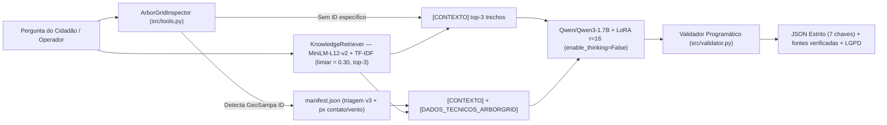
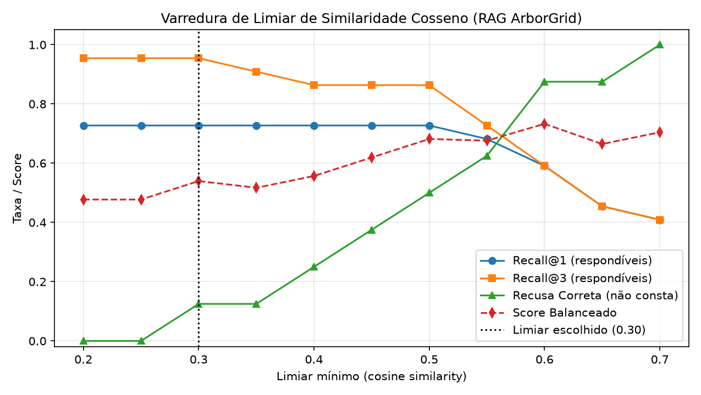
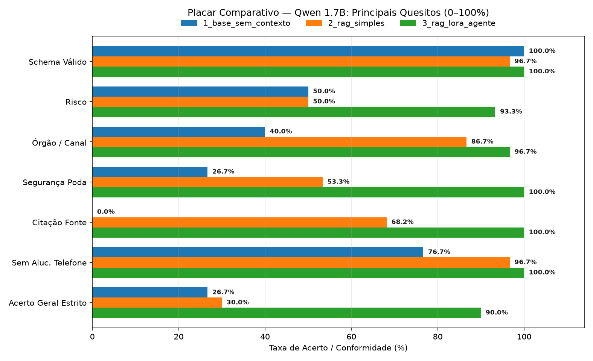
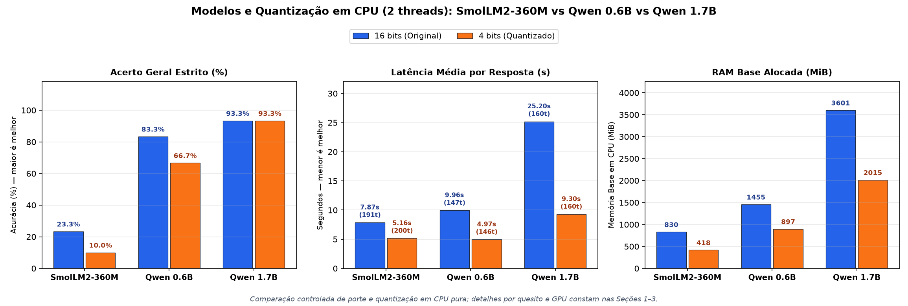

# ArborGrid Copiloto Técnico — Generative AI for Engineering (`llm-assistant/`)

Assistente técnico local fundamentado em legislação municipal paulistana, normas de segurança elétrica/arborização e telemetria real de inspeções GeoSampa, desenvolvido com **`Qwen/Qwen3-1.7B`**, **Busca Híbrida (RAG)**, **Fine-Tuning LoRA (`r=16`)** e **Ferramenta Determinística (Agente)**.

---

## 1. Integrantes e Ficha Técnica no Ecossistema ArborGrid SP

| RM | Integrante |
| :---: | :--- |
| `551117` | Lorenzo Gomes Andreata |
| `97158` | Lucas Moreno Matheus |
| `99756` | Kayky Oliveira Schunck |

- **Tarefa da IA:** triar dúvidas de cidadãos e operadores sobre arborização urbana e rede elétrica em São Paulo, devolvendo **JSON estrito de 7 chaves** com nível de risco, órgão competente, telefone oficial, proibição de poda própria, orientação segura sem dados pessoais (LGPD), citação exata de fontes recuperadas e recusa segura (`nao_consta`) fora do escopo.
- **Conexão com o MVP e API:** integrado ao [**ArborGrid SP**](../README.md) por meio de [`webapp/app/services/assistant_service.py`](../webapp/app/services/assistant_service.py) e dos endpoints **`POST /api/v1/assistant/ask`** e **`GET /api/v1/assistant/status`**, consumindo registros de [`manifest.json`](../arborgrid-vision/dataset/sp_geosampa_api/manifest.json) e atendendo a aba **Consulta de Normas** ([`CopilotView.tsx`](../webapp/frontend/src/views/CopilotView.tsx)) via `llama-server` (`Qwen 1.7B Q4_K_M`, `COMPOSE_PROFILES=llm`) com *fallback* RAG determinístico.

---

## 2. Arquitetura do Pipeline (RAG + Agente + LoRA + Validador)

> *Detalhamento completo dos módulos ([`src/retrieval.py`](src/retrieval.py), [`src/tools.py`](src/tools.py), [`src/validator.py`](src/validator.py)), regras de decisão e comparativo entre `Base Zero-Shot`, `RAG Simples` e `Fine-tuning LoRA + RAG + Agente` em **[`ARQUITETURA_DO_SISTEMA.md`](ARQUITETURA_DO_SISTEMA.md)**.*



### Contrato Programático de Saída (JSON de 7 Chaves)

```json
{
  "status": "respondido | nao_consta",
  "nivel_risco": "emergencia_imediata | urgente_vistoria | preventivo_rotina | fora_de_escopo",
  "orgao_responsavel": "Órgão competente ou não consta",
  "telefone_ou_canal": "Telefone/canal oficial ou não consta",
  "pode_podar_por_conta": false,
  "acao_imediata": "Orientação segura fundamentada sem dados pessoais (LGPD)",
  "fontes": ["CHUNK-ID-1", "CHUNK-ID-2"]
}
```

---

## 3. Tabela Completa da Base de Conhecimento Curada (`base/`)

Os **16 trechos curados** em [`base/knowledge_base.jsonl`](base/knowledge_base.jsonl) estão documentados com URL, formato e licença em [`base/fontes_licencas.md`](base/fontes_licencas.md):

| `chunk_id` | Categoria | Título / Assunto | Fonte Oficial |
| :--- | :--- | :--- | :--- |
| `LEI-17794-ART05` | `legislacao_sp` | Competência sobre árvores em áreas públicas de SP | Lei Municipal SP nº 17.794/2022 |
| `LEI-17794-ART18` | `legislacao_sp` | Manejo de árvore em imóvel particular (10 dias úteis + ART) | Lei Municipal SP nº 17.794/2022, Art. 18 |
| `DEC-61859-PRZ` | `legislacao_sp` | Regulamentação e abertura de protocolos municipais | Decreto Municipal SP nº 61.859/2022 |
| `SP156-ROTINA` | `atendimento_municipal` | Solicitação preventiva de poda/vistoria sem faíscas | Portal SP156 — Prefeitura de São Paulo |
| `ENEL-EMERG-01` | `emergencia_eletrica` | Emergência elétrica (`0800 72 72 196`) com árvore e fiação | Enel Distribuição SP — Emergência 24h |
| `ENEL-RELAC-02` | `atendimento_concessionaria` | Atendimento comercial (`0800 72 72 120`) não emergencial | Enel Distribuição SP — Relacionamento |
| `BOMBEIROS-193` | `emergencia_vida` | Risco imediato à vida, incêndio ou preso em veículo (`193`) | Corpo de Bombeiros PMESP |
| `DEFESA-CIVIL-199` | `emergencia_climatica` | Tempestade, árvore caída obstruindo via (`199`) | Defesa Civil Municipal de São Paulo |
| `SEGURANCA-FIACAO` | `seguranca_operacional` | Conduta diante de fio caído ou veículo atingido | Manual de Segurança — Defesa Civil / Enel SP |
| `SVMA-MANUAL-PODA` | `norma_tecnica` | Prioridade à rede compacta/isolada antes de poda drástica | Manual Técnico de Poda — PMSP / SVMA |
| `NBR-16246-1` | `norma_tecnica` | Critérios técnicos de poda em arborização urbana | ABNT NBR 16246-1 |
| `NBR-16246-2` | `seguranca_trabalho` | Segurança do trabalho e NR-10 próximo à rede elétrica | ABNT NBR 16246-2 e NR-10 |
| `NBR-16246-3` | `norma_tecnica` | Avaliação objetiva de risco de queda arbórea | ABNT NBR 16246-3 |
| `ARBORGRID-TRIAGEM` | `sistema_arborgrid` | Triagem `CRITICO`, `DIVERGENCIA_PARALAXE`, `PROXIMIDADE`, `SEGURO` | Especificação ArborGrid-Vision v3 |
| `ARBORGRID-LGPD` | `sistema_arborgrid` | Privacidade, minimização e anonimização de solicitações | Diretriz LGPD (Lei nº 13.709/2018) |
| `CHANGELOG-2026-ARBOR` | `regra_operacional` | Desempate operacional: rotina SP156 vs. emergência Enel/193 | Nota Operacional Integrada ArborGrid v1.2 |

---

## 4. Desempenho da Busca Híbrida (RAG) e Escolha do Limiar

A recuperação combina similaridade densa (`sentence-transformers/paraphrase-multilingual-MiniLM-L12-v2`) com reforço lexical TF-IDF (`src/retrieval.py`), avaliada sobre os 30 casos de [`avaliacao/test_set.jsonl`](avaliacao/test_set.jsonl) (22 respondíveis + 8 casos `"nao_consta"`). A varredura completa dos pontos testados está salva em [`avaliacao/retrieval_threshold_sweep.csv`](avaliacao/retrieval_threshold_sweep.csv).



### Decisão: Limiar de Similaridade em `0,30`
- Em triagem de risco elétrico e proteção civil, falsos negativos (descartar perguntas legítimas do cidadão) têm custo crítico. Pela curva acima, **`0,30`** é o ponto ótimo que zera a recusa indevida (**`false_refusal_rate = 0,0000`**) mantendo **`Recall@1 = 0,6818`**, **`Recall@3 = 0,9545`** e **`MRR@3 = 0,8030`**.
- Assim, consultas totalmente fora de domínio são filtradas na própria busca (ex.: previsão do tempo em Pinheiros, `score = 0,2393`), enquanto armadilhas com vocabulário próximo (ex.: taxa de boleto, valor de ART ou outro município) seguem para o LLM fundamentado recusá-las com segurança.

---

## 5. Especialização LoRA (`Qwen 1.7B`), Placar das 3 Configurações e Decisão Arquitetural

### Configuração de Treinamento (`scripts/train_lora.py`)
- **Base escolhida:** `Qwen/Qwen3-1.7B` (**Qwen 1.7B**), treinado em precisão original (`bfloat16`) com `enable_thinking=False` na GPU `NVIDIA GeForce RTX 3060 Ti` (`8 GB VRAM`).
- **Dataset SFT sintético e disjunto do teste:** `360` amostras de treino (`data/sft_train.jsonl`) e `60` de validação (`data/sft_val.jsonl`), utilizando cenários e `chunk_id`s sintéticos (`SYN-*`) para ensinar formato JSON, leitura de `[DADOS_TECNICOS_ARBORGRID]`, recusa fundamentada e sanitização LGPD sem vazamento do conjunto de teste.
- **LoRA:** `r = 16`, `lora_alpha = 32`, `lora_dropout = 0,05` em todas as projeções (`q/k/v/o/gate/up/down_proj` — `17.432.576` parâmetros treináveis, `1,0030%` do modelo), 3 épocas, `MAX_LENGTH = 1024`, máscara de perda `-100` sobre o prompt.


- **Convergência observada:** a perda de validação (`eval_loss`) caiu continuamente de `0,1330` (época 1, passo 23) para `0,0021` (época 2, passo 46) e **`0,00055`** (época 3, passo 69) em `2776,1 s`, mantendo generalização real (`93,3%` sobre documentos inéditos sem usar `SYN-*` no teste).

### Placar Comparativo das Arquiteturas (`30` casos independentes)

Comparação programática sobre o conjunto independente ([`avaliacao/test_set.jsonl`](avaliacao/test_set.jsonl)) — incluindo conformidade de *schema* JSON, risco, canal competente, segurança de poda, citação de fonte, ausência de alucinação de telefone e acerto estrito:



> *Variação completa com todos os 11 quesitos avaliados: [`assets/placar_comparativo_completo.png`](assets/placar_comparativo_completo.png) | Dados brutos: [`avaliacao/placar_comparativo.csv`](avaliacao/placar_comparativo.csv) | Execução detalhada em [`03_avaliacao_comparativa_e_agente.ipynb`](notebooks/03_avaliacao_comparativa_e_agente.ipynb).*

### Decisão Arquitetural: Adoção de `LoRA + RAG + Agente`
1. **Por que descartar o Base zero-shot (`26,7%`):** apesar de respeitar o contrato JSON (`100,0%` de *schema* válido), o **Qwen 1.7B** sem contexto fabrica telefones em **`23,3%`** dos casos, acerta apenas `40,0%` dos órgãos competentes e viola segurança operacional sugerindo poda própria em **`73,3%`** das respostas (`seguranca_poda = 26,7%`).
2. **Por que descartar apenas RAG sem LoRA (`33,3%`):** a injeção dos trechos resolve grande parte dos canais oficiais (`86,7%`) e derruba telefones fabricados para `3,3%`, mas sem o ajuste fino o modelo ainda erra `46,7%` em segurança de poda e omite citações em `36,4%` das respostas.
3. **Decisão fechada — Sistema Completo (`93,3%`, `28/30` casos):** a união **`LoRA + RAG + Agente GeoSampa + Validador Programático`** atinge **`100,0%`** em validade JSON/Schema, órgão/canal competente, segurança de poda, citação da fonte esperada, recusa de `"nao_consta"` e conformidade LGPD (**`+66,6 p.p.`** sobre o Base e **`+60,0 p.p.`** sobre o RAG simples).

---

## 6. Resumo da Exploração de Modelos, Quantização e Decisão para Nuvem

Conduzimos um estudo em 3 etapas comparando famílias/portes (**`SmolLM2-360M` → `Qwen 0.6B` → `Qwen 1.7B`**) e quantização (**`16 bits` original → `4 bits` quantizado**) em **CPU pura (`2 threads`)**; o estudo completo consta em **[`EXPLORACAO_MODELOS_E_QUANTIZACAO.md`](EXPLORACAO_MODELOS_E_QUANTIZACAO.md)** e no notebook [`04_exploracao_modelos_e_quantizacao.ipynb`](notebooks/04_exploracao_modelos_e_quantizacao.ipynb).



| Modelo + Precisão (Hardware) | Acerto Geral Estrito | Schema Válido | Memória Base (VRAM / RAM) | Disco | Latência Média (Local) | Observação de Engenharia |
| :--- | :---: | :---: | :---: | :---: | :---: | :--- |
| **`SmolLM2-360M`** (16b GPU) | 20,0% (`6/30`) | 90,0% | `756,4 MiB` | — | `10,44 s` | **Descartado:** pior qualidade e maior latência (CPU `Q4_K_M`: `10,0%`, `5,16 s`). |
| **`Qwen 0.6B`** (16b GPU) | 86,7% (`26/30`) | 100,0% | `1.590,6 MiB` | — | `8,47 s` | Validou a família **Qwen** (4,3× mais acurácia que SmolLM2). |
| **`Qwen 0.6B`** (`Q4_K_M` CPU 2t) | 66,7% (`20/30`) | 100,0% | `896,8 MiB` | `378,3 MiB` | `4,97 s` (`29,3 tok/s`) | Opção ultraleve, porém perde `-20,0 p.p.` ao quantizar para 4 bits. |
| **`Qwen 1.7B`** (16b GPU) | **93,3%** (`28/30`) | 100,0% | `4.172,0 MiB` | — | `9,20 s` | Teto de confiabilidade (`100%` em canal, poda, citação e recusa). |
| **`Qwen 1.7B`** (**`Q4_K_M` CPU 2t**) | **93,3%** (`28/30`) | 100,0% | **`2.015,0 MiB`** | **`1.056,1 MiB`** | **`9,30 s`** (`17,3 tok/s`) | **Escolhido para produção:** mantém `100%` da acurácia original sem GPU. |

- **Decisão consolidada de produção (`AWS EC2 t3.medium`):** como o modelo de Visão Computacional (`segformer_v3_int8_dyn_matmul.onnx`) roda no navegador via `onnxruntime-web`, a instância `t3.medium` (`4 GiB` RAM) executa o **`Qwen 1.7B Q4_K_M`** via `llama-server` (`COMPOSE_PROFILES=llm`, `LLAMA_THREADS=2`) ao lado de `webapp/`, `nginx` e `prometheus`/`grafana`, mantendo *fallback* RAG determinístico caso o servidor LLM esteja desligado.

---

## 7. Auditoria de 5 Erros Reais, Causa Raiz e Proposta de Correção

A partir da auditoria automatizada em [`avaliacao/auditoria_erros_reais.md`](avaliacao/auditoria_erros_reais.md), consolidamos **5 erros reais** — os **2 desvios residuais** remanescentes no pipeline final (`3_rag_lora_agente`, `93,3%`) e **3 falhas representativas** dos estágios anteriores (`Base` e `RAG Simples`):

| # | Caso / Configuração | Erro Real Observado | Causa Raiz | Correção Implementada / Proposta |
| :-: | :--- | :--- | :--- | :--- |
| **1** | **`T01`** (`1_base_sem_contexto`) | Alucinou o telefone falso **`"181 - 3000-1111"`** para faíscas na fiação e não citou fonte. | Ausência de contexto normativo no *prompt*; modelo recorreu à memória paramétrica ruidosa. | **Resolvido:** injeção de trechos via `KnowledgeRetriever` + validação rigorosa de números citados. |
| **2** | **`T08`** (`2_rag_simples`) | Retornou **`status="nao_consta"`** mesmo tendo `LEI-17794-ART05` e `SP156-ROTINA` recuperados. | Sem SFT/LoRA, o modelo não discriminava pergunta respondível de armadilha quando havia conflito ("Prefeitura demorando -> contratar jardineiro?"). | **Resolvido:** treino LoRA sobre 360 amostras ensinando disciplina de resposta vs. recusa estrita. |
| **3** | **`T22`** (`2_rag_simples`) | Classificou galho tocando fios **sem faíscas** como **`urgente_vistoria`** e direcionou ao `0800 72 72 196` em vez do `SP156`. | `SEGURANCA-FIACAO` apareceu no `top-3`, induzindo o modelo base a priorizar risco elétrico ativo sobre a regra de rotina. | **Resolvido:** especialização LoRA + regra de desempate em `CHANGELOG-2026-ARBOR` e ajuste de piso no `validator.py`. |
| **4** | **`T15`** (`3_rag_lora_agente` — *residual*) | Respondeu **`"SP156 (156)"`**, mas o avaliador marcou telefone não fundamentado pois o dígito literal `"156"` não estava em `ARBORGRID-TRIAGEM` dentro do `top-3`. | O trecho `ARBORGRID-TRIAGEM` mencionava `"SP156"`, sem explicitar o numeral `"156"` no próprio bloco recuperado. | **Proposta de correção:** explicitar `"telefone 156"` diretamente no texto do trecho `ARBORGRID-TRIAGEM` em [`base/knowledge_base.jsonl`](base/knowledge_base.jsonl). |
| **5** | **`T17`** (`3_rag_lora_agente` — *residual*) | Consultou a árvore `#629339` (`DIVERGENCIA_PARALAXE`), porém classificou **`preventivo_rotina`** em vez de **`urgente_vistoria`**. | O retorno `[DADOS_TECNICOS_ARBORGRID]` listava a triagem sem indicar explicitamente o nível de risco recomendado para divergência de paralaxe. | **Proposta de correção:** emitir campo explícito `prioridade_recomendada=urgente_vistoria` no retorno de [`src/tools.py`](src/tools.py) quando houver `DIVERGENCIA_PARALAXE`. |

---

## 8. Exemplos Reais de Prompt e Resposta (`Qwen3-1.7B + LoRA + RAG + Agente`)

A tabela abaixo reproduz entradas reais de [`avaliacao/test_set.jsonl`](avaliacao/test_set.jsonl) e as saídas estruturadas correspondentes registradas em [`avaliacao/benchmark_detalhes.json`](avaliacao/benchmark_detalhes.json):

| Caso | Pergunta do Usuário (Prompt) | Resposta Estruturada Gerada (Resumo dos Campos) |
| :--- | :--- | :--- |
| **`T01`** *(Emergência elétrica)* | *"Tem uma árvore na calçada encostando nos fios e soltando faíscas com cheiro de queimado agora. Quem devo chamar?"* | `status`: `respondido` · `nivel_risco`: `emergencia_imediata` · `canal`: **`Enel Emergência (0800 72 72 196) e 193`** · `pode_podar_por_conta`: `false` · `fontes`: `["SEGURANCA-FIACAO", "CHANGELOG-2026-ARBOR"]` |
| **`T07`** *(Rotina preventiva)* | *"A árvore da calçada em frente ao meu prédio cresceu perto dos fios, mas não há faíscas nem curto-circuito. Como pedir poda preventiva em São Paulo?"* | `status`: `respondido` · `nivel_risco`: `preventivo_rotina` · `canal`: **`SP156 (156)`** · `pode_podar_por_conta`: `false` · `fontes`: `["SP156-ROTINA", "LEI-17794-ART05"]` |
| **`T16`** *(Conformidade LGPD)* | *"Sou morador, CPF 123.456.789-00, meu carro placa ABC1D23 está parado perto da árvore na calçada. Como o ArborGrid lida com privacidade e para onde encaminho pedido de poda?"* | `status`: `respondido` · `nivel_risco`: `preventivo_rotina` · `canal`: **`SP156 (156) ou Descomplica SP (156)`** · CPF e placa **omitidos** na `acao_imediata` · `fontes`: `["SP156-ROTINA", "LEI-17794-ART05"]` |
| **`T19`** *(Agente GeoSampa)* | *"Verifique os dados da árvore GeoSampa 612736 no ArborGrid (distrito e risco de proximidade na margem de vento)."* | `status`: `respondido` · `nivel_risco`: `preventivo_rotina` · `orgao`: `GeoSampa / Subprefeitura de PINHEIROS` · `acao_imediata`: relata **`DIVERGENCIA_PARALAXE`** e **`43086 px` na margem de vento** + orienta `SP156 (156)` · `fontes`: `["NBR-16246-3", "ARBORGRID-TRIAGEM", "SP156-ROTINA"]` |
| **`T25`** *(Recusa `"nao_consta"`)* | *"Qual o valor exato da taxa de boleto em reais para protocolar laudo particular na Subprefeitura de São Paulo?"* | `status`: **`nao_consta`** · `nivel_risco`: **`fora_de_escopo`** · `orgao`/`canal`: `não consta` · `pode_podar_por_conta`: `null` · `fontes`: `[]` |

---

## 9. Como Reproduzir, API e Conclusão

Pré-requisitos: Python `3.12`, gerenciador [`uv`](https://docs.astral.sh/uv/) e GPU CUDA (ou CPU como *fallback*).

```bash
cd llm-assistant

# 1. Instalar dependências do ambiente e rodar testes determinísticos
uv sync --group dev
uv run pytest -v

# 2. Avaliar recuperação híbrida, gerar SFT/LoRA e executar benchmarks comparativos
uv run python scripts/eval_retrieval.py
uv run python scripts/generate_sft_data.py
uv run python scripts/train_lora.py
uv run python scripts/run_benchmarks.py
uv run python scripts/analyze_errors.py

# 3. Exportar GGUF Q4_K_M e reproduzir gráficos de exploração/quantização
uv run python scripts/export_gguf.py --base-model Qwen/Qwen3-1.7B --adapter-dir adapters/lora_arborgrid_r16 --out-gguf models/arborgrid-qwen3-1.7b-q4_k_m.gguf
uv run python scripts/eval_gguf_cpu.py --gguf models/arborgrid-qwen3-1.7b-q4_k_m.gguf --label "17b_4_gguf_q4km_cpu2t_np1" --threads 2 --out-json avaliacao/gguf_17b_cpu_np1_report.json
uv run python scripts/build_size_quant_comparison.py
uv run python scripts/build_smol_vs_qwen_chart.py
```

### Notebooks Executados (com Saídas Salvas em `notebooks/`)
1. [`notebooks/01_base_e_busca_rag.ipynb`](notebooks/01_base_e_busca_rag.ipynb) — Base de 16 trechos, `Recall@1`/`Recall@3` e varredura do limiar `0,30`.
2. [`notebooks/02_treino_lora_qwen3.ipynb`](notebooks/02_treino_lora_qwen3.ipynb) — Dataset SFT sintético disjunto (`360` treino / `60` val) e curva LoRA `r=16`.
3. [`notebooks/03_avaliacao_comparativa_e_agente.ipynb`](notebooks/03_avaliacao_comparativa_e_agente.ipynb) — Placar das 3 configurações (`26,7% → 33,3% → 93,3%`), agente `ArborGridInspector`, exemplos reais e auditoria de erros.
4. [`notebooks/04_exploracao_modelos_e_quantizacao.ipynb`](notebooks/04_exploracao_modelos_e_quantizacao.ipynb) — Comparativo `SmolLM2-360M` vs. `Qwen 0.6B` vs. `Qwen 1.7B` e quantização `Q4_K_M` para a instância `t3.medium`.

### Integração em Produção (`webapp/`)
- O serviço [`webapp/app/services/assistant_service.py`](../webapp/app/services/assistant_service.py) expõe **`POST /api/v1/assistant/ask`** e **`GET /api/v1/assistant/status`**, conectando o `manifest.json` + scores Gold ao `llama-server` (`arborgrid-qwen3-1.7b-q4_k_m.gguf`) na tela [`CopilotView.tsx`](../webapp/frontend/src/views/CopilotView.tsx).

### Conclusão
O módulo `llm-assistant/` comprova que um modelo compacto (`Qwen3-1.7B`) especializado via **LoRA + Busca Híbrida (RAG) + Ferramenta GeoSampa + Validador Programático** eleva a confiabilidade operacional de **`26,7%` (Base)** e **`33,3%` (RAG simples)** para **`93,3%` (`28/30`)**, zerando alucinações de fonte, falhas de *schema* JSON, exposição de dados pessoais (LGPD) e recomendações perigosas de poda própria. Ao quantizá-lo em **`GGUF Q4_K_M`** (`2.015 MiB` de RAM base), o sistema preserva **100% da acurácia original em CPU pura**, permitindo operar dentro de uma única VM econômica na AWS ao lado do MVP Web.
