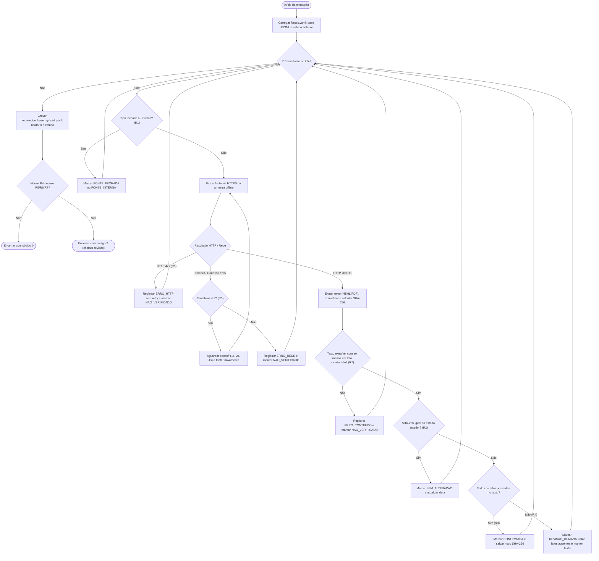

# Process Definition Document (PDD): RPA Normativo ArborGrid SP

## 1. Visão geral do processo

Este documento descreve o processo de verificação e sincronização da base de conhecimento normativa do Assistente do ArborGrid SP, composta por 16 trechos de legislação municipal, portais de atendimento, canais de emergência, normas técnicas e diretrizes internas.

## 2. Mapeamento AS-IS vs TO-BE

### 2.1 Processo AS-IS (manual)

No fluxo anterior à automação, a conferência dependia de ação manual esporádica:

1. Abrir manualmente cada portal público (Legislação PMSP, Portal SP156, Enel SP, Corpo de Bombeiros, Defesa Civil e PDF da SVMA).
2. Localizar o texto ou telefone correspondente a cada um dos 16 trechos da base.
3. Comparar visualmente telefones, prazos e números de lei ou decreto com o arquivo `webapp/data/knowledge_base.jsonl`.
4. Anotar eventuais divergências em planilha ou mensagem para atualização futura.

**Tempo estimado no AS-IS:** cerca de 60 minutos por ciclo de revisão, sujeito a esquecimento e erro humano na comparação de números e prazos.

### 2.2 Processo TO-BE (automatizado)

No fluxo automatizado pelo pacote `rpa_normativo`:

1. O agendador dispara o robô periodicamente (ou o operador executa via CLI).
2. O robô carrega `fontes.yaml`, a base original de 16 trechos e `estado/ultima_execucao.json`.
3. Em repetição sobre todas as fontes, aplica R1 para fontes fechadas/internas ou coleta o conteúdo via HTTPS (ou `amostras/fontes/` em modo offline).
4. Extrai o texto, normaliza espaços e caixa e gera `sha256`.
5. Se não há texto extraível ou se nenhum fato monitorado aparece no conteúdo obtido (R7), registra `ERRO_CONTEUDO` como exceção de sistema e segue o lote.
6. Se o hash não mudou (R2), registra `SEM_ALTERACAO` sem reprocessar fatos.
7. Se o hash mudou ou é a primeira execução, verifica a lista de fatos obrigatórios por trecho (R3 confirma quando todos estão presentes; R4 sinaliza `REVISAO_HUMANA` quando parte dos fatos sumiu, preservando o texto original intacto).
8. Falhas de rede, HTTP ou conteúdo (R5 a R7) são tratadas individualmente sem interromper as demais fontes e encaminhadas para auditoria.
9. Uma pessoa só é acionada quando o processo retorna código de saída `2` (existência de `REVISAO_HUMANA` ou erro de sistema).

**Tempo estimado no TO-BE:** poucos segundos por execução completa, com rastreabilidade integral em JSON e log estruturado.

## 3. Fluxograma do processo (TO-BE)



## 4. Regras de negócio (R1 a R7)

Uma alteração legítima de norma modifica algum fato específico (como um número de telefone, prazo ou artigo), mantendo o restante do contexto presente. Quando nenhum dos fatos monitorados aparece no texto baixado, entende-se que a resposta não corresponde ao documento esperado (por exemplo, bloqueio, mudança de endereço ou página montada exclusivamente via JavaScript), tratando o caso como erro de conteúdo (R7) e não como revisão normativa (R4).

| Regra | Condição | Status resultante | Ação sobre o trecho e estado |
| :--- | :--- | :--- | :--- |
| R1 | `tipo` igual a `fechada` ou `interna` | `FONTE_FECHADA` ou `FONTE_INTERNA` | Não faz download; mantém trecho e registra justificativa |
| R2 | Download ok e `sha256` igual ao último confirmado | `SEM_ALTERACAO` | Mantém trecho, atualiza `verificado_em`, pula checagem de fatos |
| R3 | Hash novo (ou primeira execução) e todos os fatos presentes | `CONFIRMADA` | Mantém conteúdo, grava novo `sha256` no estado |
| R4 | Hash novo e parte dos fatos sumiu no texto normalizado | `REVISAO_HUMANA` | Mantém conteúdo original intacto, lista `fatos_ausentes`, preserva hash anterior no estado |
| R5 | Timeout, erro de conexão ou HTTP 5xx | `ERRO_REDE` (3 tentativas, backoff 1 s, 2 s, 4 s) | Marca trecho como `NAO_VERIFICADO` e segue o lote |
| R6 | HTTP 4xx | `ERRO_HTTP` (1 tentativa, sem retry) | Marca trecho como `NAO_VERIFICADO` e segue o lote |
| R7 | Download ok, mas sem texto extraível (página vazia, PDF escaneado ou corrompido) ou sem nenhum dos fatos monitorados (endereço mudou, bloqueio ou página montada por JavaScript) | `ERRO_CONTEUDO` | Marca trecho como `NAO_VERIFICADO` (exceção de sistema) e segue o lote |

## 5. Matriz de exceções (Negócio vs Sistema)

| Categoria | Regra | Status | Causa típica | Tratamento automatizado | Ação humana esperada |
| :--- | :--- | :--- | :--- | :--- | :--- |
| Exceção de negócio | R4 | `REVISAO_HUMANA` | Mudança parcial de telefone, prazo ou artigo em portal oficial | Preserva o texto original, registra `fatos_ausentes` no relatório e retorna código `2` | Curador confere a fonte oficial e atualiza a base com aprovação |
| Exceção de sistema | R5 | `ERRO_REDE` | Instabilidade de rede, erro TLS/DNS, timeout ou HTTP 5xx | Executa até 3 tentativas com backoff, registra erro em log e continua o lote | Verificar conectividade ou disponibilidade do portal |
| Exceção de sistema | R6 | `ERRO_HTTP` | URL movida ou bloqueio 403/404 | Interrompe na primeira tentativa (sem retry), registra erro e continua o lote | Revisar e atualizar a URL em `fontes.yaml` |
| Exceção de sistema | R7 | `ERRO_CONTEUDO` | Página vazia, PDF escaneado ou resposta sem nenhum dos fatos monitorados (endereço mudou, bloqueio ou página montada por JavaScript) | Registra `ERRO_CONTEUDO`, marca trecho como `NAO_VERIFICADO` e continua | Avaliar fonte alternativa, atualizar URL ou realizar checagem manual |

## 6. Agendamento sugerido

Como o código de saída é `0` quando não há pendências e `2` quando existe `REVISAO_HUMANA` ou erro de sistema, o agendamento diário pode acionar alertas automáticos:

- **Linux (`cron`)**, todos os dias às 06:00:

```text
0 6 * * * cd /opt/arborgrid/normas-bot/src && /opt/arborgrid/normas-bot/.venv/bin/python -m rpa_normativo
```

- **Windows (Agendador de Tarefas / `schtasks`)**: tarefa diária executando `normas-bot\.venv\Scripts\python.exe` com argumentos `-m rpa_normativo` e diretório inicial `normas-bot\src`, disparando notificação quando o código de retorno for diferente de `0`.

## 7. Segurança e conformidade com a LGPD

- **Escopo estritamente público:** o robô acessa apenas portais públicos governamentais e canais oficiais de utilidade pública, sem autenticação e sem coleta de dados de usuários.
- **Ausência de dados pessoais (PII):** nenhum dado pessoal de cidadãos ou operadores é coletado, processado ou armazenado em `fontes.yaml`, `saida/`, `estado/` ou `logs/`.
- **Zero credenciais:** não há tokens, chaves de API ou senhas no código ou na configuração.
- **Transporte seguro:** aceita exclusivamente URLs `https://` com validação de certificado TLS habilitada por padrão (`httpx`), sem desabilitar a verificação de certificado.
- **Retenção de logs:** os logs diários em `logs/rpa_normativo_AAAAMMDD.log` registram apenas identificadores de execução (`exec=`), identificadores técnicos de fonte (`fonte=`), etapas e contagens operacionais, com retenção recomendada de 90 dias.

